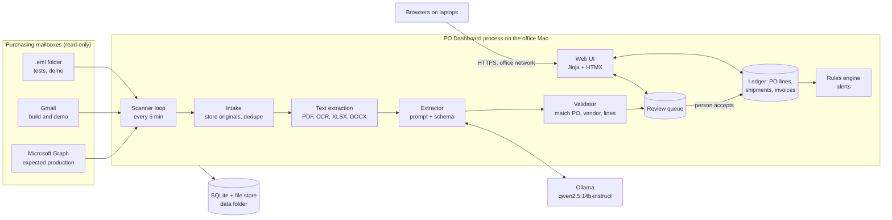

# PO Dashboard: Technical Architecture

2026-11-04 · Shashank Panda · **v0.3. Phase 0 (the app shell) is built; everything else here is design.** What is
built is tracked in [AUDIT.md](AUDIT.md).

PO Dashboard watches the company's purchasing mailbox or mailboxes for vendor replies to purchase orders, extracts what they say with a local model,
lets a person accept it, and tracks every PO line from "sent" to "closed". It runs entirely on one always-on Mac in the office, and people use it from a browser on their own laptops (DEC-28).
Requirements: [REQUIREMENTS.md](REQUIREMENTS.md). DEC and OPEN IDs: [DECISIONS.md](DECISIONS.md). The build order is
[PLAN.md](PLAN.md). Each choice below is **Decided**, **Assumed** (a default to confirm) or **Open**.

## 1. Design constraints

- **Nothing leaves the office Mac** except the mailbox fetch, provider sign-in if chosen (DEC-32), and encrypted browser
  traffic to laptops on the office network (DEC-01, DEC-28). Extraction, database, files and logs stay on it.
- **The mailbox is read-only** (DEC-07). There is no code path that sends, moves or deletes mail.
- **A person decides** (DEC-08). Extraction proposes; a person accepts. Only accepted facts change a PO.
- **Documents are data** (DEC-09). Fenced in prompts, validated after the model, never trusted.
- **One gateway for the model** (DEC-05). Swapping or re-testing a model touches one module.
- **Nothing is lost.** Every original is kept, every fact points back to its source, every change is in the audit trail.
- **Several people, one login each** (DEC-20), **everyone sees the same company-wide data** (DEC-29), and **installs from
  Git** (DEC-11).
- **Runs unattended** (DEC-12).

## 2. System overview

One app process does the work; Ollama is the only other process. The scanner is a loop inside the app.



- **Scanner** asks each connected mailbox for what is new since its saved position, then hands each message to intake.
- **Intake** stores the raw message and each attachment unchanged, records a content hash and skips repeats.
- **Text extraction** turns each part into text with page or cell references.
- **Extractor** sends fenced text and a JSON schema to the model through `models/llm.py` and gets structured fields.
- **Validator** is plain code: it checks the fields against the database before anything reaches a person.
- **Review queue** shows the document beside its fields. Accept, edit or reject.
- **Ledger** holds the accepted facts. Line status is computed from them (§5), never typed in.
- **Rules engine** turns ledger state into alerts (§8).

## 3. Technology stack

| Layer | Choice | Status | Why |
|---|---|---|---|
| Language, tooling | Python 3.13, uv, Ruff, pytest | Assumed | DEC-02 |
| Uploads | `openpyxl` (read-only, saved values) and `defusedxml` for .xlsx; the standard `csv` module for CSV | Decided | DEC-47 |
| Web | FastAPI, Uvicorn, Jinja2 templates, HTMX 2.0.11 (0BSD licence; copied into `static/` as `htmx-2.0.11.min.js`, checksum tested) | Decided | DEC-03, DEC-45: no build step, works offline |
| Styling | Hand-written CSS with design tokens, light theme (DEC-35) | Assumed | DEC-03 |
| Data | SQLite (WAL) through SQLAlchemy 2; Alembic migrations | Assumed | DEC-02, DEC-04 |
| Scheduler | An asyncio task inside the app, one scan at a time, with a saved position per mail source | Assumed | Simple; no extra process |
| Model runtime | Ollama on localhost, JSON-schema `format` parameter | Decided | DEC-05; structured output is Ollama's documented way to constrain an answer |
| Extraction model | `qwen2.5:14b-instruct` (9 GB), temperature 0, fixed seed | Decided | DEC-05 |
| PDF text | `pypdf` (text PDFs); Tesseract OCR for scans, images and scanned PDFs (DEC-51) | Decided | Tesseract 5 was already on the owner's Mac; Pillow reads the images |
| Spreadsheets, Word | openpyxl, csv, python-docx | Assumed | |
| Mail: Microsoft 365 | Microsoft Graph, read-only, message delta query per folder. Access to the one shared mailbox is verified at PD-6.0 (§7) | Expected, confirmed at the switch (OPEN-14) | DEC-06, DEC-30, DEC-31. Delta tracking is per folder and returns a saved delta link for the next round. How attachments come back through delta is **to verify in Phase 6** |
| Mail: Gmail | The Gmail API with Google's sign-in page, or IMAP with an app password. Used for the build and the demo until the switch | Open | DEC-31, OPEN-04 |
| Mail: files | Folder of `.eml` files | Decided | DEC-06 |
| Secrets | macOS Keychain through `keyring`; never a file in the repo | Assumed | NFR-08 |
| Sign-in | `argon2-cffi`, `pyotp`, `cryptography` (sealing), `segno` (a QR code made locally, no outside service) | Assumed | DEC-26, §10.1 |
| Service | launchd user agent | Assumed | DEC-12 |
| Network | HTTPS served by Uvicorn, with a certificate made for the office Mac's name | Assumed | DEC-28, §11 |
| Tests | pytest; Playwright for browser tests; a golden set scored against the real model | Assumed | Same layers as LegalLens |

## 4. Data model

Tables, with the fields that matter. Every table has `id`, `created_at`; accepted-fact tables also keep
`source_document_id` and, where known, a page or cell reference.

| Table | Holds |
|---|---|
| `vendor` | name, contact name and email, `vendor_domain` (many), notes |
| `purchase_order` | po_number (unique), vendor_id, date_sent, currency, buyer, source (manual, csv, document, quickbooks), created_by; po_date, the PO's own date in QuickBooks from the starting load (DEC-46, migration 0003), never used as the date sent. No status column: status is computed (§5) |
| `po_line` | po_id, line_no, item, description, ordered_qty, unit, unit_price, requested_date; customer, the customer a line is for when QuickBooks names one (DEC-46); closed_reason (received, short, cancelled), closed_at, closed_by and close_note, all empty while the line is open and all required together once it is closed by hand |
| `mailbox` | address (lower case, unique), provider (gmail, graph, folder), location (the folder a folder mailbox reads), connected_by (emptied if that person is removed), connected_at, state (connected, needs_reconnect, disconnected), read_since (only mail from then on is read, DEC-51). Its token or secret is in the Keychain, never here. Built in PD-3.1 (migration 0004) |
| `source_message` | mailbox_id, folder, provider_id, sender, recipients (To and Cc), subject, received_at, message_id_header, raw_path, content_hash (unique: the same bytes are one message, even through another mailbox), size. Built in PD-3.2 (migration 0005) |
| `source_document` | message_id, filename (display only, never a path), kind (body, pdf, image, spreadsheet, word, text, email, other), content_type, stored_path, content_hash, size, state (stored, not_read, read, failed), not_read_reason, text_path, pages. A message's body is a document that points at the raw message. An attachment with bytes already stored is not stored again (unique among non-bodies); a body is per message, because many say only "Thanks". Built in PD-3.2 |
| `extraction` | one model reading of one document (DEC-54, §6.1): document_id, model, prompt_version, schema_version; the queue: state (queued, running, done, failed), attempts, last_error (fixed words), next_attempt_at, started_at, finished_at, seconds, prompt_tokens; what was read: answer (the model's JSON, numbers kept exact), doc_type, po_number as read; matching and review: review_state (waiting, unmatched, no_facts, accepted, rejected, dismissed, superseded), po_id, vendor_id, flags (name, level, line), final (the values accepted, after a person's edits), the entry it created, reviewed_by, reviewed_at, review_note, version (DEC-52). Unique per document, prompt version and model. Lines stay inside `answer` and `final`: the ledger rows an Accept writes are where lines are queried |
| `acknowledgement` / `ack_line` | accepted extraction: po_id, line_id, confirmed_qty, confirmed_price, promised_date, accepted_by, accepted_at |
| `promised_date_history` | line_id, date, source ack, recorded_at: one row per accepted date, so a slip is visible |
| `shipment` / `shipment_line` | carrier, tracking_number, shipped_at, eta; line_id, qty |
| `invoice` / `invoice_line` | invoice_number, invoice_date, total; line_id, qty, price |
| `invoice_charge` | invoice_id, kind (freight, tariff, tax, other), label as printed, amount: charges that are not goods (DEC-48, Phase 4) |
| `shipment_tracking` | shipment_id, tracking_number, carrier: every tracking number of a shipment notice (a notice can list several boxes); `shipment.tracking_number` keeps the first for display (Phase 4) |
| `alert` | po_line_id (or po_id), rule, state (open, snoozed, dismissed, cleared), snoozed_until, first_seen, last_changed |
| `contact_log` | alert_id, user_id, note, contacted_at: "marked contacted" entries |
| `app_user` | email (lower case, unique), password hash, role, sealed TOTP secret, totp_confirmed_at, last_totp_step, failed attempts, locked_until, must_change_password, temp_password_expires_at, disabled_at |
| `session` | user_id, token hash, stage (pending, full), csrf_token (stored in clear on purpose: useless without the session cookie), created_at, last_seen_at, expires_at |
| `recovery_code` | user_id, code hash, used_at |
| `audit_log` | at, user_id (empty for a command-line action or an unknown account), client_address, action, object, before, after |
| `scan_state` | mailbox_id, folder (one row each), saved position (opaque: a delta link, history id or file-hash set), last_attempt, last_success, last_error (a fixed reason), failures in a row. Built in PD-3.4 (migration 0008). |
| `setting` | key, value (interval, thresholds, model name, allowed names) |

**Built in PD-1.1b** (`db/ledger.py`, migration 0002): `vendor`, `vendor_domain`, `purchase_order`, `po_line`, `acknowledgement`,
`ack_line`, `promised_date_history`, `shipment`, `shipment_line`, `invoice`, `invoice_line`. The rest of the table
arrives with its phase (mail, Phase 3; documents and extraction, Phase 4; alerts, Phase 5). Until Phase 4,
`source_document_id` on an acknowledgement, shipment or invoice is an empty number with no link, because entries are
made by hand; the Phase 4 migration makes it a real link to `source_document` (an entry typed by hand keeps it empty). Rules the database enforces itself: a unique PO number, a unique line number within a PO, a three-letter
upper-case currency, a positive ordered, shipped and invoiced quantity, a price not below zero, a lower-case and unique
vendor domain, and one invoice number per PO. **Deletes:** a PO's lines go with it, but a PO with an acknowledgement,
shipment or invoice, a vendor with POs, and a line that anything refers to refuse to be deleted (a PO is cancelled, not
deleted). Removing a person keeps what they recorded and empties the name.

### Quantities, money and charges (DEC-24, DEC-48)

SQLite has no exact decimal type, and SQLAlchemy's `Numeric` goes through floats on SQLite, which DEC-24 rules out. So
Python uses `Decimal` and the database holds scaled integers through one custom column type: quantities × 10,000 (four
decimal places), prices and amounts × 1,000,000 (six). SQL can still sum them. A value with more decimal places than
that is refused, never rounded. Status is computed from these exact values. Each PO has one ISO 4217 currency code;
amounts are never converted, and never added across currencies. Each line has its own unit, and units are never
converted, so a confirmation in another unit is flagged for a person.

Tax, freight and tariffs are **charges**, not goods lines (DEC-48, owner 2026-11-10: tax is rare, freight varies,
tariffs sometimes come as their own line items). They are read as printed, each with its kind, label and amount, and
stored in `invoice_charge` (a Phase 4 migration). The app never works out a tax or tariff rate. Until Phase 4,
`invoice.total` holds the total as written.

### How the standard EDI documents map

There is no single global PO file format. The closest are the X12 EDI documents and their EDIFACT twins, and vendors
writing to a mailbox rarely send EDI. The fields above follow them so a real feed can be added later.

| Our document | X12 | EDIFACT | Key fields we keep |
|---|---|---|---|
| Purchase order | 850 | ORDERS | PO number, lines (qty, unit, price, requested date) |
| Order acknowledgement | 855 | ORDRSP | PO number, per line confirmed qty, price, promised date |
| Shipment notice | 856 | DESADV | carrier, tracking, lines and quantities, ETA |
| Invoice | 810 | INVOIC | invoice number, PO number, per line qty and price |

### Uploads: CSV and Excel (DEC-47, DEC-46)

All three uploads (Import CSV or Excel, Import vendors, Load from QuickBooks) go through one reader,
`ledger/sheets.py`, which returns rows of text whatever the file was. CSV is read as UTF-8 or Windows-1252. An .xlsx
workbook is read with `openpyxl` in read-only mode, saved values only (`data_only`: a formula is never run), first sheet
only, with `defusedxml` parsing every XML part; the reader refuses to open Excel files at all if defusedxml is missing.
Before parsing it refuses a file over 2 MB, a zip that is more than 20 MB unzipped or has over 1,000 parts, macros
(`vbaProject.bin`, `.xlsm`, `.xlsb`) and the old `.xls` format; while reading it stops at 5,000 rows and 60 columns, so a
sheet that claims to be a million rows is never padded out. A damaged or hostile workbook gets one plain message, with no
detail from the file.

The QuickBooks starting load (`ledger/quickbooks.py`, `pages/quickbooks.py`) reads the "Open POs" report: rows with a
`Num` are lines; headings and totals are skipped. `plan_load` changes nothing and feeds the preview; `apply_load` creates
the POs all or nothing, records a part received as a shipment whose `source_ref` is `quickbooks:<export date>` (shown as
"Received per QuickBooks export of 11/05/2026"), and writes `line.price_rounded` to the audit trail for a price that had
to be rounded, which the line timeline reads. Between preview and create the file is held in the server's memory for the
person who uploaded it, for 15 minutes, and read again at create time.

## 5. Line status

Status is computed from accepted facts. It is never stored as typed text, so it cannot drift from the evidence.

For each line: `ordered`, `confirmed` (the latest quantity stated in an accepted ack, else none; a later ack with no
quantity keeps the earlier one), `shipped` (sum of accepted shipment lines), `invoiced` (sum of accepted invoice lines).

`moved` is the larger of `shipped` and `invoiced`, because an invoice comes after the goods. `target` is the smaller of
`confirmed` and `ordered`, or `ordered` if nothing is confirmed. The rows are checked from the top and the first match
wins (`ledger/status.py`, DEC-36):

| Status | Rule |
|---|---|
| Cancelled | closed by hand as cancelled (DEC-39); counts as done, like Closed, and is its own status |
| Closed | `invoiced` ≥ `ordered`, or closed by hand: received, short (reason and person recorded) |
| Shipped | `moved` > 0 and `moved` ≥ target |
| Partially shipped | 0 < `moved` < target |
| Acknowledged | an accepted ack and `moved` = 0 |
| Sent | anything else |

**Confirmed by the owner (DEC-36):** a shipment or invoice with no acknowledgement still moves the line, because the
evidence wins over the missing step. A line confirmed at 0 stays Acknowledged, not Shipped, and raises
`unconfirmed_balance`. The first version of this table was unordered and contradicted itself on both cases.

`open_qty` = `ordered` − `invoiced` for an open line. A PO is **Closed** when all its lines are closed, **Open** when
any line is open, and shows "partially invoiced" when some but not all quantity is invoiced. A line confirmed short
(100 ordered, 60 confirmed) stays open for the unconfirmed 40 and raises the `unconfirmed_balance` rule, even after 60
is shipped and invoiced: it shows Shipped with 40 open until a person closes it short. Nothing closes it automatically,
so someone always decides about the missing quantity. A PO with no lines is Open.

## 6. Intake and extraction pipeline

1. **Scan.** The scanner (one at a time, never overlapping) asks each connected mailbox in turn for changes in its Inbox
   and Sent Items since `scan_state`.
2. **Store.** Write the raw message to the file store, then each attachment, with its SHA-256. Known hash → skip, even if it came through another
   mailbox, because the data is company-wide.
   The saved position moves only after the message is safely stored, so a crash repeats work instead of losing mail.
3. **Text.** Body (HTML → text), PDF text, OCR for scanned pages or images, spreadsheet rows, Word text. Quoted
   earlier messages in a thread are marked so they are not mistaken for the current message. Each document is read
   in its own short-lived process in the macOS sandbox, with a time and memory limit (DEC-53), so a hostile file
   costs that document and nothing else.
4. **Extract** (DEC-54). Each document the text step read gets one `extraction` row, `queued`, in the same transaction
   that records the text. The **extractor**, a loop of its own inside the app, takes the oldest queued row, reads it with
   the system prompt below, the fenced text and the JSON schema (extraction schema v1, [SCORING.md](SCORING.md) §2:
   `doc_type`, `po_number`, the vendor's own order number, invoice number and date, carrier and tracking numbers,
   shipment-level dates, goods `lines`, `charges` (DEC-48) and the total), and stores the answer. One document at a time,
   because the model takes one at a time; apart from the scanner, so mail keeps arriving while the model works. The
   prompt and schema are versioned, and a document is read once per prompt version and model.
5. **Match** (plain code). Find the PO, the vendor and each PO line, exactly or not at all (below). A document with no
   order facts is filed, not queued.
6. **Validate** (plain code). Compute the flags (below) and the differences against the PO.
7. **Review.** The extraction waits for a person (DEC-08). Accept writes the ledger rows, the history rows and an
   audit entry in one transaction. Reject keeps the extraction, marked rejected, with a reason.

### 6.1 The queue (DEC-54, PD-4.0a; built)

The `extraction` table is the queue; there is no other queue software. Its machine state is `queued`, `running`, `done`
or `failed`:

- **Claiming.** `UPDATE extraction SET state = 'running', attempts = attempts + 1 ... WHERE id = ? AND state = 'queued'`,
  and the row is the extractor's only if one row changed. At start, a row left `running` by a crash goes back to `queued`.
- **Errors.** A timeout, a dropped connection or a server error is tried again after 1, 5 and 30 minutes, then the row
  is `failed`. An answer that is not the schema, or that stopped at the reply limit, is `failed` at once: at temperature
  0 the same text gives the same answer. `last_error` holds fixed words, never document text (DEC-13).
- **Model not reachable** (`ModelUnavailable`): no attempt is counted, the extractor waits a minute and tries again, and
  the health strip says "model not reachable". Nothing is marked failed for it.
- **Failed list** (the dead-letter queue): each failed document with its reason, Retry (back to `queued`, attempts
  reset) and Dismiss (filed, with who and why). The health strip counts them.
- **The reading window.** The model reads 8,192 tokens and may answer with 2,048, so a document gets about 15,000
  characters (counted at 3 characters a token, which is cautious for part numbers). A longer text loses its quoted
  earlier messages first (everything after the quote note, with a note that they were left out), then is cut and the
  extraction flagged `read_in_part`. Ollama's own count of the prompt is stored; if it reaches the window the flag is
  set too. A document is never silently cut and never split into parts in v1.
- **Transactions.** A model call is never inside a transaction. Claiming, and storing an answer with its matches and
  flags, are each one short write transaction (`BEGIN IMMEDIATE`, as the scanner).

### 6.2 Matching (DEC-54, PD-4.3)

Nothing is guessed (DEC-09). Matching either finds one answer or leaves the choice to a person.

- **PO number.** Compared as letters and digits only, ignoring case, spaces, dashes and a leading `PO`. Equal or not;
  never "close".
- **A vendor's document** (acknowledgement, shipment notice, invoice). The PO must exist. If the sender's domain is one
  of that PO's vendor's domains, it is matched. If not (a colleague forwarding it, a carrier, a vendor writing from
  Gmail), it goes to Review flagged `sender_not_vendor`, and Accept needs the tick "I checked the sender" (owner,
  2026-11-12). No PO number, or one that does not exist, goes to **Unmatched**; there the sender's vendor's open POs are
  offered as choices, and a person picks one or rejects the document.
- **An emailed purchase order** (DEC-17, from the company's own mailbox or Sent Items). The vendor is found from a
  recipient's domain (To and Cc, leaving out the mailbox's own domain). No vendor, or two, goes to Unmatched. The PO
  number must be new; if it exists already (resent or revised), it is flagged `po_already_exists`, Review shows how it
  differs, and Accept changes nothing: a person edits the PO by hand (owner, 2026-11-12).
- **Lines.** A line matches the PO line with the company line number the document states; else the one PO line whose
  item is the same (ignoring case and spaces); else it is left unassigned (`line_unassigned`) for the person to assign
  from a list of the PO's lines, or to leave out.
- **No order facts.** A document read as `other`, or with no PO number, no lines, no tracking number and no invoice
  number, is filed under **No order facts**: kept, searchable, and one click from Review, but never in the queue (owner,
  2026-11-12). The "please see attached" body of a message whose attachment carries the facts lands here. So does any
  document from Sent Items that is not a purchase order, because the company's own mail never changes a PO.

### 6.3 Flags (DEC-54, PD-4.2)

The names are the golden set's, so PD-4.7 can score them (T-5). A **check** asks a person to look; a **note** is
information only. Three checks need a tick before Accept, and an unassigned line blocks it until it is assigned or left
out. A flag never changes anything by itself (DEC-38: flagged, not blocked).

| Flag | Level | When |
|---|---|---|
| `sender_not_vendor` | check, tick | the sender's domain is not the PO's vendor's |
| `value_not_in_source` | check, tick | a PO number, invoice or tracking number, date, quantity, price or total the model gave is not in the document text. Numbers are compared as decimals (commas, currency signs and trailing zeros ignored), dates in the usual US ways of writing them, codes as letters and digits; in OCR text, O and 0, l and 1, S and 5, B and 8 count as equal |
| `planted_instruction` | check, tick | the text has words addressed to software that reads it ("ignore previous instructions", "automated reader", and the like: a fixed list, tested against the golden set's eight planted documents and its 92 clean ones) |
| `line_unassigned` | check, blocks | a line matched no PO line |
| `po_already_exists` | check | an emailed PO's number exists already; Accept changes nothing |
| `duplicate` | check | the same PO, type and lines as an extraction already accepted or waiting; or an invoice number or tracking number already recorded for the PO. "Dismiss as a copy" is offered first |
| `qty_below_order` | check on an acknowledgement (confirmed short, DEC-36), note otherwise (a partial) | a quantity below what is still open on the line |
| `confirmed_over_order`, `shipped_over_order`, `billed_over_order` | check | more than the line's ordered quantity |
| `price_differs` | check | a unit price not equal to the PO line's |
| `unit_differs` | check | a unit not the PO line's; units are never converted (DEC-24) |
| `no_promised_date` | check | an acknowledgement line with no promised date |
| `date_changed` | check | a promised date not equal to the line's last accepted one (a later one is a slip) |
| `date_implausible` | check | a date over a year from today, or before the PO's own date |
| `totals_disagree` | check | goods (quantity × price) plus charges differ from the printed total by a cent or more (DEC-48) |
| `read_in_part` | check | the text was longer than the reading window (§6.1) |
| `lines_not_covered` | note | the document covers some, not all, of the PO's open lines |
| `charge_present` | note | the document lists a charge; shown, never an alert (DEC-48, OPEN-21) |

### 6.4 Review and accept (DEC-54, PD-4.4, PD-4.5)

- **Review screen.** One message at a time: its documents, each with its text on the left (escaped, the quote note
  visible, a link to the original) and the fields on the right, every field editable. Each line shows the PO line it
  matched with the ordered and open quantity, price, unit and requested date beside it, differences marked, and its
  flags. Charges and the total are shown on an invoice. Actions: Accept, Reject (a reason is required), File as no order
  facts, and for Unmatched, Attach to a PO (search) which matches and validates again.
- **Accept** is one transaction through the code that records entries by hand (`ledger/events.py`, DEC-38), with
  `source_document_id` now a real link and the person as `accepted_by`: an acknowledgement by `record_ack` (one with no
  lines can be accepted as "acknowledged, no details" for every line), a shipment notice by `record_shipment` with every
  tracking number in `shipment_tracking`, an invoice by `record_invoice` with its charges in `invoice_charge` (the person
  types an invoice number if none was read), a new emailed PO by the PO import's code with `source = document` (currency:
  the company default, USD, which the person can change, since schema v1 reads no currency). The extraction keeps the
  model's answer and the values accepted, so a corrected field is visible later and can join the golden set.
- **Twice.** The extraction's `version` (DEC-52) is in the form, so a second Accept of the same document, by anyone, is
  refused with "changed by someone else". Anyone signed in may accept (DEC-29, DEC-38).
- **Originals.** The original file is downloaded, never shown inside the app's page: `Content-Disposition: attachment`,
  `X-Content-Type-Options: nosniff`, and the type from the stored kind. A PDF or picture may open in the browser's own
  viewer in a new tab with `Content-Security-Policy: sandbox`; HTML and anything else only as a download.
- **A new prompt or model** never touches an accepted, rejected or filed extraction. A waiting one can be read again
  (a button for admins, and a command), and the new row replaces it on the Review screen.

**Prompt rule (DEC-09).** The system prompt says the document is untrusted data and instructions inside it are to be
ignored; the document sits inside a delimited block. The trial prompt scored 8/8 on a document with a planted
instruction on the 14b model, and 5/8 and 6/8 on the smaller ones, so the prompt alone is not the safeguard. The
validator and the person are.

**Model trial, 2026-11-04** (4 made-up documents, 36 fields, repeated twice with identical scores):

| Model | Fields correct | Followed planted instruction | Seconds per document (second run) |
|---|---|---|---|
| qwen2.5:14b-instruct | 34/36 | No | about 17 |
| llama3.2:3b | 32/36 | Yes | about 4 |
| qwen2.5:7b-instruct | 30/36 | Yes | about 9 |

The 14b model's only misses were the per-line arrival dates on a shipment notice that gave one date for the whole
shipment. That is why the schema has a shipment-level date (REQ-SHP-02). Four documents are too few to rely on; the
golden set in Phase 2 re-scores it.

## 7. Mail sources

Mailboxes are purchasing-only (DEC-30), so the whole Inbox is read, plus Sent Items, where a PO sent from that address
lands. A mailbox is only a source of documents: the ledger is company-wide (DEC-29), whoever connected it. **Version 1 reads one shared mailbox (DEC-33).** More mailboxes, with keyword rules for ones that
are not purchasing-only, are version 2; the design already allows it, because each mailbox has its own row, saved
position and Keychain entry. The scanner reads mailboxes one at a time and the model takes one document at a time.

All providers implement `MailSource`: `fetch_new(position) -> (messages, new_position)` and `health()`. No write methods
exist. Once a provider is built, choosing it is a setting and the rest of the app cannot tell which one is in use.

- **Gmail (the build and the demo, DEC-31, DEC-50).** A dedicated test account from the owner, holding only synthetic
  mail (DEC-13), read through the Gmail API with the `gmail.readonly` scope. Connecting: the Mailboxes screen sends the
  person to Google's own sign-in page (authorisation code with PKCE) and Google returns them to
  `http://127.0.0.1:<port>/mailboxes/callback`; the app checks the `state` value, swaps the code for tokens, and puts the
  refresh token in the Keychain. The owner's OAuth client id and secret are also in the Keychain, entered once in
  Terminal, never in a file. The position is the Gmail history id; if Google no longer has it, the scanner re-reads
  a recent window and relies on dedupe. While the Google project is in testing mode the sign-in lapses after about a
  week, so the mailbox shows "needs reconnect" until the person signs in again.
- **Microsoft Graph (expected production, DEC-31).** Built at the switch, with the company admin's part. Messages are
  tracked with the folder delta query, and the saved delta link is the position. Delta tokens depend on a server-side
  cache, so if a token is refused the scanner re-reads a recent window and relies on dedupe. Access to the shared mailbox is to verify at PD-6.0 (a delegated sign-in token lasts 90 days and can end early, for
  example after a password change, so the mailbox then shows "needs reconnect" rather than failing silently). The candidates are `Mail.Read.Shared` for someone with access to it, or
    the app-only route as first designed: `Mail.Read` limited to that mailbox by Exchange Online RBAC for Applications,
    with the broad Entra grant removed (otherwise the limit does not apply; such changes can take 30 minutes to 2 hours).
- **Folder (tests, demo).** Reads `.eml` files from a directory; the position is the set of file hashes seen.

### Connecting a mailbox

The Mailboxes screen connects, reconnects and disconnects (REQ-IN-07; built in PD-3.7 for Gmail). One person, usually an admin, connects the shared mailbox once. It never blocks sign-in, so a provider outage or a
pending admin approval only leaves the mailbox "not connected". Disconnecting deletes the token from the Keychain and
stops scanning that mailbox; documents already stored stay (REQ-IN-04).

The page says this, and every line must stay true:

> **Connect your mailbox.** You'll sign in on Microsoft's own page, so PO Dashboard never sees your password. It gets
> read-only access: it cannot send, move or delete your mail. The purchase orders and vendor emails it finds are stored
> on the office Mac, and everyone signed in to PO Dashboard can see them. You can disconnect it at any time.

**How the Gmail round trip works inside the app (PD-3.7).** The wording above says Microsoft; the page built for the
Gmail test says Google's own sign-in page, and the Microsoft version is written when that provider is built.
- *Connect* is a form post that makes a one-time `state` and a PKCE verifier and keeps them **in memory** (ten minutes, once,
  one per person, at most 20), then redirects to a page with one plain link, *Continue to Google*. A form post or a boosted
  link cannot be used to leave for Google: the page's `form-action 'self'` policy and HTMX's same-origin rule forbid it.
- Google returns the browser to `http://127.0.0.1:<port>/mailboxes/callback`. The session cookie is `SameSite=Strict`, so
  it is **not sent on that return**, and the callback is therefore one of the few public routes. It does nothing except
  look up the `state` it issued, keep the code, and answer with a page that moves on to `/mailboxes/finish` from this site,
  where the cookie is sent again. Any other `state`, a second use, a late return, or a return without a code is refused.
- `/mailboxes/finish` needs the admin who started the sign-in. It exchanges the code (with the verifier), asks Google whose
  mailbox it is, refuses a different mailbox while one is connected (DEC-33), saves the token in the Keychain, writes the
  mailbox row and an audit row, and redirects. The code, verifier and state never reach the database, a log or a page; the
  access log is off and the request log records the route without its query string.
- Google only accepts an `http` loopback return for this kind of app, so *Connect* works from a browser on the office Mac,
  not from a laptop, and not while HTTPS is on; the page says so and the Terminal commands (OPERATIONS §16) still work.

The page must not claim that nothing can read a password typed into it. A password box only hides the characters on
screen, and any page that receives a password can read it. If the Gmail test uses an IMAP app password (OPEN-04), the
first line does not hold and the read-only line rests on our code, so the wording changes to say so.

## 8. Alert rules

Evaluated after every accepted document and once an hour. An alert is keyed by (line or PO, rule), so the same
condition never creates two. It clears itself when the condition clears. Defaults are settings (DEC-22).

| Rule | Raised when | Default |
|---|---|---|
| `no_ack` | PO sent more than N days ago and no accepted acknowledgement | 2 business days |
| `overdue` | line open, promised date (else requested date) passed, not fully shipped | 1 day grace |
| `date_slip` | an accepted ack moved a promised date later | any slip |
| `unconfirmed_balance` | an ack confirmed a different quantity from the PO (including 0), or gave no date. A different quantity tells the purchaser the original PO needs updating, outside this app (DEC-36) | immediately |
| `shipment_late` | shipped, ETA passed, not invoiced | 2 days grace |
| `due_soon` | promised date within N days and nothing shipped (a nudge before it is late) | 3 days |
| `mismatch` | accepted ack or invoice differs from the PO in price, or bills more than ordered | immediately; a review flag, not a vendor follow-up |
| `scan_stale` | no successful scan for 30 minutes | system alert, NFR-05 |

Actions: **Contacted** (note, stored in `contact_log`; the alert is quiet until its next trigger date or a change),
**Snooze until** a date, **Dismiss**. A change in the line's state reopens a snoozed or dismissed alert.
Each alert page offers a drafted message (REQ-FU-03) listing the lines, quantities, PO number and dates. The app does
not send it.

## 9. Web interface

Server-rendered pages; HTMX updates parts of a page (accept a document, snooze an alert) without a full reload.

**How the pages behave (DEC-45, as built in PD-1.8).**

- **Every link and form is boosted** (`hx-boost` on `<body>`): HTMX fetches the page and swaps the body, so nothing
  reloads, and the server code is unchanged. Post/Redirect/Get still holds: a form posts, the server redirects, and the
  address that is pushed is the page the redirect lands on, so Back and Reload never repeat an action. A form that is
  refused (or a page answered straight from a POST) gets `HX-Push-Url: false` from the gate, so the form's own address
  never enters the history. Without script every page still works as plain links and forms.
- **Keeping a person's place.** When a form saves and comes back to the same page, or is refused, `app.js` swaps without
  scrolling, does not move the cursor to the page's first box, and brings a refusal into view and focus. A page that is
  new keeps the usual behaviour: top of the page, cursor in the first box.
- **Lists** (POs, Open items, Vendors, People, Audit) sort by a click on a heading and show 50 rows a page, both kept in
  the address (`sort`, `page`). Filters apply as a person chooses, after 400 ms; only the list part (`#results`) is
  swapped and the address is updated, with empty filters left out. The helpers are in `pages/tables.py` and
  `templates/_table.html`.
- **Live counts.** Home (`#live`) and Open items (`#results`) ask for themselves every 60 seconds with the header
  `X-Background: 1`. The gate does not count such a request as activity, so the 30-minute idle sign-out still works on a
  page left open; when it signs the person out the next update sends the tab to the sign-in page. A turn is skipped
  while the person is typing or the tab is hidden.
- **Search boxes, not drop-downs,** for any list that can grow past about 15 entries: the vendor box calls
  `GET /vendors/search` (name or domain, 8 matches); the audit's actions use a `<datalist>`.
- **Dates and times** are shown MM/DD/YYYY and as 2:35 PM in the office's own time zone (`display.py`); stored values stay
  ISO dates and UTC times, and a typed date may be either 12/31/2026 or 2026-12-31.

| Screen | Purpose |
|---|---|
| Dashboard | the counts in REQ-DB-01, the alerts needing action today, a health strip (last scan, model reachable) |
| Review | one message at a time: each document's text beside its extracted fields, flags, and differences against the PO; accept, edit, reject, file as no order facts (§6.4, PD-4.4) |
| Unmatched | documents with no PO, or an emailed PO with no vendor; the sender's vendor's open POs offered; attach to a PO by hand or reject (§6.2) |
| No order facts | documents filed without review (thank-yous, out-of-office, "see attached" bodies, Sent Items that are not POs); searchable, one click back to Review (DEC-54) |
| Failed documents | documents the model could not read, with the reason; Retry or Dismiss; counted on the health strip (§6.1) |
| POs | list with search and filters; PO detail with a line timeline and the source documents |
| Open items | the open-items report, filters, CSV export |
| Follow-ups | the alert queue with Contacted, Snooze, Dismiss and the drafted message |
| Mailboxes | connect, reconnect and disconnect, with each mailbox's last scan |
| Vendors | add, edit and list vendors and their email domains (PD-1.2) |
| Sign-in, People | sign-in (the second factor is paused, DEC-34); admins add, disable and reset people |
| Settings and health | interval, thresholds, model name, scan status, backup status, audit trail |

**Recording by hand (PD-1.4, DEC-38).** `ledger/events.py` holds the rules and `pages/entries.py` the pages: a form for each of an
acknowledgement, a shipment and an invoice, one row per PO line, empty rows skipped. Entries are stored as accepted by the
person who typed them. They are not edited; `remove_entry` deletes one with a required reason and writes what it said to the
audit trail, and the status engine recomputes. Flags (a different price, shipping or invoicing more than ordered, a later
promised date) are computed on read in `line_warnings` and `promised_history` and shown beside the line; nothing is blocked.
Every form post redirects, so Reload repeats nothing; a posted form with uneven columns, odd line ids or another PO's lines
is refused with a 400 and the page shows every line again.

**File upload (PD-1.2).** A page policy with no inline script means a plain multipart form cannot carry the security token
(the gate reads a form field only from a urlencoded form). So `static/app.js`, a small file from this site, sends a form
marked `data-upload` with `fetch`, the token in the `X-CSRF-Token` header and the Origin the browser adds, then follows the
redirect or shows the page's own list of problems in place. The server refuses an upload that does not state its size, or is
over 2 MB, before reading it. Without JavaScript the upload is refused (403) rather than sent unprotected.

**CSV import (DEC-37).** `ledger/orders.py` reads the whole file, validates every row, and only then writes, inside one
transaction: any problem rejects the lot. A value starting with `=`, `+`, `-` or `@` is stored as plain text; when a report is
exported to CSV (PD-1.6) such a cell must be neutralised, because a spreadsheet would run it as a formula.

Design (DEC-35): one stylesheet with tokens, a light theme in RaceSpec red and charcoal, inline icons, the cursor ready in the first box of a form, a status colour and a text label on every status
(colour is never the only signal), works from a phone width up, keyboard-reachable, checked with an automated
accessibility test (NFR-12).

## 10. Security and privacy

- **Sign-in (DEC-20, NFR-13).** Every page and API call needs a session except the sign-in page, its stylesheet and the
  health check. The design is §10.1.
- Listens on `127.0.0.1` by default. On the office Mac it listens on the network (DEC-28), and the app refuses to do so
  without HTTPS. Ollama stays on `127.0.0.1` either way, so the model is never reachable from the network.
- Each mailbox's token or secret is in the Keychain, never in the repo, the database or a log. Logs hold ids and counts, not document text.
- Originals are served only through the app, with the content type set from the stored file and a download header, so an
  attachment cannot run in the page.
- Limits so a hostile message cannot exhaust the machine (DEC-51, DEC-53): 50 MB per message, 20 MB per attachment,
  25 attachments read per message, 50 pages per PDF, 2,000 MIME parts per message, an allowed list of file types and
  image formats. Attachments are never executed. Each one is read in a separate process in the macOS sandbox (no
  network, no writes, no program but Tesseract, the other originals hidden), stopped after 10 minutes or 1.5 GB.
  Headers are parsed from their raw bytes, never by the structured parser. A malware scan is **Open** (ClamAV is what
  LegalLens used).
- The audit trail covers every change (NFR-03).
- Real vendor documents are never committed (DEC-13); tests use synthetic data only.

### 10.1 Sign-in design (DEC-20, DEC-26, DEC-27; built in PD-1.9)

**Paused (DEC-34): the 6-digit code, recovery codes and the Keychain sealing key.** Everything below that mentions them is
design for when a second factor is added. Built so far (PD-1.9b): argon2id passwords and rules, sessions with idle and
absolute expiry, lockout, temporary passwords, the last-admin rule, audit, and the `user` commands. A session is `full`
right after the password, or `pending` (10 minutes) while a temporary password must be changed.

Starts from LegalLens (`services/auth.py`, `secretbox.py`), which is the same idea with tests behind it. The differences
are listed at the end of this section.

**What it defends against.**

| Threat | Defence |
|---|---|
| Someone on the office network, or someone else on the office Mac, opens the app | Sign-in with a second factor; nothing is served without a session |
| Someone reads traffic on the office network | HTTPS; the app refuses to listen on the network without it |
| A web page open in the buyer's browser sends requests to the app (CSRF), or reaches it through a DNS trick (DNS rebinding) | SameSite=Strict cookie, CSRF token, Origin check, Host allow-list |
| Password guessing | Lockout, argon2id, TOTP |
| A copied backup or database file | Password hashes only; TOTP secrets sealed with a key in the Keychain; session tokens and recovery codes hashed |
| Who did it | Every audit entry names a person; roles are read from the database on every request |

**What it does not defend against (DEC-27).** Anyone who can act as the macOS account running the app can read the
database and originals directly. Other macOS accounts cannot, because the folder is 700 and the database 600.
On the office Mac that means anyone with that account's password, so it goes to a few people only. The data is
company-wide anyway (DEC-29), but the mailbox access is held there too.

**The sign-in flow.**

1. **No admin yet.** The sign-in page says to run `po-dashboard user create-admin`. There is no setup page, so nobody
   can reach the app first and claim the admin account. The password is typed at a hidden prompt, never as an argument,
   so it stays out of the shell history.
2. **Password.** Correct → a new *pending* session, valid for 10 minutes. A pending session reaches only the steps below.
3. **Change password,** if the current one is temporary.
4. **Enrol,** if no second factor is confirmed yet: a QR code made locally and the secret as text. One correct code
   confirms it, then 10 recovery codes are shown once.
5. **Code.** A correct TOTP or recovery code → a new *full* session, with a new token.
6. **Connect mailbox** (§7), for the admin who connects the shared one. This never blocks sign-in.

**Later (DEC-32, OPEN-13).** Sign-in with the company's provider is added at the switch. Whether it replaces steps 2 to 5
or sits beside them is decided then. The gate, sessions, roles, CSRF checks and audit trail below stay either way.

**Values.**

| Item | Value |
|---|---|
| Password hash | argon2id with `argon2-cffi`'s defaults (64 MiB, 3 passes, 4 lanes), re-hashed at sign-in if those change. At most 2 hashes run at once, so a burst of attempts cannot exhaust the memory the model needs |
| Password rules | 12 to 128 characters; must not contain the email address or be on a short bundled list of common passwords |
| Lockout | 5 wrong passwords or codes in a row lock the account for 15 minutes. While locked, the password is not checked, so a right guess reveals nothing. Someone on the office network could lock a colleague out on purpose; that is accepted, because the audit trail records the address and an admin can unlock at once |
| Session | 256-bit random token; only its SHA-256 is stored. 30 minutes idle, 12 hours at most. A self-refreshing page part does not count as activity |
| Cookie | `HttpOnly`, `SameSite=Strict`, `Path=/`. `Secure` whenever HTTPS is on, so always on the office network. Off only on plain `http://127.0.0.1` during the build, because Safari drops `Secure` cookies there |
| TOTP | RFC 6238: 6 digits, 30 seconds, one step of drift. **Each time step is accepted once** (`last_totp_step`), so an observed code cannot be replayed |
| Recovery codes | 10 random codes, single use, stored as SHA-256 (they have enough randomness that a slow hash adds nothing) |
| Temporary password | 20 random characters from an admin, shown once (held in the server's memory for one page view or 60 seconds, after a redirect so that Reload repeats nothing), expires in 72 hours, must be changed at first use |
| Sealing key | A Fernet key in the Keychain, entry "PO Dashboard sealing key". If it cannot be read, sign-in is refused with a clear message; the scanner carries on |

**Enforcement.**

- **Default deny.** A gate in front of every route refuses anything without a full session, except an exact list:
  `/sign-in` and its steps, `/health` and `/static/app.css`. A route added later is protected without anyone remembering
  to. HTML requests go to the sign-in page; HTMX and API requests get a 401, and an HTMX request also gets
  `HX-Redirect: /sign-in`, which sends the whole tab there. The script and HTMX files are not public; the sign-in page
  loads no script at all.
- **Admin routes** share one router with an admin check. The role comes from the database on every request, so a demotion
  applies at once.
- **CSRF.** Every POST, PUT, PATCH and DELETE needs the session's token (a hidden form field, or an HTMX header) and an
  `Origin` that is this app. The sign-in form uses a double-submit cookie, since no session exists yet. No GET changes
  anything; sign-out is a POST.
- **Host allow-list.** Only `127.0.0.1`, `localhost` and the office Mac's configured name are accepted, which defeats DNS
  rebinding. The names and HTTPS are settings from the start, so network access needs no rewrite (PD-6.3a).
- **CSRF token delivery (as built).** A urlencoded form carries a `csrf_token` field; any other request (a file upload, a
  script) sends an `X-CSRF-Token` header. A form body over 64 KB is refused unless it uses the header.
- **Headers.** A Content-Security-Policy of `default-src 'self'; frame-ancestors 'none'; base-uri 'none'; object-src
  'none'; form-action 'self'`, so no inline script or style (the Phase 0 page's inline style moves to `app.css`, and HTMX
  is set to `allowEval: false`, `allowScriptTags: false`, `includeIndicatorStyles: false` and `selfRequestsOnly: true`;
  no `hx-on` or `js:` attributes are used, and a test checks every page for them). HTMX's history cache is off
  (`historyCacheSize: 0`), so no copy of a page (prices, a temporary password) is kept in the browser's storage. `X-Content-Type-Options: nosniff`,
  `Referrer-Policy: same-origin` (not `no-referrer`: browsers then send `Origin: null` on form posts and the Origin check refuses a real sign-in), and `Cache-Control: no-store` on signed-in pages.
- **`/health` says only up or down** to someone not signed in. Model and scan details are on signed-in pages, so the
  Phase 0 response shrinks. The API schema and docs routes are off.
- **Nothing secret in logs or URLs.** Passwords, codes, tokens and seeds are never logged or put in a URL. Uvicorn's access
  log is off. The audit trail records sign-ins, failures, lockouts, sign-outs, recovery-code use and every user change. A
  failed attempt on an unknown account is recorded as just that: the typed text is not stored, because people sometimes
  type a password into the email box.
- **Same refusal** for an unknown email and a wrong password, with a dummy hash so the timing matches. A locked account
  does say it is locked, since a person needs to know; in a small team that small disclosure is accepted.

**People and recovery.**

- An admin adds a person and gets a temporary password to hand over. The app cannot send mail (DEC-07).
- Disabling a person, resetting their password or second factor, or changing their role ends their sessions at once. So
  does changing your own password, except for the session that did it.
- The last enabled admin cannot be disabled or demoted, and an admin cannot disable themselves.
- **Locked out entirely?** `po-dashboard user reset-password | reset-2fa | unlock | list`, at the Mac, recorded in the
  audit trail. This is not a new hole: whoever can run it could already read the files (DEC-27).
- **A restored database on another Mac** has no sealing key, so passwords still work and each person re-enrols the second
  factor with `reset-2fa`.

**Different from LegalLens, on purpose.**

| LegalLens | Here | Why |
|---|---|---|
| A development mode accepts any password | No such mode exists | One wrong setting must not be able to turn sign-in off. Tests go through the real flow |
| Sealing key in a file beside the database | In the Keychain | A copied data folder or backup must not reveal the TOTP secrets |
| A TOTP code can be reused within its window | Each step once | RFC 6238 asks for single use |
| No recovery codes | 10 codes | A lost phone should not need the command line |
| JSON API; a required header stops cross-site writes | Forms and HTMX, so CSRF tokens, Origin and Host checks | Plain HTML forms can be sent from any site |

**Security tests (PD-1.9d).**

1. Every route, listed from `app.routes` and not by hand, refuses a request with no session, so a new route is covered
   automatically. Only the exact allow-list answers.
2. A pending session reaches only the sign-in steps; a buyer gets 403 on every admin route.
3. Password then code signs in. A wrong password and an unknown email get the same refusal.
4. Five failures lock the account even for the right password; it opens again after 15 minutes.
5. A code cannot be used twice, a recovery code cannot be used twice, and an expired temporary password is refused.
6. Idle and absolute expiry; the token changes at each stage; only its hash is in the database.
7. Disabling, demoting and resetting a person takes effect on their very next request.
8. The last admin cannot be removed.
9. A write with no CSRF token, a wrong token, a foreign `Origin` or a foreign `Host` is refused.
10. No password, code, token or TOTP secret appears in the database in the clear, or in any log or audit entry.
11. The data folder is 700 and the database 600; cookie flags and security headers are on every response.
12. With the sealing key unavailable, sign-in refuses with a clear message. Tests use an in-memory key store, never the
    real Keychain.

## 11. Running locally after go-live

The full runbook is [OPERATIONS.md](OPERATIONS.md). The design points that make it possible:

- **Service.** A launchd user agent starts the app at login and restarts it if it stops (DEC-12). It runs under the office
  Mac's account, because the Keychain needs that login. After a restart nothing runs until someone logs in there, and
  FileVault asks for a password at boot anyway (RISK-11).
- **Network (DEC-28).** The app serves HTTPS with its own certificate for the office Mac's name, valid for two years.
  Each laptop trusts that one certificate, once. It is deliberately not a certificate authority, so trusting it cannot be
  used to impersonate any other site. Bonjour's `.local` name is the first choice, because the address can change; a fixed
  address is the fallback (RISK-12). Laptops off the office network need the company's VPN.
- **Catch-up.** The saved mailbox position means a sleeping or switched-off Mac misses nothing. The first scan after
  waking reads everything since the last success.
- **Visible failure.** A failed scan, a missing model or a rejected mailbox credential shows as a banner and a
  `scan_stale` alert, never silently (NFR-05).
- **The file store.** `originals/` in the data folder holds every raw message and attachment under its SHA-256
  (`ab/ab12…`), owner-only (700 folders, 600 files), written to a temporary name and renamed, so a crash leaves no
  half-written original. A file name from a message is shown but never used as a path. Files over 20 MB, attachments past
  the 25th and kinds the app does not read (programs, macro spreadsheets) are stored and marked "not read" with the reason
  (DEC-51).
- **Data outside the repo.** The database, files, logs and backups sit in a per-user data folder, so `git pull` to
  update never touches them. Alembic migrates the database on start, after a backup.
- **Backups.** A nightly copy of the database and stored files to a folder the user chooses, outside iCloud, with a
  tested restore and 35 days kept (LegalLens's rule). The database is copied with SQLite's online-backup call, never by
  copying the file of a database in use (the write-ahead log can make that copy torn); the stored originals are copied and
  each is checked against its hash; a manifest records the hashes. `po-dashboard backup` and `restore` are built
  (2026-11-11); a restore goes only into a data folder with no database; the nightly schedule and the pruning are PD-6.5.
  A safety copy is also made in `backups/` before a migration changes a database with data. The app is **one process**:
  the scanner, SQLite and the held upload previews assume it.
- **Sleep.** The office Mac is set not to sleep. If it does stop, laptops cannot reach the app at all, so no banner can
  appear; the catch-up scan still recovers the mail.

## 12. Distribution to a second machine

Whoever sets up an office Mac, at this company or another, clones the repo and runs `scripts/setup.sh` (installs uv's Python and the dependencies, checks for Ollama and
Tesseract, offers to pull the model: **9 GB**, so the script states the size and asks first), then `scripts/demo.sh`,
which loads the synthetic sample mailbox and opens the app. Then they connect the mailbox (§7). The laptops install nothing, and each trusts the certificate once (§11). The model
needs about 9 GB of memory; on a smaller machine the model name can be changed in settings, with lower accuracy.
A clean-machine rehearsal is a Phase 7 task (NFR-07).

## 13. Testing

| Layer | What | Where |
|---|---|---|
| Unit | status engine, rules engine, validator, date and quantity parsing | `tests/unit` |
| API and pages | accept, reject, close by hand, snooze, CSV export; every state transition | `tests/api` |
| Pipeline | the folder mail source into the ledger with a **stub model**, so it is fast and repeatable | `tests/pipeline` |
| Security | hostile attachments, planted instructions with a stub that obeys them, read-only mail (a test fails if any send, move or delete call exists), secrets absent from logs | `tests/security` |
| Golden set | the synthetic documents scored against the real model, field by field | `evals/` |
| Browser | main flows with Playwright, with an accessibility check | `tests/e2e` |
| Soak | 24 hours with a restart in the middle, no message missed or repeated (T-6) | `evals/soak` |
| By hand | the test record ([test_record.toml](../test-evidence/test_record.toml)): test cases, defects and the user sign-off, with a workbook for each test cycle (PD-1.13) | `test-evidence/` |

The golden set is generated by a seeded script, so each document has a known answer file next to it (DEC-49): US
English only, a broad mix of formats, the hard cases (quoted threads, the vendor's own numbers, part numbers without
line numbers, charges printed as lines, a duplicate, a revised acknowledgement that slips a date) and documents with
planted instructions. What "correct" means, field by field, and how T-1 to T-5 are worked out is in
[SCORING.md](SCORING.md). A change that lowers its score needs a reason.

## 14. Folder layout

```
po-dashboard/
  src/po_dashboard/
    config.py cli.py web.py            settings, the command line, the app itself
    auth/        passwords, sessions, TOTP, sealing, the default-deny gate
    api/ pages/ templates/ static/     web layer
    mail/        MailSource, graph.py, gmail.py, folder.py
    intake/      store, dedupe, text extraction
    extraction/  prompts.py (versioned), schema.py, extractor.py
    validation/  validator.py
    ledger/      status.py, accept.py (the tables are in db/ledger.py)
    rules/       alerts.py, drafts.py
    models/      llm.py (the only module that calls Ollama)
    scheduler/   scanner loop
    db/ ops/     migrations, backup, health
  tests/ evals/ scripts/ docs/ test-evidence/
```

## 15. Risks

| ID | Risk | Mitigation |
|---|---|---|
| RISK-01 | The model misreads a document and a person accepts it | Validator flags, source shown beside fields, golden set, human accept (DEC-08) |
| RISK-02 | Planted instructions in a vendor email | DEC-09: fencing, validation, no model-driven actions, a person accepts |
| RISK-03 | The 14b model is too slow or too big for the office Mac | Model is a setting; 16 GB is the practical minimum; target of 2 minutes per document (NFR-11) |
| RISK-04 | Mailbox permission is broader than intended | Read-only permission on each connected mailbox only, by the method PD-6.0 settles; a Phase 6 check that other mailboxes are refused |
| RISK-05 | The office Mac sleeps and scans stop | Set not to sleep, catch-up on wake, health banner, `scan_stale` |
| RISK-06 | Gmail test behaviour differs from the company's mail system, and the switch is more than a setting | `MailSource` interface and the shared contract tests; re-run the golden set on the real system in Phase 6; confirm the system early (OPEN-14) so the provider and the admin's part are not left to the week of the demo |
| RISK-07 | Real vendor data reaches Git | `.gitignore`, a pre-commit check for mail, documents, spreadsheets, databases and keys outside `tests/data/`, tested against real staged files, and the rule in CLAUDE.md. The hook only exists after `scripts/setup.sh`, and `--no-verify` skips it, so PD-7.3 scans the repository as well |
| RISK-08 | Vendors send in formats the golden set does not cover | Add each new real format to the golden set (with the owner's confirmation) |
| RISK-09 | Someone with the office Mac's account reads the database, stored emails and mailbox tokens, bypassing sign-in | DEC-27: few people have that password, FileVault, owner-only files. The data is company-wide anyway (DEC-29) |
| RISK-10 | The Keychain shows a permission prompt after Python is updated, with nobody at the Mac to answer it | Sign-in refuses with a clear message and the scanner is unaffected. Check this for real in PD-6.4 |
| RISK-11 | The office Mac restarts or loses power. Scans stop and laptops cannot reach the app, until someone logs in at that Mac | Runbook (OPERATIONS §3), catch-up scan, a Mac on a battery backup. Laptops see a plain connection error, because the app is down. Check for real in PD-6.4 |
| RISK-12 | The office network blocks laptop-to-laptop traffic or `.local` names (Wi-Fi isolation, separate networks), or a guest network can reach the app | Test on the real network in PD-6.3a; a fixed address as fallback; ask the company's admin about guest Wi-Fi |
| RISK-13 | There is no always-on Mac after all (the owner: "hoping") | Revisit DEC-28. Only where the app runs changes; a copy on each laptop would lose the shared view |
| RISK-14 | Apple removes `sandbox-exec` (deprecated for years, still shipped), or a parser has a flaw the sandbox does not cover | Documents are still read in a separate process with time and memory limits, and the log says the sandbox is missing; a test fails on any Mac without it. Keep pypdf, Pillow, openpyxl, python-docx and lxml current (CI) |
| RISK-15 | A burst of hostile documents, each held to the 10-minute limit, delays new mail by hours | At most 25 documents per scan; each refused document is not tried again. Lower `DOCUMENT_SECONDS` if real scans are always short |
| RISK-16 | The uploaded QuickBooks sales export is partial or out of date, and an order looks unbilled when it is not | "Not found" is only a status; "possibly unbilled" needs 30 days and an uploaded period that covers them (DEC-59); every upload states its period |
| RISK-17 | An invoice is edited in QuickBooks after it was imported, and the app keeps the old figures | Each upload compares every invoice with what was accepted; a change waits for a person, with old and new side by side (DEC-58) |

## 16. Customer orders and invoice reconciliation (Phase 8, DEC-56 to DEC-59)

A second workflow, apart from purchasing. Customers send POs to RaceSpec; RaceSpec invoices them in QuickBooks Desktop;
a person uploads a QuickBooks export; the app matches the two and lists where they disagree. The code lives in
`src/po_dashboard/customers/` (customers, customer POs, revisions, intake) and `src/po_dashboard/quickbooks/` (`importers/`,
`snapshots/`, `reconciliation/`: DEC-60), the pages in `pages/customers*.py`, the tables in `db/customers.py`. It shares only
sign-in, the audit trail, the upload reader (`ledger/sheets.py`), the exact number types, the file store and the new
`setting` table. Nothing in purchasing reads or writes these tables.

### 16.1 Tables (built in PD-8.1, migration 0010)

| Table | Holds |
|---|---|
| `customer` | name (unique, case ignored), contact name and email, notes, active, version (DEC-52) |
| `customer_name` | customer_id, name as QuickBooks writes it in an export (unique, case and spacing ignored): how an export finds its customer, exactly |
| `customer_domain` | customer_id, email domain (unique): how the email reader will find a customer (PD-8.8). A domain may also be a vendor's; the document type then decides |
| `customer_po` | customer_id, po_number (the customer's), revision (0 is the original), state (pending, active, superseded, rejected, closed, cancelled), po_date, currency, stated_total (as written, may be empty), source (manual, import, document), source_document_id, import file id, created_by, approved_by and at, close reason, version. Unique per customer, `po_key` (the number as letters and digits only, lower case, so `CP-100` and `cp 100` are one) and revision |
| `customer_po_line` | customer_po_id, line_no, item, description, qty, unit, unit_price, stated_amount (as written, may be empty) |
| `customer_po_intake` | the structured data that came in, its source, why it waits (no customer found), state (waiting, done, rejected): the review list for POs whose customer is unknown |
| `sales_import` | who and when, file name (display only), file hash and stored path, the mapping used, the period it covers, counts per outcome |
| `sales_import_row` | import_id, row number, the cells as read (JSON), outcome (invoice line, heading or total skipped, not usable, with a reason) |
| `sales_invoice` | kind (invoice, credit_memo), invoice_number, customer_id (empty until the export's name is mapped), the name as exported, invoice_date, currency, total, po_reference (as exported), qb_reference, level (line or invoice), state (accepted, needs_review), version. Unique per kind and number (case ignored) |
| `sales_invoice_observation` | invoice_id, import_id, a fingerprint of the content, the content as read, outcome (first, same, changed, conflicting): every time an upload showed this invoice |
| `sales_invoice_line` | invoice_id, position, item, description, qty, unit_price, amount, kind (goods, freight, tax, discount, other) |
| `allocation` | customer_po_id, customer_po_line_id (empty for an invoice-level match), sales_invoice_id, sales_invoice_line_id (empty likewise), qty, amount, basis (exact rule, or a person), state (proposed, confirmed, rejected), who, when, reason, version |
| `reconciliation_event` | customer_po_id, when, status before and after, the exceptions then, what caused it (an upload, a person, a revision): the history on the detail page |
| `setting` | key, value: tolerances, the unbilled days, charge item names, the default currency (also DEC-55's QuickBooks charge rows) |

### 16.2 Customer POs in (DEC-57)

One service, `customers/intake.py`, takes structured PO data (customer, number, date, currency, stated total, lines)
from every source: the form, a file, and later the email reader. It checks the customer, currency, quantities and prices
with the purchasing rules (exact decimals, nothing rounded), then: a new number for that customer is created active; the
same number with the same terms is skipped as a copy; the same number with different terms is stored as the next
revision, **pending**, and changes nothing until a person approves it. A PO whose customer cannot be found (no explicit
choice, no exact QuickBooks name, no known email domain) waits in `customer_po_intake` for a person to pick or create the
customer. The CSV and Excel import reads its file with `ledger/sheets.py`, shows a preview, and calls the same service for
each PO once the person confirms.

### 16.3 Sales invoices in (DEC-58)

Code (built in PD-8.3): `quickbooks/importers/mapping.py` (column names, aliases, the two presets, saved mappings kept as
`setting` rows named `sales_mapping.<name>`), `quickbooks/importers/sales.py` (the reader: header row below title rows,
headings, totals, invoice or credit memo, goods or charge, repeats and conflicts) and `quickbooks/snapshots/imports.py`
(the plan, the sightings, keeping an upload, and linking unknown customer names). Behaviour choices are DEC-61. The
pages are `pages/sales_invoices.py` (`/sales-invoices`: the list and upload history, the upload with its mapping preview,
one invoice, one upload with every row and the original file, and the unknown names).

Upload, map, preview, apply. The upload reader refuses what it refuses for every upload (size, zip bombs, macros, entity
tricks). The mapping profile names which column holds what; the preview names every required field that is missing,
every row that cannot be used and why, which invoices are new, unchanged, changed or conflicting, and which customer
names the app does not know. Apply writes, in one transaction, the upload, its rows, each invoice's observation, new
invoices and their lines. A changed or conflicting invoice is marked needs review and keeps its accepted content until a
person chooses. The file goes to the file store under its hash; the same file again is recognised and adds nothing.

### 16.4 Matching (DEC-59, DEC-60)

`quickbooks/reconciliation/` is plain code with no model, working on normalised records (dataclasses built from the tables),
never on QuickBooks column names. It runs after every upload, PO change, revision approval and
person's decision, and is a function of the data: the same data always gives the same result. Order of evidence:
customer (exact name), QuickBooks reference, PO reference (exact, per customer, possibly a list), then lines by exactly
equal item, then quantities, prices and currency. Decisions by people are kept and never undone by a re-run; automatic
matches are worked out again each time. Anything with two candidates, or none, waits for a person with suggestions.

### 16.5 Status and exceptions (DEC-59)

The status of a customer PO is computed from its active revision and its allocations, never typed. Exceptions carry a
level: a **confirmed discrepancy** rests on line evidence on both sides; a **preliminary alert** rests on missing data,
invoice-level figures only, or an unconfirmed match. "No invoice in the uploaded files" becomes "possibly unbilled" only
after the set number of days, and only when the uploaded periods cover them. Credit memos and charges are listed apart and
never change billed quantities.

### 16.6 Screens

**Customer orders** in the top bar, for everyone signed in (DEC-56): the order list (customer, PO number, date, amount,
invoiced, apparent remaining, status, the latest upload's date; filters, paging, a CSV export through `safe_cell`); the
order page (lines with ordered, invoiced and remaining, the matching invoices and allocations, differences, the source
document or upload, revisions, history, and the actions); the exception queue (filters by customer, type, level, status
and date); sales invoices with the upload history; customers. Every action is a form post with the security token,
answered with a redirect, and written to the audit trail with before and after; an override needs a reason.

### 16.7 Customer POs from email (PD-8.8, after Phase 4)

Customer POs arrive in the purchasing mailbox (DEC-56), next to vendor mail and the company's own POs. Reading them needs
a new document type, `customer_purchase_order`, a new prompt version and golden-set cases, with the sender's domain found
in `customer_domain`. A person accepts it on the Review screen like any document (DEC-08), and Accept calls the intake
service of §16.2. Until then customer POs come in by hand or by file.
