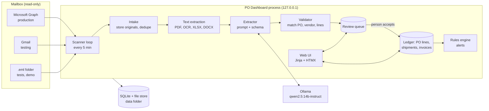

# PO Dashboard: Technical Architecture

2026-11-04 · Shashank Panda · **v0.1, design only: nothing is built yet**

PO Dashboard watches one mailbox for vendor replies to purchase orders, extracts what they say with a local model,
lets a person accept it, and tracks every PO line from "sent" to "closed". It runs entirely on the user's computer.
Requirements: [REQUIREMENTS.md](REQUIREMENTS.md). DEC and OPEN IDs: [DECISIONS.md](DECISIONS.md). The build order is
[PLAN.md](PLAN.md). Each choice below is **Decided**, **Assumed** (a default to confirm) or **Open**.

## 1. Design constraints

- **Nothing leaves the machine** except the mailbox fetch (DEC-01). Extraction, database, files and logs are local.
- **The mailbox is read-only** (DEC-07). There is no code path that sends, moves or deletes mail.
- **A person decides** (DEC-08). Extraction proposes; a person accepts. Only accepted facts change a PO.
- **Documents are data** (DEC-09). Fenced in prompts, validated after the model, never trusted.
- **One gateway for the model** (DEC-05). Swapping or re-testing a model touches one module.
- **Nothing is lost.** Every original is kept, every fact points back to its source, every change is in the audit trail.
- **Several people, one login each** (DEC-20), and **installs from Git** (DEC-11) on someone else's machine.
- **Runs unattended** (DEC-12).

## 2. System overview

One app process does the work; Ollama is the only other process. The scanner is a loop inside the app.



- **Scanner** asks the mail source for what is new since its saved position, then hands each message to intake.
- **Intake** stores the raw message and each attachment unchanged, records a content hash and skips repeats.
- **Text extraction** turns each part into text with page or cell references.
- **Extractor** sends fenced text and a JSON schema to the model through `models/llm.py` and gets structured fields.
- **Validator** is plain code: it checks the fields against the database before anything reaches a person.
- **Review queue** shows the document beside its fields. Accept, edit or reject.
- **Ledger** holds the accepted facts. Line status is computed from them (§5), never typed in.
- **Rules engine** turns ledger state into alerts (§8).

## 3. Technology stack

| Layer | Choice | Status | Why |
|---|---|---|---|
| Language, tooling | Python 3.13, uv, Ruff, pytest | Assumed | DEC-02 |
| Web | FastAPI, Uvicorn, Jinja2 templates, HTMX 2 (copied into `static/`) | Assumed | DEC-03: no build step, works offline |
| Styling | Hand-written CSS with design tokens, light and dark | Assumed | DEC-03 |
| Data | SQLite (WAL) through SQLAlchemy 2; Alembic migrations | Assumed | DEC-02, DEC-04 |
| Scheduler | An asyncio task inside the app, one scan at a time, with a saved position per mail source | Assumed | Simple; no extra process |
| Model runtime | Ollama on localhost, JSON-schema `format` parameter | Decided | DEC-05; structured output is Ollama's documented way to constrain an answer |
| Extraction model | `qwen2.5:14b-instruct` (9 GB), temperature 0, fixed seed | Decided | DEC-05 |
| PDF text | pdfplumber (text PDFs); Tesseract OCR for scans and images | Assumed | Tesseract is already installed on the owner's Mac |
| Spreadsheets, Word | openpyxl, csv, python-docx | Assumed | |
| Mail: Microsoft 365 | Microsoft Graph, app-only sign-in, read-only, one mailbox, message delta query per folder | Decided | DEC-06, DEC-07. Delta tracking is per folder and returns a saved delta link for the next round. How attachments come back through delta is **to verify in Phase 6** |
| Mail: Gmail | IMAP with an app password, or the Gmail API | Open | OPEN-04 |
| Mail: files | Folder of `.eml` files | Decided | DEC-06 |
| Secrets | macOS Keychain through `keyring`; never a file in the repo | Assumed | NFR-08 |
| Service | launchd user agent | Assumed | DEC-12 |
| Tests | pytest; Playwright for browser tests; a golden set scored against the real model | Assumed | Same layers as LegalLens |

## 4. Data model

Tables, with the fields that matter. Every table has `id`, `created_at`; accepted-fact tables also keep
`source_document_id` and, where known, a page or cell reference.

| Table | Holds |
|---|---|
| `vendor` | name, contact name and email, `vendor_domain` (many), notes |
| `purchase_order` | po_number (unique), vendor_id, date_sent, currency, buyer, status (derived), source (manual, csv, document) |
| `po_line` | po_id, line_no, item, description, ordered_qty, unit, unit_price, requested_date, closed_reason (none, received, short, cancelled) |
| `source_message` | mail source, provider message id, sender, subject, received_at, raw_path, content_hash |
| `source_document` | message_id, filename, kind, stored_path, content_hash, text_path, pages |
| `extraction` | document_id, model, prompt_version, raw JSON, doc_type, po_number, vendor_match, validation flags, state (pending, accepted, rejected, unmatched) |
| `extraction_line` | extraction_id, line_no, item, qty, price, promised_date, flags |
| `acknowledgement` / `ack_line` | accepted extraction: po_id, line_id, confirmed_qty, confirmed_price, promised_date, accepted_by, accepted_at |
| `promised_date_history` | line_id, date, source ack, recorded_at: one row per accepted date, so a slip is visible |
| `shipment` / `shipment_line` | carrier, tracking_number, shipped_at, eta; line_id, qty |
| `invoice` / `invoice_line` | invoice_number, invoice_date, total; line_id, qty, price |
| `alert` | po_line_id (or po_id), rule, state (open, snoozed, dismissed, cleared), snoozed_until, first_seen, last_changed |
| `contact_log` | alert_id, note, contacted_at: "marked contacted" entries |
| `app_user` | email, password hash, role, totp secret (sealed), failed attempts, locked_until, disabled |
| `session` | user_id, token hash, created, last_seen |
| `audit_log` | at, user_id, action, object, before, after |
| `scan_state` | mail source, saved position (delta link or last uid), last_success, last_error |
| `setting` | key, value (interval, thresholds, model name, mail source) |

### How the standard EDI documents map

There is no single global PO file format. The closest are the X12 EDI documents and their EDIFACT twins, and vendors
writing to a mailbox rarely send EDI. The fields above follow them so a real feed can be added later.

| Our document | X12 | EDIFACT | Key fields we keep |
|---|---|---|---|
| Purchase order | 850 | ORDERS | PO number, lines (qty, unit, price, requested date) |
| Order acknowledgement | 855 | ORDRSP | PO number, per line confirmed qty, price, promised date |
| Shipment notice | 856 | DESADV | carrier, tracking, lines and quantities, ETA |
| Invoice | 810 | INVOIC | invoice number, PO number, per line qty and price |

## 5. Line status

Status is computed from accepted facts. It is never stored as typed text, so it cannot drift from the evidence.

For each line: `ordered`, `confirmed` (latest accepted ack, else none), `shipped` (sum of accepted shipment lines),
`invoiced` (sum of accepted invoice lines).

| Status | Rule |
|---|---|
| Sent | no accepted acknowledgement |
| Acknowledged | an accepted ack and `shipped` = 0 |
| Partially shipped | 0 < `shipped` < the target, where target is `confirmed` if present, else `ordered` |
| Shipped | `shipped` ≥ target and `invoiced` < `ordered` |
| Closed | `invoiced` ≥ `ordered`, or closed by hand: received, short, cancelled (reason and person recorded) |

`open_qty` = `ordered` − `invoiced` for an open line. A PO is **Closed** when all its lines are closed, **Open** when
any line is open, and shows "partially invoiced" when some but not all quantity is invoiced. A line confirmed short
(100 ordered, 60 confirmed) stays open for the unconfirmed 40 and raises the `unconfirmed_balance` rule.

## 6. Intake and extraction pipeline

1. **Scan.** The scanner (one at a time, never overlapping) asks the mail source for changes since `scan_state`.
2. **Store.** Write the raw message to the file store, then each attachment, with its SHA-256. Known hash → skip.
   The saved position moves only after the message is safely stored, so a crash repeats work instead of losing mail.
3. **Text.** Body (HTML → text), PDF text, OCR for scanned pages or images, spreadsheet rows, Word text. Quoted
   earlier messages in a thread are marked so they are not mistaken for the current message.
4. **Extract.** One model call per document with the system prompt below, the fenced text and the JSON schema:
   `doc_type` (now including `purchase_order`), `po_number`, `tracking_numbers`, a shipment-level arrival date, and per line `line_no`, `item`,
   `qty`, `promised_date`. The prompt is versioned (`prompt_version`) so results can be compared across changes.
5. **Validate** (plain code, no model):
   - the PO number exists and the sender's domain belongs to the PO's vendor, else **Unmatched**. For a `purchase_order`
  document the PO number must be new, and the vendor is found from the recipient domain (DEC-17);
   - each line number exists on the PO; the item agrees with the PO line, else flagged;
   - quantity is a positive number and not above what is still open; dates parse and are plausible (not years away);
   - invoice total agrees with lines × price, where the total is given;
   - a value present in the document text. The extracted PO number and each date must appear in the source text,
     so a value the model invented cannot pass;
   - differences against the PO (price, quantity, date) are listed beside the line.
6. **Queue.** The extraction waits for a person (DEC-08). Accept writes the ledger rows, the history rows and an
   audit entry in one transaction. Reject keeps the extraction, marked rejected, with a reason.

**Prompt rule (DEC-09).** The system prompt says the document is untrusted data and instructions inside it are to be
ignored; the document sits inside a delimited block. The trial prompt scored 8/8 on a document with a planted
instruction on the 14b model, and 5/8 and 6/8 on the smaller ones, so the prompt alone is not the safeguard. The
validator and the person are.

**Model trial, 2026-11-04** (4 made-up documents, 36 fields, repeated twice with identical scores):

| Model | Fields correct | Followed planted instruction | Seconds per document (second run) |
|---|---|---|---|
| qwen2.5:14b-instruct | 34/36 | No | about 17 |
| llama3.2:3b | 32/36 | Yes | about 4 |
| qwen2.5:7b-instruct | 30/36 | Yes | about 9 |

The 14b model's only misses were the per-line arrival dates on a shipment notice that gave one date for the whole
shipment. That is why the schema has a shipment-level date (REQ-SHP-02). Four documents are too few to rely on; the
golden set in Phase 2 re-scores it.

## 7. Mail sources

All implement `MailSource`: `fetch_new(position) -> (messages, new_position)` and `health()`. No write methods exist.

- **Microsoft Graph (production).** App-only sign-in with a client secret or certificate held in the Keychain.
  `Mail.Read` for one mailbox, limited by Exchange Online RBAC for Applications, with the broad Entra grant removed
  (otherwise the limit does not apply). Permission changes can take 30 minutes to 2 hours to apply. Messages are
  tracked with the folder delta query; the saved delta link is the position. Delta tokens depend on a server-side
  cache, so if a token is refused the scanner re-reads a recent window and relies on dedupe.
- **Gmail (testing).** OPEN-04. IMAP with an app password on a dedicated account is the leading option. The position is
  the last UID per folder.
- **Folder (tests, demo).** Reads `.eml` files from a directory; the position is the set of file hashes seen.

Switching provider is a setting; the rest of the app cannot tell which one is in use.

## 8. Alert rules

Evaluated after every accepted document and once an hour. An alert is keyed by (line or PO, rule), so the same
condition never creates two. It clears itself when the condition clears. Defaults are settings (OPEN-07).

| Rule | Raised when | Default |
|---|---|---|
| `no_ack` | PO sent more than N days ago and no accepted acknowledgement | 2 business days |
| `overdue` | line open, promised date (else requested date) passed, not fully shipped | 1 day grace |
| `date_slip` | an accepted ack moved a promised date later | any slip |
| `unconfirmed_balance` | an ack confirmed less than ordered, or gave no date | immediately |
| `shipment_late` | shipped, ETA passed, not invoiced | 2 days grace |
| `due_soon` | promised date within N days and nothing shipped (a nudge before it is late) | 3 days |
| `mismatch` | accepted ack or invoice differs from the PO in price, or bills more than ordered | immediately; a review flag, not a vendor follow-up |
| `scan_stale` | no successful scan for 30 minutes | system alert, NFR-05 |

Actions: **Contacted** (note, stored in `contact_log`; the alert is quiet until its next trigger date or a change),
**Snooze until** a date, **Dismiss**. A change in the line's state reopens a snoozed or dismissed alert.
Each alert page offers a drafted message (REQ-FU-03) listing the lines, quantities, PO number and dates. The app does
not send it.

## 9. Web interface

Server-rendered pages; HTMX updates parts of a page (accept a document, snooze an alert) without a full reload.

| Screen | Purpose |
|---|---|
| Dashboard | the counts in REQ-DB-01, the alerts needing action today, a health strip (last scan, model reachable) |
| Review | each pending document beside its extracted fields, validator flags, price and quantity differences; accept, edit, reject |
| Unmatched | documents with no PO or vendor; attach to a PO by hand or reject |
| POs | list with search and filters; PO detail with a line timeline and the source documents |
| Open items | the open-items report, filters, CSV export |
| Follow-ups | the alert queue with Contacted, Snooze, Dismiss and the drafted message |
| Vendors | vendors, their domains and contacts |
| Sign-in, Users | sign-in with a second factor; admins add and disable people |
| Settings and health | mail source, interval, thresholds, model name, scan status, backup status, audit trail |

Design: one stylesheet with tokens, light and dark themes, a status colour and a text label on every status
(colour is never the only signal), works from a phone width up, keyboard-reachable, checked with an automated
accessibility test (NFR-12).

## 10. Security and privacy

- **Sign-in (DEC-20, NFR-13).** Every page and API call needs a session except the sign-in page and the health check.
  Passwords are hashed with argon2id; roles are admin and buyer; sessions time out when idle; repeated failures lock the
  account for a while; every form carries a CSRF token; a TOTP second factor is required. The first run creates the
  first admin. The same design as LegalLens, so its tested approach is reused.
- Listens on `127.0.0.1` only until the owner chooses network access (OPEN-10). Network access needs HTTPS.
- Mailbox secret in the Keychain, never in the repo, the database or a log. Logs hold ids and counts, not document text.
- Originals are served only through the app, with the content type set from the stored file and a download header, so an
  attachment cannot run in the page.
- A 25 MB limit per attachment, an allowed list of file types, and a page limit on PDFs, so a hostile attachment cannot
  exhaust the machine. Attachments are never executed or opened by an external program except Tesseract and the
  parsers above. A malware scan is **Open** (ClamAV is what LegalLens used).
- The audit trail covers every change (NFR-03).
- Real vendor documents are never committed (DEC-13); tests use synthetic data only.

## 11. Running locally after go-live

The full runbook is [OPERATIONS.md](OPERATIONS.md). The design points that make it possible:

- **Service.** A launchd user agent starts the app at login and restarts it if it stops (DEC-12).
- **Catch-up.** The saved mailbox position means a sleeping or switched-off Mac misses nothing. The first scan after
  waking reads everything since the last success.
- **Visible failure.** A failed scan, a missing model or a rejected mailbox credential shows as a banner and a
  `scan_stale` alert, never silently (NFR-05).
- **Data outside the repo.** The database, files, logs and backups sit in a per-user data folder, so `git pull` to
  update never touches them. Alembic migrates the database on start, after a backup.
- **Backups.** A nightly copy of the database and stored files to a folder the user chooses, outside iCloud, with a
  tested restore and 35 days kept (LegalLens's rule).
- **Sleep.** The Mac is not woken to scan; the app tells the user how to keep it awake if they need scans overnight.

## 12. Distribution to a second machine

The friend clones the repo, runs `scripts/setup.sh` (installs uv's Python and the dependencies, checks for Ollama and
Tesseract, offers to pull the model: **9 GB**, so the script states the size and asks first), then `scripts/demo.sh`,
which loads the synthetic sample mailbox and opens the app. Then they enter their own mailbox settings. The model
needs about 9 GB of memory; on a smaller machine the model name can be changed in settings, with lower accuracy.
A clean-machine rehearsal is a Phase 7 task (NFR-07).

## 13. Testing

| Layer | What | Where |
|---|---|---|
| Unit | status engine, rules engine, validator, date and quantity parsing | `tests/unit` |
| API and pages | accept, reject, close by hand, snooze, CSV export; every state transition | `tests/api` |
| Pipeline | the folder mail source into the ledger with a **stub model**, so it is fast and repeatable | `tests/pipeline` |
| Security | hostile attachments, planted instructions with a stub that obeys them, read-only mail (a test fails if any send, move or delete call exists), secrets absent from logs | `tests/security` |
| Golden set | the synthetic documents scored against the real model, field by field | `evals/` |
| Browser | main flows with Playwright, with an accessibility check | `tests/e2e` |
| Soak | 24 hours with a restart in the middle, no message missed or repeated (T-6) | `evals/soak` |
| By hand | [test-evidence/HUMAN_TEST_CHECKLIST.md](../test-evidence/HUMAN_TEST_CHECKLIST.md), written in Phase 7 | |

The golden set is generated by a script from templates, so each document has a known answer file next to it:
tables, prose, European date formats, short confirmations, shipment-level dates, quoted threads, scanned PDFs,
spreadsheets, partial invoices, price differences, a duplicate, a revised acknowledgement that slips a date, and
documents with planted instructions. A change that lowers its score needs a reason.

## 14. Folder layout

```
po-dashboard/
  src/po_dashboard/
    api/ pages/ templates/ static/     web layer
    mail/        MailSource, graph.py, gmail.py, folder.py
    intake/      store, dedupe, text extraction
    extraction/  prompts.py (versioned), schema.py, extractor.py
    validation/  validator.py
    ledger/      models, status.py, accept.py
    rules/       alerts.py, drafts.py
    models/      llm.py (the only module that calls Ollama)
    scheduler/   scanner loop
    db/ ops/     migrations, backup, health
  tests/ evals/ scripts/ docs/ test-evidence/
```

## 15. Risks

| ID | Risk | Mitigation |
|---|---|---|
| RISK-01 | The model misreads a document and a person accepts it | Validator flags, source shown beside fields, golden set, human accept (DEC-08) |
| RISK-02 | Planted instructions in a vendor email | DEC-09: fencing, validation, no model-driven actions, a person accepts |
| RISK-03 | The 14b model is too slow or too big for the friend's machine | Model is a setting; the friend's machine is probably a 16 GB Mac, to confirm (DEC-18); target of 2 minutes per document (NFR-11) |
| RISK-04 | Mailbox permission is broader than intended | RBAC scoping, remove the unscoped grant, a Phase 6 check that other mailboxes are refused |
| RISK-05 | The Mac sleeps and scans stop | Catch-up on wake, health banner, `scan_stale` |
| RISK-06 | Gmail test behaviour differs from Microsoft 365 | `MailSource` interface and the shared contract tests; re-run the golden set on real Microsoft mail in Phase 6 |
| RISK-07 | Real vendor data reaches Git | `.gitignore`, a pre-commit check for `.eml`, PDFs and databases outside `tests/data/`, and the rule in CLAUDE.md |
| RISK-08 | Vendors send in formats the golden set does not cover | Add each new real format to the golden set (with the owner's confirmation) |
