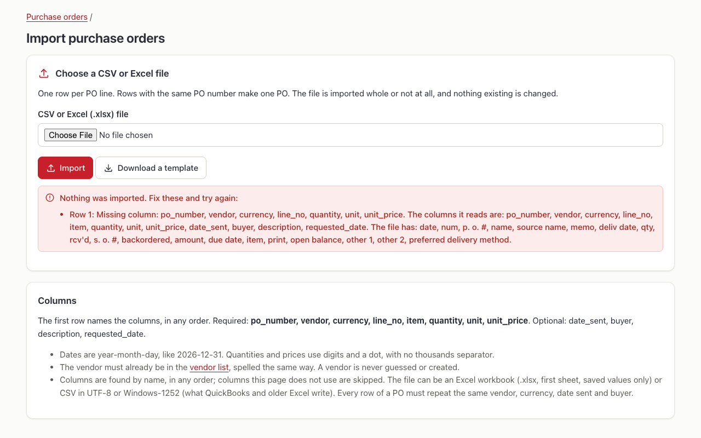
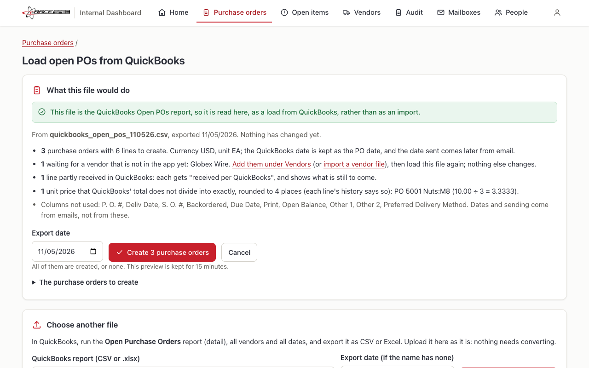
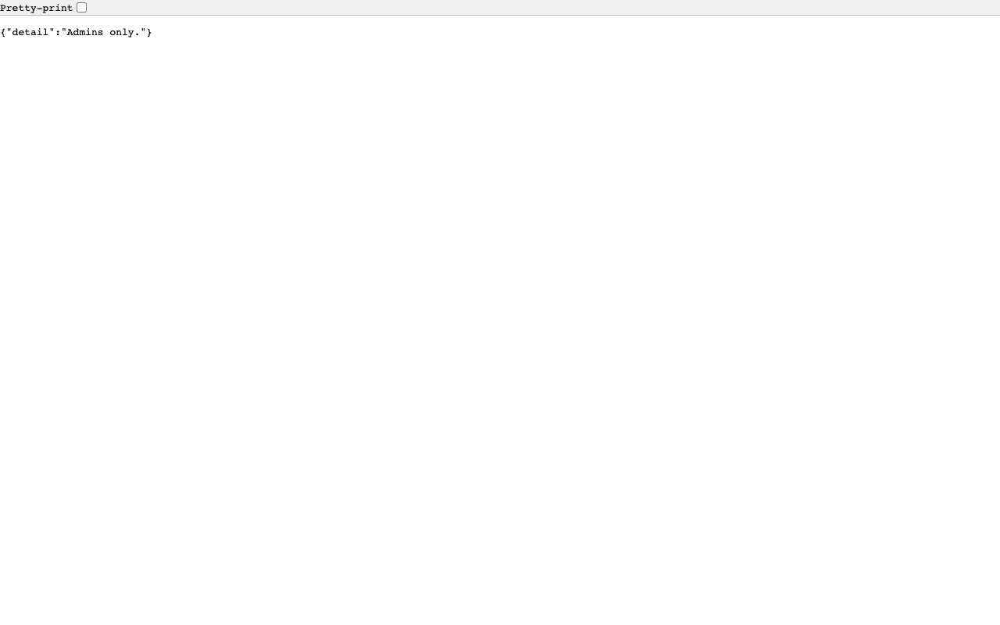
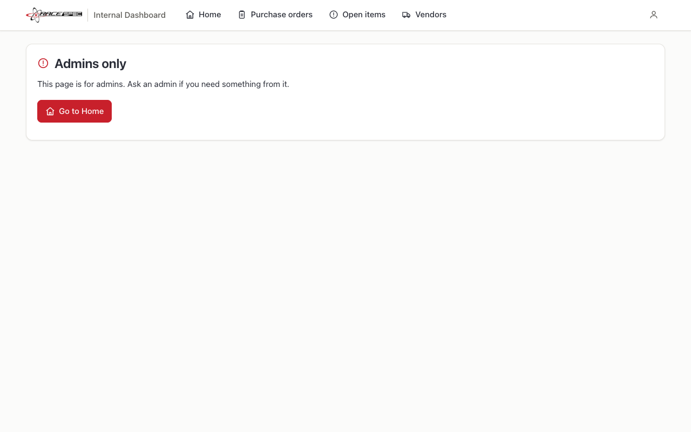
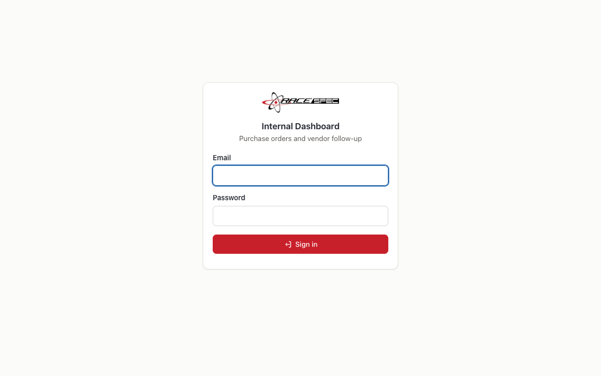
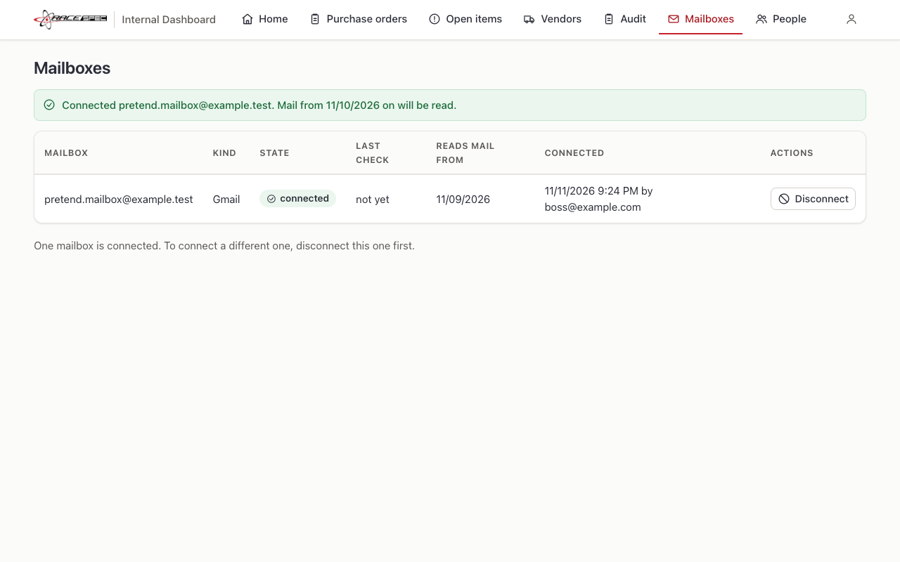

# Defects and retests

*Built from [test_record.toml](test_record.toml) by `scripts/test_record.py`. Do not edit by hand.*

Every failure is logged here the moment it is found, by whoever finds it: the case, the browser, what was seen and a screenshot; then the cause, the fix and its commit; then a retest with its own screenshot. Failures before 11/07/2026 are in [BUILD_HISTORY.md](../docs/BUILD_HISTORY.md) and are not repeated here.

| ID | Found | Case | Severity | Title | Status |
|---|---|---|---|---|---|
| [DEF-001](#def-001) | 11/07/2026 | [TC-QB-01](TEST_CASES.md#tc-qb-01) | Medium | The QuickBooks report uploaded on Import CSV or Excel was refused with a list of missing columns | Fixed, waiting for the owner's retest |
| [DEF-002](#def-002) | 11/07/2026 | [TC-SIGN-06](TEST_CASES.md#tc-sign-06) | Low | A buyer opening an admin address saw raw code instead of a page | Fixed, waiting for the owner's retest |
| [DEF-003](#def-003) | 11/11/2026 | [TC-MAIL-24](TEST_CASES.md#tc-mail-24) | High | One email with a long encoded Subject could exhaust the app's memory | Fixed, not committed yet |
| [DEF-004](#def-004) | 11/11/2026 | [TC-MAIL-24](TEST_CASES.md#tc-mail-24) | Medium | A message with 300,000 tiny attachments held the scanner for minutes and would write a file and a row for each | Fixed, not committed yet |
| [DEF-005](#def-005) | 11/11/2026 | [TC-MAIL-23](TEST_CASES.md#tc-mail-23) | Medium | A slow or broken document could hold the scanner without limit or stop the app | Fixed, not committed yet |
| [DEF-006](#def-006) | 11/11/2026 | [TC-MAIL-21](TEST_CASES.md#tc-mail-21) | Low | A file named .png that is really EPS reached Pillow's EPS reader | Fixed, not committed yet |
| [DEF-007](#def-007) | 11/11/2026 | [TC-MAIL-24](TEST_CASES.md#tc-mail-24) | Low | A silent connection to the Gmail sign-in listener could hold up the sign-in | Fixed, not committed yet |
| [DEF-008](#def-008) | 11/11/2026 | [TC-MAIL-10](TEST_CASES.md#tc-mail-10) | Low | A test lowered Pillow's pixel limit for the whole test run, so another test failed when the files ran in a different order | Fixed, not committed yet |
| [DEF-009](#def-009) | 11/11/2026 | [TC-SIGN-01](TEST_CASES.md#tc-sign-01) | Low | The browser check for the cursor in Email failed on a slow first page load, though the cursor was there | Fixed, not committed yet |
| [DEF-010](#def-010) | 11/12/2026 | [TC-MAIL-27](TEST_CASES.md#tc-mail-27) | Low | After connecting, the message gave a different start date from the table on the same page | Fixed, Chrome retest waiting |
| [DEF-011](#def-011) | 11/12/2026 | [TC-MAIL-23](TEST_CASES.md#tc-mail-23) | High | With python.org's Python, every document failed: the sandbox refused Python's own restart | Fixed, CI retest waiting |

## DEF-001: The QuickBooks report uploaded on Import CSV or Excel was refused with a list of missing columns

**Found:** 11/07/2026 by Owner, QuickBooks check step 4 · **Case:** TC-QB-01 · **Browser:** Not stated · **Severity:** Medium · **Status:** Fixed, waiting for the owner's retest

**Steps to reproduce**

1. Purchase orders, Import CSV or Excel (instead of Load from QuickBooks, the button beside it).
2. Choose tests/data/quickbooks_open_pos_110526.csv and press Import.

**Expected:** The QuickBooks preview, or at least a message saying which button to use.

**Actual:** "Nothing was imported. Fix these and try again: Row 1: Missing column: po_number, vendor, currency, line_no, quantity, unit, unit_price ..." followed by the file's columns.

**Seen:** screenshots/DEF-001-before.png (recreated by Claude on commit 7f2d081)

**Cause:** The two upload buttons sit side by side with the same icon, and the import page only knew its own format.

**Fix:** PD-1.10a.5: Import CSV or Excel recognises the QuickBooks report and shows the QuickBooks preview (nothing is created until Create); the app's own file on the QuickBooks page is refused with a link to Import. 3 new tests. Commit e0bdb3e.

**Retest:** 11/07/2026, Claude in Chrome: pass (TC-PIMP-06, TC-QB-08). Owner's retest of step 4 and new steps 15 and 16: waiting.

## DEF-002: A buyer opening an admin address saw raw code instead of a page

**Found:** 11/07/2026 by Claude, browser evidence run in Chrome · **Case:** TC-SIGN-06 · **Browser:** Google Chrome 156.0.8078.81 (scripts/browser_evidence.py) · **Severity:** Low · **Status:** Fixed, waiting for the owner's retest

**Steps to reproduce**

1. Sign in as a buyer.
2. Type /admin/users or /admin/audit in the address bar.

**Expected:** A refusal page saying Admins only, in the app's own layout.

**Actual:** The access was refused (status 403), but the browser showed the raw answer {"detail":"Admins only."} on a blank page. A mistyped address (404) and an unreadable form (422) did the same.

**Seen:** screenshots/DEF-002-before.png

**Cause:** Refusals raised as errors used the web framework's default answer, meant for scripts. The sign-in check of 11/04/2026 looked for the words Admins only, which the raw answer also contains.

**Fix:** Refusals, missing pages and unreadable forms are now pages in the app's layout with a Go to Home button, for browsers and HTMX; a script that does not ask for HTML still gets the short JSON. 3 new tests; new case TC-WEB-06. Commit e0bdb3e.

**Retest:** 11/07/2026, Claude in Chrome: pass (TC-SIGN-06, TC-WEB-06). Owner's retest: waiting.

## DEF-003: One email with a long encoded Subject could exhaust the app's memory

**Found:** 11/11/2026 by Claude, PD-3.6 security probe on Opus · **Case:** TC-MAIL-24 · **Browser:** Not a browser case (made-up hostile files run through the real code) · **Severity:** High · **Status:** Fixed, not committed yet

**Steps to reproduce**

1. Store a message whose Subject is 20,000 encoded words (=?utf-8?q?...?=), 0.3 MB in all.
2. Watch the app's memory while intake reads the Subject.

**Expected:** The message is stored in moments with its Subject cut to 1,000 characters.

**Actual:** The process passed 2 GB and was stopped by the probe's own 2 GB guard; an earlier run without the guard was killed by macOS. 4,000 words used 180 MB and 8,000 used 612 MB: the memory grows with the square of the number of words. This runs inside the app, so one email could stop it.

**Cause:** Intake parsed headers with Python's structured email parser (policy.default), whose memory for a header of many encoded words grows with the square of their number (Python 3.13.15).

**Fix:** Intake now uses the plain parser and reads each header from its raw bytes, cut to 10,000 characters, then decodes the encoded words (DEC-53). Not committed yet.

**Retest:** 11/11/2026, Claude: pass. The same Subject is stored under a 500 MB cap (TC-MAIL-24).

## DEF-004: A message with 300,000 tiny attachments held the scanner for minutes and would write a file and a row for each

**Found:** 11/11/2026 by Claude, PD-3.6 security probe on Opus · **Case:** TC-MAIL-24 · **Browser:** Not a browser case (made-up hostile files run through the real code) · **Severity:** Medium · **Status:** Fixed, not committed yet

**Steps to reproduce**

1. Store a 33 MB message with 300,000 different one-line attachments.

**Expected:** The message is stored whole and not taken apart, in moments.

**Actual:** Parsing and walking the parts alone took 105 seconds and 518 MB inside the app; storing would then have written 300,000 files and rows in one transaction.

**Cause:** Nothing limited the number of MIME parts below the 50 MB message limit.

**Fix:** A message with more than 2,000 lines starting with "--" is stored whole, its body marked not read with a reason, and not parsed (DEC-53). Not committed yet.

**Retest:** 11/11/2026, Claude: pass with 2,500 parts (TC-MAIL-24).

## DEF-005: A slow or broken document could hold the scanner without limit or stop the app

**Found:** 11/11/2026 by Claude, PD-3.6 security probe on Opus · **Case:** TC-MAIL-23 · **Browser:** Not a browser case (made-up hostile files run through the real code) · **Severity:** Medium · **Status:** Fixed, not committed yet

**Steps to reproduce**

1. Read a PDF with no text and 150 page images (3 on each of 50 pages).
2. Consider a reader that crashes inside C code (Pillow, lxml, zlib).

**Expected:** A document is stopped after a set time, and a crash costs that document only.

**Actual:** Blank page images took 24 s; a page of noise takes Tesseract about 3.4 s, so 150 noisy images about 9 minutes, and each image was allowed 120 s (5 hours in all). No crash was produced, but a crash in a C parser would have stopped the whole app, and the same document would have been read again, and crashed it again, on every restart.

**Cause:** Documents were read inside the app's own process with only a per-image OCR limit.

**Fix:** Each document is read by a fresh process in the macOS sandbox, stopped after 10 minutes with anything it started, and stopped past 1.5 GB; a crash or a wrong answer marks it failed (DEC-53). Not committed yet.

**Retest:** 11/11/2026, Claude: pass (TC-MAIL-23: hang, memory, crash and wrong answers).

## DEF-006: A file named .png that is really EPS reached Pillow's EPS reader

**Found:** 11/11/2026 by Claude, PD-3.6 security probe on Opus · **Case:** TC-MAIL-21 · **Browser:** Not a browser case (made-up hostile files run through the real code) · **Severity:** Low · **Status:** Fixed, not committed yet

**Steps to reproduce**

1. Attach a small EPS (PostScript) file named a.png and read it.

**Expected:** It is refused as not a picture the app reads, without Pillow's EPS reader.

**Actual:** Pillow recognised it as EPS and failed only because Ghostscript is not installed on this Mac (OSError). With Ghostscript installed, the attachment would have been run by it.

**Cause:** Pillow was asked to open any format it knows.

**Fix:** Pillow now opens PNG, JPEG, GIF, TIFF and BMP only, and the sandbox allows no program but Tesseract (DEC-53). Not committed yet.

**Retest:** 11/11/2026, Claude: pass (TC-MAIL-21).

## DEF-007: A silent connection to the Gmail sign-in listener could hold up the sign-in

**Found:** 11/11/2026 by Claude, PD-3.6 security probe on Opus · **Case:** TC-MAIL-24 · **Browser:** Not a browser case (made-up hostile files run through the real code) · **Severity:** Low · **Status:** Fixed, not committed yet

**Steps to reproduce**

1. During connect-gmail, open a connection to the loopback listener and send nothing.
2. Let Google's return arrive.

**Expected:** The silent connection is dropped and the sign-in finishes.

**Actual:** Found by reading the code: the listener handles one request at a time with no time limit, so it would wait on the silent connection until the 5-minute sign-in wait ran out. Only a program on this Mac could do it.

**Cause:** The request handler had no socket timeout.

**Fix:** Each connection may stay silent for 10 seconds at most. Not committed yet.

**Retest:** 11/11/2026, Claude: pass (TC-MAIL-24).

## DEF-008: A test lowered Pillow's pixel limit for the whole test run, so another test failed when the files ran in a different order

**Found:** 11/11/2026 by Claude, PD-3.6 security probe on Opus · **Case:** TC-MAIL-10 · **Browser:** Not a browser case (made-up hostile files run through the real code) · **Severity:** Low · **Status:** Fixed, not committed yet

**Steps to reproduce**

1. Run tests/test_text.py before tests/test_golden_set.py.

**Expected:** Each test passes whatever order the files run in.

**Actual:** test_the_generator_rebuilds_the_committed_set_exactly failed: Pillow refused a 2,629-pixel picture as a bomb, because its limit was still 1,000.

**Cause:** image_text set Pillow's process-wide limit from the app's constant, and a test lowers that constant. The normal order hid it.

**Fix:** The app no longer changes Pillow's process-wide limit; it checks the size itself before decoding. Not committed yet.

**Retest:** 11/11/2026, Claude: pass with the files in that order.

## DEF-009: The browser check for the cursor in Email failed on a slow first page load, though the cursor was there

**Found:** 11/11/2026 by Claude, browser evidence run in Chrome · **Case:** TC-SIGN-01 · **Browser:** Google Chrome (scripts/browser_evidence.py) · **Severity:** Low · **Status:** Fixed, not committed yet

**Steps to reproduce**

1. Run scripts/browser_evidence.py on a busy Mac.
2. TC-SIGN-01 opens the app signed out and asks which box has the cursor.

**Expected:** The cursor is in the Email box.

**Actual:** The check failed with: the cursor is not in Email. The failure screenshot (seen by Claude, which found the cursor in Email) was deleted by the retest run, which clears old screenshots; it was not kept. The first page of the run took 2.1 seconds instead of 0.5.

**Cause:** The script read the focused box 300 ms after the page loaded, before the browser had applied autofocus on a slow first load. A flaw in the check, not in the app.

**Fix:** The check now waits up to 5 seconds for the Email box to take focus before it judges. Not committed yet.

**Retest:** 11/11/2026, Claude in Chrome: pass (all 60 browser cases, 0.6 s). Owner's retest: not needed (test script only).

## DEF-010: After connecting, the message gave a different start date from the table on the same page

**Found:** 11/12/2026 by Claude, reading the Chrome screenshots before the first push · **Case:** TC-MAIL-27 · **Browser:** Google Chrome (scripts/browser_evidence.py) · **Severity:** Low · **Status:** Fixed, Chrome retest waiting

**Steps to reproduce**

1. At 9:24 PM, connect a mailbox on the Mailboxes screen with Also read the last 2 days.

**Expected:** The message and the table give the same date, the office date mail is read from: 11/09/2026.

**Actual:** The message said Mail from 11/10/2026 on will be read; the table said 11/09/2026. The Terminal command connect-gmail printed the same kind of date.

**Seen:** screenshots/DEF-010-before.png

**Cause:** The message printed the stored time, which is in UTC, as a date; the table turns it into the office date first (DEC-45). In the evening in the US the two are different days. The browser check looked for the word Connected, not the date.

**Fix:** The message and the Terminal command use the same date display as the table. A test pins the time to 2 AM UTC with the Mac in New York, and the browser check now compares the message date with the table date. Not committed yet.

**Retest:** 11/12/2026, Claude: pass in the tests (the new test fails on the old code). Chrome retest: waiting for the next browser evidence run.

## DEF-011: With python.org's Python, every document failed: the sandbox refused Python's own restart

**Found:** 11/12/2026 by GitHub Actions CI, its first run (macOS runner) · **Case:** TC-MAIL-23 · **Browser:** Not a browser case (the test suite on GitHub's Mac, python.org Python 3.13) · **Severity:** High · **Status:** Fixed, CI retest waiting

**Steps to reproduce**

1. Run the tests on a Mac whose Python is the python.org (framework) build, as GitHub's runners use.
2. Read any document through the reading process.

**Expected:** The document is read inside the sandbox, as on this Mac.

**Actual:** Every read ended as failed: the reader stopped unexpectedly. 20 tests failed in CI (reading, scanner, hostile files). On this Mac they passed, because uv's own Python does not restart itself.

**Cause:** python.org's Python starts by running a second program inside its installation (Resources/Python.app/Contents/MacOS/Python). The sandbox rules allowed only the python file itself to run, so that restart was refused before any code ran. Reproduced here with the python.org Python 3.14 installed on this Mac.

**Fix:** The sandbox also allows programs inside the running Python's own installation folder (sys.base_prefix). Every other program, apart from Tesseract, is still refused. A new test runs python.org's Python under the real rules whenever one is installed, and first shows the old rules failing. Not committed yet.

**Retest:** 11/12/2026, Claude: pass on this Mac with python.org Python 3.14 and with uv's Python 3.13. CI retest: waiting for the next push.
