# Test cases

*Built from [test_record.toml](test_record.toml) by `scripts/test_record.py`. Do not edit by hand.*

PO Dashboard (RaceSpec Internal Dashboard). Scope: Phase 0 and Phase 1: sign-in, people, vendors, purchase orders, imports, the QuickBooks starting load, entries by hand, Home, Open items, Audit, page behaviour, security and speed.

**182 cases:** 51 Critical, 114 High, 17 Medium; 3 terminal, 108 automated, 67 browser, 4 owner only.

Latest Chrome run: 11/12/2026, Google Chrome 158.0.8127.37, by Claude, scripts/browser_evidence.py, on commit 54eb6fe with uncommitted changes: **67 of 67** browser cases pass. Automated tests: `uv run pytest`. Defects: [DEFECTS.md](DEFECTS.md). Sign-off: [SIGN_OFF.md](SIGN_OFF.md).

**To run them by hand:**

- cd ~/Projects/po-dashboard
- export PO_DASHBOARD_DATA="$HOME/Projects/po-dashboard-check-data"   (a throwaway folder; never the real one)
- uv run po-dashboard user create-admin boss@example.com   (choose a password, twice; nothing shows as you type)
- uv run po-dashboard serve   (leave this window open), then open http://127.0.0.1:8000 and sign in
- Made-up files to use, all in tests/data: vendors_sample.xlsx, vendors_problems.csv, purchase_orders_sample.csv, purchase_orders_bad_row.csv, quickbooks_open_pos_110526.csv
- Run the cases in the order listed: later cases use what earlier ones created.
- Clean up afterwards: Ctrl-C in the server window, then rm -r "$HOME/Projects/po-dashboard-check-data" and unset PO_DASHBOARD_DATA

## Summary

| ID | Title | Priority | How | Claude, Chrome | Owner, last result |
|---|---|---|---|---|---|
| [TC-SET-01](#tc-set-01) | Set-up states the 9 GB model download and never starts it without a yes | High | Terminal | — | — |
| [TC-SET-02](#tc-set-02) | The first admin is made in Terminal with a hidden password prompt | High | Terminal | — | Pass 11/04/2026 |
| [TC-SET-03](#tc-set-03) | The app stays local: it refuses other host names and a model server off this Mac | Critical | Automated | Automated tests | — |
| [TC-SET-04](#tc-set-04) | The commit guard refuses real documents and secrets outside tests/data | Critical | Automated | Automated tests | — |
| [TC-SET-05](#tc-set-05) | The data folder and database are private to the Mac's user, and upgrades are safe to repeat | High | Automated | Automated tests | — |
| [TC-SIGN-01](#tc-sign-01) | A signed-out visitor sees only the sign-in page | Critical | Browser | Pass 11/12/2026 | Pass 11/04/2026 (Safari, Chrome) |
| [TC-SIGN-02](#tc-sign-02) | A wrong password and an unknown email get the same message | Critical | Browser | Pass 11/12/2026 | Pass 11/04/2026 (Safari, Chrome) |
| [TC-SIGN-03](#tc-sign-03) | Signing in opens Home, with the account menu at the top right | High | Browser | Pass 11/12/2026 | Pass 11/06/2026 |
| [TC-SIGN-04](#tc-sign-04) | An admin adds a person and sees the temporary password once | Critical | Browser | Pass 11/12/2026 | Pass 11/04/2026 (Safari, Chrome) |
| [TC-SIGN-05](#tc-sign-05) | A temporary password leads only to Change password, which refuses a weak password | Critical | Browser | Pass 11/12/2026 | Pass 11/04/2026 (Safari, Chrome) |
| [TC-SIGN-06](#tc-sign-06) | A buyer cannot open the admin screens | Critical | Browser | Pass 11/12/2026 | Pass 11/05/2026 (Safari, Chrome), before DEF-002 was found: retest needed |
| [TC-SIGN-07](#tc-sign-07) | A disabled person is cut off and gets the ordinary refusal | Critical | Browser | Pass 11/12/2026 | Pass 11/04/2026 (Safari, Chrome) |
| [TC-SIGN-08](#tc-sign-08) | Five wrong passwords lock the account, even against the right one, until 15 minutes pass or an admin unlocks it | Critical | Browser | Pass 11/12/2026 | Pass 11/04/2026 (Safari, Chrome) |
| [TC-SIGN-09](#tc-sign-09) | 30 idle minutes sign a person out, even with a page that updates itself left open | High | Automated | Automated tests | — |
| [TC-SIGN-10](#tc-sign-10) | The session cookie is locked down, and the last admin cannot be removed | Critical | Automated | Automated tests | Pass 11/04/2026 (Safari, Chrome) |
| [TC-SIGN-11](#tc-sign-11) | Sign out, then sign in again, with no security-token error | Medium | Browser | Pass 11/12/2026 | Pass 11/06/2026 |
| [TC-VIMP-01](#tc-vimp-01) | A vendor file (Excel or CSV) creates the vendors with their domains | High | Browser | Pass 11/12/2026 | Pass 11/06/2026 (CSV); the .xlsx file: no problem reported 11/07/2026 |
| [TC-VIMP-02](#tc-vimp-02) | Uploading the same vendor file again changes nothing | Critical | Browser | Pass 11/12/2026 | Pass 11/06/2026 |
| [TC-VIMP-03](#tc-vimp-03) | Each vendor row needs an email, and an email or domain held by another vendor skips only that row | Critical | Browser | Pass 11/12/2026 | Pass 11/06/2026 |
| [TC-VIMP-04](#tc-vimp-04) | An existing vendor with a new email gets the new domain, and its other details are kept | High | Automated | Automated tests | Pass 11/06/2026 |
| [TC-VIMP-05](#tc-vimp-05) | An old Excel file (.xls) is refused with what to do | Medium | Browser | Pass 11/12/2026 | No problem reported 11/07/2026 (QuickBooks check step 2) |
| [TC-VEN-01](#tc-ven-01) | A vendor is added on its own page and lands on its vendor page | High | Browser | Pass 11/12/2026 | Pass 11/05/2026 (Safari, Chrome) |
| [TC-VEN-02](#tc-ven-02) | A vendor name that already exists, in any case, is refused and the boxes keep what was typed | High | Browser | Pass 11/12/2026 | Pass 11/05/2026 (Safari, Chrome) |
| [TC-VEN-03](#tc-ven-03) | A domain belongs to one vendor only, so a reply can never match the wrong vendor | Critical | Browser | Pass 11/12/2026 | Pass 11/06/2026 |
| [TC-VEN-04](#tc-ven-04) | Domains are checked, added and removed on the vendor page | Medium | Browser | Pass 11/12/2026 | Pass 11/05/2026 (Safari, Chrome) |
| [TC-VEN-05](#tc-ven-05) | Saving a vendor shows a Saved note and the page does not jump | Medium | Browser | Pass 11/12/2026 | Pass 11/06/2026 |
| [TC-VEN-06](#tc-ven-06) | A vendor with no domain is marked, because its replies cannot be matched | High | Browser | Pass 11/12/2026 | Pass 11/05/2026 (Safari, Chrome) |
| [TC-VEN-07](#tc-ven-07) | The vendor list searches as you type, sorts by heading, and / jumps to search | Medium | Browser | Pass 11/12/2026 | Pass 11/06/2026 |
| [TC-VEN-08](#tc-ven-08) | Markup typed into a vendor name is shown as text, never run | Critical | Browser | Pass 11/12/2026 | Pass 11/05/2026 (Safari, Chrome) |
| [TC-PO-01](#tc-po-01) | A PO entered by hand keeps exact numbers and starts as Sent | Critical | Browser | Pass 11/12/2026 | Pass 11/05/2026 (Safari, Chrome) |
| [TC-PO-02](#tc-po-02) | Reload after creating a PO never creates a second one | Critical | Browser | Pass 11/12/2026 | Pass 11/06/2026 |
| [TC-PO-03](#tc-po-03) | A wrong line value is refused naming the line and field, and every box keeps what was typed | High | Browser | Pass 11/12/2026 | Pass 11/06/2026 |
| [TC-PO-04](#tc-po-04) | More than 4 decimal places is refused; nothing is ever rounded | Critical | Browser | Pass 11/12/2026 | Pass 11/05/2026 (Safari, Chrome) |
| [TC-PO-05](#tc-po-05) | The vendor box searches as you type, and a name not picked from the list is refused | High | Browser | Pass 11/12/2026 | Pass 11/06/2026 |
| [TC-PO-06](#tc-po-06) | An existing PO number is refused in any case | Critical | Automated | Automated tests | — |
| [TC-PO-07](#tc-po-07) | The PO list filters as you choose, reads dates as MM/DD/YYYY, and Clear resets it | High | Browser | Pass 11/12/2026 | Pass 11/06/2026 |
| [TC-PO-08](#tc-po-08) | The PO list shows 50 a page and sorts by any heading | Medium | Automated | Automated tests | — |
| [TC-PO-09](#tc-po-09) | A buyer, not only an admin, can use Vendors and Purchase orders | High | Browser | Pass 11/12/2026 | Pass 11/05/2026 (Safari, Chrome) |
| [TC-PIMP-01](#tc-pimp-01) | A PO file imports every PO and line, and the template downloads | High | Browser | Pass 11/12/2026 | Pass 11/06/2026 |
| [TC-PIMP-02](#tc-pimp-02) | Importing the same file again adds nothing and overwrites nothing | Critical | Browser | Pass 11/12/2026 | Pass 11/06/2026 |
| [TC-PIMP-03](#tc-pimp-03) | One bad row rejects the whole file, naming the row | Critical | Browser | Pass 11/12/2026 | Pass 11/05/2026 (Safari, Chrome) |
| [TC-PIMP-04](#tc-pimp-04) | A vendor not in the app is refused, never guessed or created | Critical | Automated | Automated tests | — |
| [TC-PIMP-05](#tc-pimp-05) | Excel files with real date cells, Windows-1252 accents and formulas are read safely | High | Automated | Automated tests | — |
| [TC-PIMP-06](#tc-pimp-06) | The QuickBooks report uploaded on Import CSV or Excel becomes the QuickBooks preview | High | Browser | Pass 11/12/2026 | Not yet run |
| [TC-QB-01](#tc-qb-01) | The preview shows what the file would do and changes nothing | Critical | Browser | Pass 11/12/2026 | Step 4 failed 11/07/2026: DEF-001 |
| [TC-QB-02](#tc-qb-02) | Create loads all of them or none, and lands on the PO list | Critical | Browser | Pass 11/12/2026 | Not yet run |
| [TC-QB-03](#tc-qb-03) | Back and Create again can never load the file twice | Critical | Browser | Pass 11/12/2026 | Not yet run |
| [TC-QB-04](#tc-qb-04) | A loaded PO keeps the QuickBooks date, the customer, and what was already received | High | Browser | Pass 11/12/2026 | Not yet run |
| [TC-QB-05](#tc-qb-05) | A unit price that cannot be exact is rounded to 4 places, and the line's history says so | Critical | Browser | Pass 11/12/2026 | Not yet run |
| [TC-QB-06](#tc-qb-06) | Loaded POs are not flagged for an acknowledgement the app never had the chance to see | High | Browser | Pass 11/12/2026 | Not yet run |
| [TC-QB-07](#tc-qb-07) | Loading the same file again creates nothing; adding the waiting vendor lets its PO in | Critical | Browser | Pass 11/12/2026 | Not yet run |
| [TC-QB-08](#tc-qb-08) | A file that is not the report is refused naming what is missing; the app's own file is pointed to Import | Medium | Browser | Pass 11/12/2026 | Not yet run |
| [TC-QB-09](#tc-qb-09) | The company's real export previews with counts that match QuickBooks | Critical | Owner only | — | Not yet run (Claude's dry run 11/06/2026: 0 problems; counts only) |
| [TC-QB-10](#tc-qb-10) | A Shipping or Freight row in the report is listed as skipped and never becomes a PO line | High | Browser | Pass 11/12/2026 | Not yet run |
| [TC-QB-11](#tc-qb-11) | Charge names come from a setting; only a whole item name (or the part before a colon) counts, and a file of only charges is not an error | High | Automated | Automated tests | — |
| [TC-EVT-01](#tc-evt-01) | A short confirmation at another price is recorded and the purchaser is told to update the PO | Critical | Browser | Pass 11/12/2026 | Pass 11/05/2026 (Safari, Chrome) |
| [TC-EVT-02](#tc-evt-02) | A later promised date is shown as a slip | High | Browser | Pass 11/12/2026 | Pass 11/05/2026 (Safari, Chrome) |
| [TC-EVT-03](#tc-evt-03) | Shipments move a line from Partially shipped to Shipped, with who entered them | Critical | Browser | Pass 11/12/2026 | Pass 11/05/2026 (Safari, Chrome) |
| [TC-EVT-04](#tc-evt-04) | An invoice starts at the PO price; a short-confirmed line stays open until someone settles it | Critical | Browser | Pass 11/12/2026 | Pass 11/05/2026 (Safari, Chrome) |
| [TC-EVT-05](#tc-evt-05) | Over-billing and a price above the PO are flagged and still recorded | Critical | Browser | Pass 11/12/2026 | Pass 11/05/2026 (Safari, Chrome) |
| [TC-EVT-06](#tc-evt-06) | Removing an entry needs a reason and undoes its effect | High | Browser | Pass 11/12/2026 | Pass 11/05/2026 (Safari, Chrome) |
| [TC-EVT-07](#tc-evt-07) | Reload after recording or removing anything repeats nothing | Critical | Automated | Automated tests | Pass 11/05/2026 (Safari, Chrome) |
| [TC-EVT-08](#tc-evt-08) | A promised date in the past makes the line late, on the PO, in the list and in Late only | High | Browser | Pass 11/12/2026 | Pass 11/05/2026 (Safari, Chrome) |
| [TC-EVT-09](#tc-evt-09) | Settling by hand needs a reason, stays in place, and can be reopened with a reason | High | Browser | Pass 11/12/2026 | Pass 11/06/2026 |
| [TC-EVT-10](#tc-evt-10) | A line's timeline keeps everything that happened, including what was taken back | High | Browser | Pass 11/12/2026 | Pass 11/06/2026 |
| [TC-EVT-11](#tc-evt-11) | The status of every line follows the agreed table in every combination | Critical | Automated | Automated tests | — |
| [TC-HOME-01](#tc-home-01) | Home shows the six counts and a Needs attention list with the next step | High | Browser | Pass 11/12/2026 | Pass 11/06/2026 |
| [TC-HOME-02](#tc-home-02) | Home updates itself within a minute | High | Browser | Pass 11/12/2026 | Pass 11/06/2026 |
| [TC-HOME-03](#tc-home-03) | Open items filters as you choose, and a late tile opens it filtered | Medium | Browser | Pass 11/12/2026 | Pass 11/06/2026 |
| [TC-HOME-04](#tc-home-04) | The Open items CSV downloads as a file and a formula in a cell stays plain text | Critical | Browser | Pass 11/12/2026 | Pass 11/06/2026 |
| [TC-HOME-05](#tc-home-05) | A PO sent with no acknowledgement is flagged only after two working days | High | Automated | Automated tests | — |
| [TC-AUD-01](#tc-aud-01) | An admin sees every change, newest first, and can narrow it | High | Browser | Pass 11/12/2026 | Pass 11/06/2026 |
| [TC-AUD-02](#tc-aud-02) | Every change to the ledger writes an audit record with who and where, and nothing secret | Critical | Automated | Automated tests | — |
| [TC-WEB-01](#tc-web-01) | Pages change without a white flash, and Back and Forward work | Medium | Browser | Pass 11/12/2026 | Pass 11/06/2026 |
| [TC-WEB-02](#tc-web-02) | At phone width the page never scrolls sideways | High | Browser | Pass 11/12/2026 | Pass 11/06/2026 |
| [TC-WEB-03](#tc-web-03) | Everything can be reached with the keyboard | Medium | Browser | Pass 11/12/2026 | Pass 11/06/2026 |
| [TC-WEB-04](#tc-web-04) | Dark mode on the Mac leaves the app light and readable | Medium | Browser | Pass 11/12/2026 | Pass 11/04/2026 (Safari, Chrome) |
| [TC-WEB-05](#tc-web-05) | Every page answers within 0.3 seconds with a year's worth of data | High | Automated | Automated tests | — |
| [TC-WEB-06](#tc-web-06) | A mistyped address or an unreadable form shows a page a person can read | Medium | Browser | Pass 11/12/2026 | Not yet run |
| [TC-SEC-01](#tc-sec-01) | Every change needs the session's token and must come from the app's own pages | Critical | Automated | Automated tests | — |
| [TC-SEC-02](#tc-sec-02) | Pages carry the security headers, are not cached, and run no inline script or style | High | Automated | Automated tests | — |
| [TC-SEC-03](#tc-sec-03) | Hostile spreadsheets are refused: macros, zip bombs, entity tricks, huge sheets, links to files | Critical | Automated | Automated tests | — |
| [TC-SEC-04](#tc-sec-04) | Uploads over 2 MB, or that do not state their size, are refused before they are read | High | Automated | Automated tests | — |
| [TC-SEC-05](#tc-sec-05) | Passwords are stored only as argon2id hashes; no secret is in the database file or the logs | Critical | Automated | Automated tests | — |
| [TC-SEC-06](#tc-sec-06) | Quantities and money are exact everywhere | Critical | Automated | Automated tests | — |
| [TC-AI-01](#tc-ai-01) | The golden set is rebuilt exactly from its seed, and has the mix the owner asked for | High | Automated | Automated tests | — |
| [TC-AI-02](#tc-ai-02) | Each scoring rule gives the verdict SCORING.md says, with made-up model answers | Critical | Automated | Automated tests | — |
| [TC-AI-03](#tc-ai-03) | The document is fenced as data, and the model call is local, repeatable and leaks no text | Critical | Automated | Automated tests | — |
| [TC-MAIL-01](#tc-mail-01) | Mail is read-only: nothing in the app can send, move, flag or delete a message | Critical | Automated | Automated tests | — |
| [TC-MAIL-02](#tc-mail-02) | Every mail source passes the same contract (folder now; Gmail and Microsoft 365 later) | High | Automated | Automated tests | — |
| [TC-MAIL-03](#tc-mail-03) | The folder reader ignores what is not mail and cannot be tricked out of its folder | High | Automated | Automated tests | — |
| [TC-MAIL-04](#tc-mail-04) | The mailbox table keeps its own rules | Medium | Automated | Automated tests | — |
| [TC-MAIL-05](#tc-mail-05) | Every original message and attachment is kept unchanged, once, under its hash | Critical | Automated | Automated tests | — |
| [TC-MAIL-06](#tc-mail-06) | A hostile message cannot hurt intake: odd file names, broken mail, huge or too many files | Critical | Automated | Automated tests | — |
| [TC-MAIL-07](#tc-mail-07) | The store is private, never half-written, rolls back cleanly, keeps message text out of logs and honours the start date | High | Automated | Automated tests | — |
| [TC-MAIL-08](#tc-mail-08) | Every kind of document in the golden set becomes the expected text | High | Automated | Automated tests | — |
| [TC-MAIL-09](#tc-mail-09) | HTML, earlier messages, scans, spreadsheets and Word are read the DEC-51 way | High | Automated | Automated tests | — |
| [TC-MAIL-10](#tc-mail-10) | A file over a limit, a damaged file or a missing Tesseract never loses a document | High | Automated | Automated tests | — |
| [TC-MAIL-11](#tc-mail-11) | A scan stores and reads new mail once, in both folders, and finds nothing the second time | High | Automated | Automated tests | — |
| [TC-MAIL-12](#tc-mail-12) | A crash mid-scan loses no mail and repeats none | High | Automated | Automated tests | — |
| [TC-MAIL-13](#tc-mail-13) | One scan at a time, a cap per scan, and errors recorded without mail text | High | Automated | Automated tests | — |
| [TC-MAIL-14](#tc-mail-14) | The scanner waits for the database lock, never holds it while reading, and the Home page shows the last scan | Medium | Automated | Automated tests | — |
| [TC-MAIL-15](#tc-mail-15) | The Gmail provider passes the same contract as every other mail source | High | Automated | Automated tests | — |
| [TC-MAIL-16](#tc-mail-16) | Gmail is only ever read: GET requests, one fixed host, the read-only scope | High | Automated | Automated tests | — |
| [TC-MAIL-17](#tc-mail-17) | Retries only where a retry helps, with backoff, and a lapsed sign-in needs a reconnect | High | Automated | Automated tests | — |
| [TC-MAIL-18](#tc-mail-18) | The sign-in uses PKCE and a checked state on a loopback listener, and no secret is kept outside the Keychain | High | Automated | Automated tests | — |
| [TC-MAIL-19](#tc-mail-19) | The real Gmail test account connects, is read, and is never changed (owner's check) | High | Owner only | — | Passed 2026-11-11 by the owner: connected the dedicated test account; both test emails (each with a PDF) were read by the scanner (2 messages, 2 bodies and 2 PDFs read); both stayed unread in Gmail. Reconnecting with --days 7 first showed the start date would not move (fixed the same day, tested). |
| [TC-MAIL-20](#tc-mail-20) | A PDF bomb, a picture bomb, a looping PDF, a program named .pdf, a JBIG2 scan and oversize files are refused without harm | High | Automated | Automated tests | — |
| [TC-MAIL-21](#tc-mail-21) | A picture is opened only as one of five formats, and a picture bomb is refused before it is decoded | High | Automated | Automated tests | — |
| [TC-MAIL-22](#tc-mail-22) | A spreadsheet's formulas are never run or fetched, a macro is ignored, and a Word file with nested entities is refused | High | Automated | Automated tests | — |
| [TC-MAIL-23](#tc-mail-23) | Each document is read in its own sandboxed process, and a hang, blow-up or crash costs that document only | High | Automated | Automated tests | — |
| [TC-MAIL-24](#tc-mail-24) | A hostile message cannot exhaust the app while it is stored, and a silent connection cannot hold up the Gmail sign-in | High | Automated | Automated tests | — |
| [TC-MAIL-25](#tc-mail-25) | An admin connects, reconnects and disconnects the one mailbox on the Mailboxes screen, and the return from Google is checked | High | Automated | Automated tests | — |
| [TC-MAIL-26](#tc-mail-26) | From another computer or with HTTPS on, the screen explains how to connect instead of failing | Medium | Automated | Automated tests | — |
| [TC-MAIL-27](#tc-mail-27) | In Chrome the connect round trip works, even though the sign-in cookie is not sent when Google sends the browser back | High | Browser | Pass 11/12/2026 | Not yet run |
| [TC-MAIL-28](#tc-mail-28) | The real Google account connects through the Mailboxes screen (owner's check) | High | Owner only | — | Not yet run |
| [TC-QUE-01](#tc-que-01) | The queue tables exist, the entries link to their documents, and the database refuses nonsense | High | Automated | Automated tests | — |
| [TC-QUE-02](#tc-que-02) | Every read document is queued once, and the scanner queues what it reads | High | Automated | Automated tests | — |
| [TC-QUE-03](#tc-que-03) | A row is claimed by one reader only, oldest first, when due, and a crash puts it back | High | Automated | Automated tests | — |
| [TC-QUE-04](#tc-que-04) | The extractor stores a read exactly, and every failure ends the way the design says | High | Automated | Automated tests | — |
| [TC-QUE-05](#tc-que-05) | A long document is cut to the reading window, the quoted earlier messages first, and it says so | High | Automated | Automated tests | — |
| [TC-QUE-06](#tc-que-06) | The gateway tells an answer that will fail again from an error worth trying again | High | Automated | Automated tests | — |
| [TC-QUE-07](#tc-que-07) | Failed documents are listed on their own page, and a person can Retry or Dismiss them | High | Browser | Pass 11/12/2026 | Not yet run |
| [TC-QUE-08](#tc-que-08) | Only the model gateway reaches the model server, and Home says when it cannot be reached | High | Automated | Automated tests | — |
| [TC-VAL-01](#tc-val-01) | Every flag is named as in the golden set and raised by its own case, at its level | High | Automated | Automated tests | — |
| [TC-VAL-02](#tc-val-02) | A value the model gave that is not in the document's text is flagged, by field and line | High | Automated | Automated tests | — |
| [TC-VAL-03](#tc-val-03) | Planted instructions are caught on all 8 golden documents that have one and on none of the other 92 | High | Automated | Automated tests | — |
| [TC-VAL-04](#tc-val-04) | A document's lines match the PO line by stated number, else by one equal item, else not at all | High | Automated | Automated tests | — |
| [TC-VAL-05](#tc-val-05) | Each golden answer gets exactly the flags its answer file expects | High | Automated | Automated tests | — |
| [TC-MATCH-01](#tc-match-01) | A document is tied to a PO by its PO number exactly, never by a close one | High | Automated | Automated tests | — |
| [TC-MATCH-02](#tc-match-02) | The sender narrows and raises the tick but never ties a document to a PO | High | Automated | Automated tests | — |
| [TC-MATCH-03](#tc-match-03) | A recorded tracking, invoice or vendor order number ties a document to one PO; more than one PO is left to a person | High | Automated | Automated tests | — |
| [TC-MATCH-04](#tc-match-04) | With no number at all, equal items and quantities on one open PO of the sender's vendor propose it | High | Automated | Automated tests | — |
| [TC-MATCH-05](#tc-match-05) | Emailed POs find their vendor; documents with no order facts and the company's own mail are filed | High | Automated | Automated tests | — |
| [TC-MATCH-06](#tc-match-06) | The extractor stores the match, the state and the flags (no text), and the lists and candidates work | High | Automated | Automated tests | — |
| [TC-REV-01](#tc-rev-01) | A person reviews a read document: the lists, the text beside the fields and the PO line, Reject, Attach and File | High | Browser | Pass 11/12/2026 | Not yet run |
| [TC-REV-02](#tc-rev-02) | The lists and Home count what waits, and an unknown place shows the first list | High | Automated | Automated tests | — |
| [TC-REV-03](#tc-rev-03) | The message page shows the escaped text, editable fields, the PO line beside each line and the ticks | High | Automated | Automated tests | — |
| [TC-REV-04](#tc-rev-04) | Reject needs a reason, File moves a document, and a stale page is refused; each is audited | High | Automated | Automated tests | — |
| [TC-REV-05](#tc-rev-05) | An unmatched document is attached to a PO a person chooses and validated against it again | High | Automated | Automated tests | — |
| [TC-REV-06](#tc-rev-06) | The original is a download; only a PDF or a plain picture may open in the browser, under a sandbox policy | High | Automated | Automated tests | — |
| [TC-ACC-01](#tc-acc-01) | A person accepts a read document: the entry is recorded from the values in the form, linked to the document, under their name | High | Browser | Pass 11/12/2026 | Not yet run |
| [TC-ACC-02](#tc-acc-02) | Accept records an acknowledgement, a shipment (every tracking number) and an invoice (with charges) in one transaction | High | Automated | Automated tests | — |
| [TC-ACC-03](#tc-acc-03) | Accept is refused, and keeps nothing, when a tick is missing, a line or field is wrong, the page is old or the document was already accepted | High | Automated | Automated tests | — |
| [TC-ACC-04](#tc-acc-04) | A line that matches no PO line is assigned or left out; nothing is guessed | High | Automated | Automated tests | — |
| [TC-ACC-05](#tc-acc-05) | An emailed PO is created for its vendor; a revised one shows its differences only and changes nothing | High | Automated | Automated tests | — |
| [TC-ACC-06](#tc-acc-06) | The PO's timeline shows each accepted line's source document | Medium | Automated | Automated tests | — |
| [TC-PIPE-01](#tc-pipe-01) | Mail in a folder mailbox flows to Review, and accepting each document moves the PO's lines from Sent to Closed | Critical | Automated | Automated tests | — |
| [TC-PIPE-02](#tc-pipe-02) | Scanning again and restarting the extractor read nothing twice | High | Automated | Automated tests | — |
| [TC-INJ-01](#tc-inj-01) | A model that obeys the planted words: the golden set's eight planted documents reach no PO until a person checks and corrects them | Critical | Automated | Automated tests | — |
| [TC-INJ-02](#tc-inj-02) | Told "this is no order", a document with planted words is never filed out of sight | Critical | Automated | Automated tests | — |
| [TC-INJ-03](#tc-inj-03) | Only the company's own mail brings a new PO, whatever the model reads | Critical | Automated | Automated tests | — |
| [TC-INJ-04](#tc-inj-04) | Disguised planted words are caught, and words the list does not know still cannot move a PO or its quantities | High | Automated | Automated tests | — |
| [TC-INJ-05](#tc-inj-05) | The model's answer is data: it cannot set its own flags, state, PO or ticks, and no shape of answer breaks a page | Critical | Automated | Automated tests | — |
| [TC-INJ-06](#tc-inj-06) | Through the app's own model call, the planted words reach the model only inside the fence | High | Automated | Automated tests | — |
| [TC-CO-01](#tc-co-01) | The customer-side tables are new, leave every purchasing record unchanged, and the two workflows stay apart | High | Automated | Automated tests | — |
| [TC-CO-02](#tc-co-02) | The database itself enforces the customer-side rules | High | Automated | Automated tests | — |
| [TC-CO-03](#tc-co-03) | The settings have owner-approved defaults, and a missing or damaged value falls back to its default | High | Automated | Automated tests | — |
| [TC-CO-04](#tc-co-04) | Customers keep their QuickBooks names and domains, are found exactly and never by resemblance, and every change is audited | High | Automated | Automated tests | — |
| [TC-CO-05](#tc-co-05) | Every customer PO goes through one intake: created, skipped as a copy, a pending revision, or waiting for a customer | High | Automated | Automated tests | — |
| [TC-CO-06](#tc-co-06) | A revised customer PO keeps the original and every revision, and changes nothing until a person approves it | High | Automated | Automated tests | — |
| [TC-CO-07](#tc-co-07) | A customer PO file (CSV or Excel) is read, previewed, and filed all or nothing | High | Automated | Automated tests | — |
| [TC-CO-08](#tc-co-08) | The customer screens: add a customer, file orders by hand and by file, approve a revision, resolve a waiting order | High | Browser | Pass 11/12/2026 | Not yet run |
| [TC-CO-10](#tc-co-10) | A QuickBooks sales export is read by a configurable column mapping, and nothing is invented | High | Automated | Automated tests | — |
| [TC-CO-11](#tc-co-11) | An upload is planned without changing anything, then kept with its file, rows and period, and never overwrites an accepted invoice | High | Automated | Automated tests | — |
| [TC-CO-12](#tc-co-12) | A customer name an export uses that the app does not know is linked by a person, never guessed, and remembered | High | Automated | Automated tests | — |
| [TC-CO-09](#tc-co-09) | The Sales invoices screens: upload, check the columns, see what it would do, keep it, and look at invoices, uploads and unknown names | High | Browser | Pass 11/12/2026 | Not yet run |
| [TC-CO-13](#tc-co-13) | The reconciliation rules, one by one, on plain records | High | Automated | Automated tests | — |
| [TC-CO-14](#tc-co-14) | T-7: the owner's ten reconciliation scenarios and their variants, end to end | High | Automated | Automated tests | — |
| [TC-CO-15](#tc-co-15) | What a run keeps, a person's decisions, and the pages that re-run it | High | Automated | Automated tests | — |
| [TC-CO-16](#tc-co-16) | The reconciliation screens: order list with status and CSV, order page, exception queue, a person's decisions, settling an invoice | High | Automated | Automated tests | Not yet run |
| [TC-CO-17](#tc-co-17) | The reconciliation screens in Chrome: list, order page, decisions, exception queue, invoice review | High | Browser | Pass 11/12/2026 | Not yet run |
| [TC-CO-18](#tc-co-18) | Phase 8 security and regression: hostile uploads, the token and Origin on every change, an audit row for every action, the upgrade | High | Automated | Automated tests | Not yet run |
| [TC-CO-19](#tc-co-19) | T-7 end to end through the screens: customers, POs by file, two uploads on different days, every scenario, and a person settling what waits | High | Automated | Automated tests | Not yet run |
| [TC-OPS-01](#tc-ops-01) | A backup restores to exactly what was backed up; it never overwrites, never deletes, and refuses unsafe places | Critical | Automated | Automated tests | — |
| [TC-OPS-02](#tc-ops-02) | Two people, or a double click, cannot corrupt a record | High | Automated | Automated tests | — |
| [TC-OPS-03](#tc-ops-03) | A model server that is down fails fast and leaves the document waiting; the health check sees a broken database | High | Automated | Automated tests | — |
| [TC-OPS-04](#tc-ops-04) | The log is useful and holds no secret, no message text, no query and no id; its files are private | Critical | Automated | Automated tests | — |
| [TC-OPS-05](#tc-ops-05) | Extra security headers are sent, and HSTS only when HTTPS is really on | Medium | Automated | Automated tests | — |
| [TC-OPS-06](#tc-ops-06) | A save from a page that is out of date is refused | High | Automated | Automated tests | — |
| [TC-GMAIL-01](#tc-gmail-01) | 18 made-up emails (25 documents) read by the real scanner and the real 14b model land where they should | High | Terminal | — | — |
| [TC-GMAIL-02](#tc-gmail-02) | The same 18 emails through the real Gmail test account (owner's check) | High | Owner only | — | Passed 11/13/2026 by the owner: all 18 emails still in the test account's Inbox, unread, not moved, starred or deleted after the scan. |

## Set-up and running

### TC-SET-01: Set-up states the 9 GB model download and never starts it without a yes

**Priority:** High · **How:** Terminal · **Refs:** PD-0.3, CLAUDE.md: Size

**Steps**

1. Run scripts/setup.sh on a Mac without the model.
2. Answer anything but yes when it asks about the download.

**Expected:** It states the size (about 9 GB) before asking, and nothing is downloaded without a yes.

**Automated tests:** `test_setup_script.py::test_states_the_size_and_does_not_pull_without_a_yes`, `test_setup_script.py::test_no_answer_at_all_does_not_pull`, `test_setup_script.py::test_pulls_on_a_yes`

**Latest:** Owner: not recorded.

### TC-SET-02: The first admin is made in Terminal with a hidden password prompt

**Priority:** High · **How:** Terminal · **Refs:** PD-1.9b

**Steps**

1. Run uv run po-dashboard user create-admin boss@example.com with a fresh data folder.
2. Run it a second time.

**Expected:** The password is asked twice and never shown. There is no way to give it on the command line. The second run is refused because an account exists.

**Automated tests:** `test_cli.py::test_create_admin_uses_a_hidden_prompt_and_signs_in`, `test_cli.py::test_there_is_no_way_to_pass_a_password_on_the_command_line`, `test_cli.py::test_create_admin_refuses_once_accounts_exist`

**Latest:** Owner: Pass 11/04/2026.

### TC-SET-03: The app stays local: it refuses other host names and a model server off this Mac

**Priority:** Critical · **How:** Automated · **Refs:** DEC-01, NFR local only

**Steps**

1. Covered by the tests named: a request with another host name, and a model server address that is not this Mac.

**Expected:** Both are refused. Health answers only 'up'. No API schema is served.

**Automated tests:** `test_web.py::test_non_loopback_host_refused`, `test_web.py::test_remote_model_server_refused`, `test_web.py::test_health_says_only_up`, `test_web.py::test_no_api_schema_is_served`, `test_gate.py::test_an_unknown_host_name_is_refused`

**Latest:** Owner: not recorded.

### TC-SET-04: The commit guard refuses real documents and secrets outside tests/data

**Priority:** Critical · **How:** Automated · **Refs:** DEC-13, PD-0.6

**Steps**

1. Covered by the tests named: staging a .pdf, .xlsx, .csv, .eml or .env outside tests/data, and a rename out of tests/data.

**Expected:** The commit is refused and names the file. Made-up files in tests/data and code pass.

**Automated tests:** `test_precommit_guard.py::test_hook_refuses_staged_documents`, `test_precommit_guard.py::test_hook_refuses_a_rename_out_of_tests_data`, `test_precommit_guard.py::test_hook_allows_synthetic_files_and_code`

**Latest:** Owner: not recorded.

### TC-SET-05: The data folder and database are private to the Mac's user, and upgrades are safe to repeat

**Priority:** High · **How:** Automated · **Refs:** PD-1.1a, ARCHITECTURE §11

**Steps**

1. Covered by the tests named.

**Expected:** The folder and database are owner-only, even if they were opened up. The database schema matches the code. Running the upgrade twice changes nothing.

**Automated tests:** `test_database.py::test_data_folder_and_database_are_owner_only`, `test_database.py::test_an_open_data_folder_is_tightened`, `test_database.py::test_migration_matches_the_models`, `test_database.py::test_upgrade_twice_is_harmless`

**Latest:** Owner: not recorded.

## Sign-in and accounts

### TC-SIGN-01: A signed-out visitor sees only the sign-in page

**Priority:** Critical · **How:** Browser · **Refs:** ARCHITECTURE §10.1, PD-1.9c · **Was:** Sign-in check #1

**Steps**

1. Open http://127.0.0.1:8000 while signed out.

**Expected:** The sign-in page; the address changes to /sign-in. No account details are shown.

**Automated tests:** `test_gate.py::test_every_route_refuses_a_request_with_no_session`, `test_gate.py::test_a_browser_is_sent_to_the_sign_in_page_and_a_script_gets_401`

**Latest:** Claude, Chrome: Pass 11/12/2026. Owner: Pass 11/04/2026 (Safari, Chrome).

Screenshot

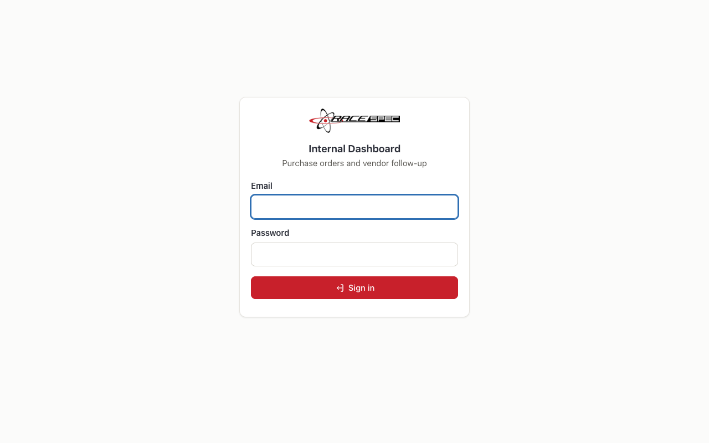

### TC-SIGN-02: A wrong password and an unknown email get the same message

**Priority:** Critical · **How:** Browser · **Refs:** ARCHITECTURE §10.1 · **Was:** Sign-in check #2, #3

**Steps**

1. Sign in as boss@example.com with a wrong password.
2. Sign in as nobody@example.com with any password.

**Expected:** Both say "The email or password is not right." word for word, and you stay on the sign-in page.

**Automated tests:** `test_auth.py::test_wrong_password_and_unknown_email_get_the_same_refusal`, `test_gate.py::test_wrong_password_and_unknown_email_look_the_same`

**Latest:** Claude, Chrome: Pass 11/12/2026. Owner: Pass 11/04/2026 (Safari, Chrome).

Screenshot

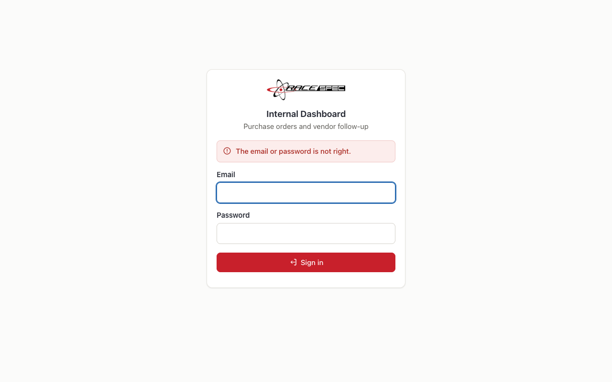

### TC-SIGN-03: Signing in opens Home, with the account menu at the top right

**Priority:** High · **How:** Browser · **Refs:** PD-1.9c, DEC-45 · **Was:** Sign-in check #4, #5; Design check #2

**Steps**

1. Sign in as boss@example.com with the right password.
2. Click the person icon at the top right; press Esc; open it again and click elsewhere.

**Expected:** Home opens. The menu shows the email, Change password and Sign out. Esc closes it, and so does a click elsewhere.

**Automated tests:** `test_gate.py::test_sign_in_sets_a_locked_down_cookie_and_opens_the_home_page`

**Latest:** Claude, Chrome: Pass 11/12/2026. Owner: Pass 11/06/2026.

Screenshot

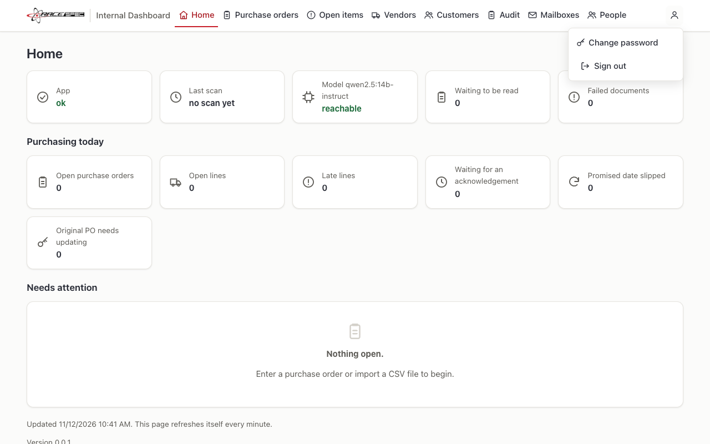

### TC-SIGN-04: An admin adds a person and sees the temporary password once

**Priority:** Critical · **How:** Browser · **Refs:** PD-1.9b, ARCHITECTURE §10.1 · **Was:** Sign-in check #6, #7

**Steps**

1. As boss, open People.
2. Add buyer@example.com as a buyer.
3. Click People again.

**Expected:** A 20-character temporary password is shown once. After clicking People again it is gone and cannot be shown again. Reload repeats nothing.

**Automated tests:** `test_gate.py::test_admin_adds_a_person_and_sees_the_temporary_password_once`, `test_gate.py::test_a_reload_after_adding_a_person_repeats_nothing`, `test_gate.py::test_the_shown_password_expires_and_belongs_to_one_admin`

**Latest:** Claude, Chrome: Pass 11/12/2026. Owner: Pass 11/04/2026 (Safari, Chrome).

Screenshot

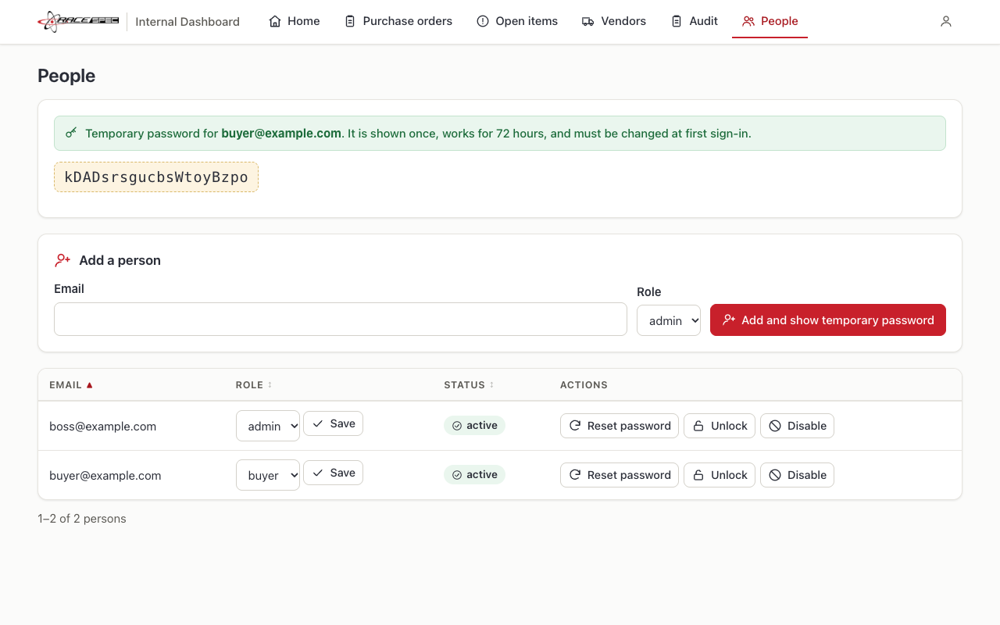

### TC-SIGN-05: A temporary password leads only to Change password, which refuses a weak password

**Priority:** Critical · **How:** Browser · **Refs:** PD-1.9b · **Was:** Sign-in check #8, #9, #10

**Steps**

1. Sign out, then sign in as buyer@example.com with the temporary password.
2. Click Home.
3. Try the new password abc.
4. Choose a good new password of 12 or more characters.

**Expected:** Change password opens, and Home sends you back to it. abc is refused with a reason (the browser asks for 12 or more characters before anything is sent). The good password opens Home, and a buyer has no People link.

**Automated tests:** `test_gate.py::test_a_temporary_password_can_reach_nothing_until_it_is_changed`, `test_auth.py::test_weak_passwords_are_refused`, `test_auth.py::test_changing_the_password_ends_other_sessions_and_clears_the_flag`

**Latest:** Claude, Chrome: Pass 11/12/2026. Owner: Pass 11/04/2026 (Safari, Chrome).

Screenshot

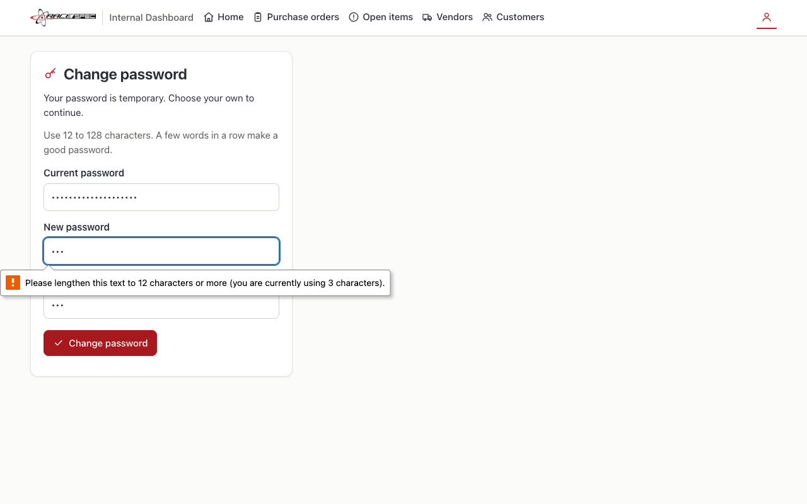

### TC-SIGN-06: A buyer cannot open the admin screens

**Priority:** Critical · **How:** Browser · **Refs:** ARCHITECTURE §10.1 · **Was:** Sign-in check #11; PO check #44

**Steps**

1. As a buyer, type /admin/users in the address bar.
2. Type /admin/audit.

**Expected:** Both are refused with a page headed "Admins only" and a Go to Home button (never raw code). The top bar shows no People or Audit link to a buyer.

**Automated tests:** `test_gate.py::test_a_buyer_gets_403_on_the_admin_screens`, `test_gate.py::test_a_refusal_in_the_browser_is_a_page_not_raw_json`, `test_audit_screen.py::test_a_buyer_and_a_stranger_cannot_see_it`

**Latest:** Claude, Chrome: Pass 11/12/2026. Owner: Pass 11/05/2026 (Safari, Chrome), before DEF-002 was found: retest needed.

Screenshot

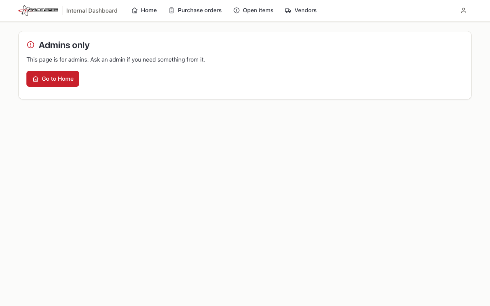

### TC-SIGN-07: A disabled person is cut off and gets the ordinary refusal

**Priority:** Critical · **How:** Browser · **Refs:** PD-1.9b · **Was:** Sign-in check #12

**Steps**

1. As boss, on People, press Disable for the buyer.
2. Try to sign in as the buyer with the right password.
3. As boss, press Enable.

**Expected:** The buyer gets "The email or password is not right." After Enable the buyer can sign in again.

**Automated tests:** `test_auth.py::test_a_disabled_account_gets_the_ordinary_refusal`, `test_gate.py::test_a_disabled_person_is_cut_off_at_once`

**Latest:** Claude, Chrome: Pass 11/12/2026. Owner: Pass 11/04/2026 (Safari, Chrome).

Screenshot

### TC-SIGN-08: Five wrong passwords lock the account, even against the right one, until 15 minutes pass or an admin unlocks it

**Priority:** Critical · **How:** Browser · **Refs:** ARCHITECTURE §10.1 · **Was:** Sign-in check #13, #14

**Steps**

1. Sign in as the buyer with a wrong password 5 times.
2. Then use the right password.
3. As boss, press Unlock for the buyer; sign in as the buyer.

**Expected:** "Too many wrong attempts. Try again in 15 minutes." The right password is still refused while locked. After Unlock the buyer signs in.

**Automated tests:** `test_auth.py::test_five_failures_lock_the_account_even_for_the_right_password`, `test_gate.py::test_five_wrong_passwords_lock_the_account_in_the_browser_too`

**Latest:** Claude, Chrome: Pass 11/12/2026. Owner: Pass 11/04/2026 (Safari, Chrome).

Screenshot

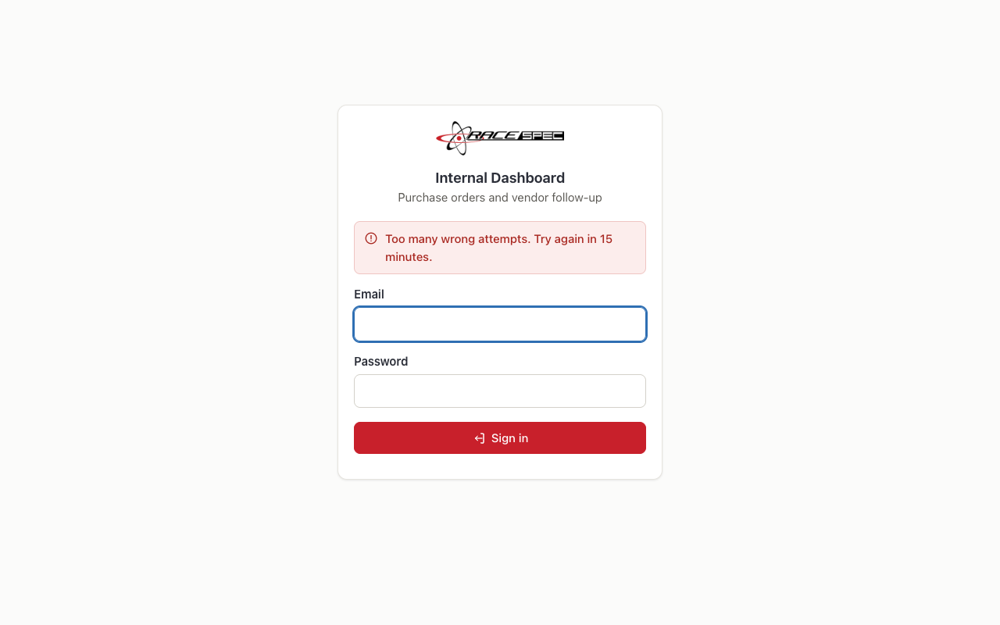

### TC-SIGN-09: 30 idle minutes sign a person out, even with a page that updates itself left open

**Priority:** High · **How:** Automated · **Refs:** ARCHITECTURE §10.1, DEC-45 · **Was:** Sign-in check #15; Design check #17 (optional, not yet done by hand)

**Steps**

1. Optional by hand: leave Home open and untouched for 31 minutes.
2. Covered by the tests named.

**Expected:** The tab moves to the sign-in page by itself. The page's own updates do not count as activity.

**Automated tests:** `test_auth.py::test_idle_and_absolute_expiry`, `test_web_standards.py::test_a_background_update_does_not_count_as_activity`, `test_web_standards.py::test_a_page_left_open_is_still_signed_out_after_30_idle_minutes`

**Latest:** Owner: not recorded.

### TC-SIGN-10: The session cookie is locked down, and the last admin cannot be removed

**Priority:** Critical · **How:** Automated · **Refs:** ARCHITECTURE §10.1 · **Was:** Sign-in check, things to look at

**Steps**

1. Covered by the tests named. By hand: in the browser's developer tools, the po_session cookie.

**Expected:** po_session is HttpOnly and SameSite Strict (Secure comes with HTTPS in Phase 6). The token changes at each stage. The last admin cannot be disabled or demoted, and an admin cannot disable themselves.

**Automated tests:** `test_gate.py::test_sign_in_sets_a_locked_down_cookie_and_opens_the_home_page`, `test_gate.py::test_the_session_token_changes_at_each_stage`, `test_auth.py::test_the_last_admin_cannot_be_disabled_or_demoted`, `test_auth.py::test_an_admin_cannot_disable_themselves`

**Latest:** Owner: Pass 11/04/2026 (Safari, Chrome).

### TC-SIGN-11: Sign out, then sign in again, with no security-token error

**Priority:** Medium · **How:** Browser · **Refs:** DEC-45 · **Was:** Design check #22

**Steps**

1. Person icon, Sign out.
2. Sign in again.

**Expected:** The sign-in page, then Home. No "security token" error.

**Automated tests:** `test_gate.py::test_sign_out_ends_the_session`, `test_gate.py::test_a_new_sign_in_never_reuses_a_token`

**Latest:** Claude, Chrome: Pass 11/12/2026. Owner: Pass 11/06/2026.

Screenshot

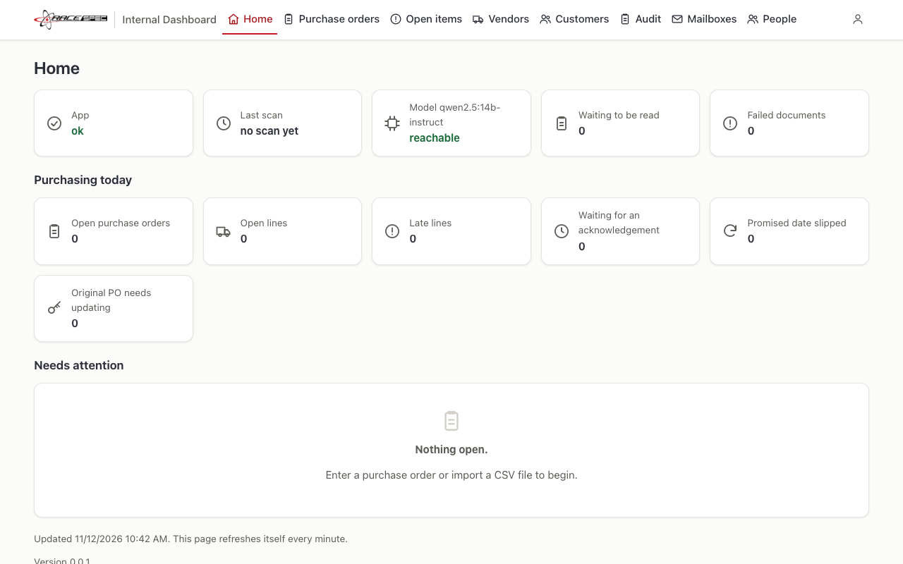

## Vendor import

### TC-VIMP-01: A vendor file (Excel or CSV) creates the vendors with their domains

**Priority:** High · **How:** Browser · **Refs:** DEC-44, DEC-47, PD-1.11 · **Was:** PO check #45, #46; QuickBooks check #1

**Steps**

1. Vendors, Import vendors.
2. Choose tests/data/vendors_sample.xlsx and press Import.

**Expected:** The cursor starts on the file chooser. In place, with no page reload: "Done. 3 created" (Acme Fasteners, Northwind Metals, Initech Tools), and the Vendors page lists them with the domains of their emails.

**Automated tests:** `test_vendor_import.py::test_a_new_vendor_is_created_with_its_domains_and_the_domain_of_its_contact_email`, `test_sheets.py::test_vendors_can_be_uploaded_as_an_excel_file`, `test_vendor_import.py::test_the_page_opens_with_the_cursor_on_the_file_chooser_and_offers_a_template`

**Latest:** Claude, Chrome: Pass 11/12/2026. Owner: Pass 11/06/2026 (CSV); the .xlsx file: no problem reported 11/07/2026.

Screenshot

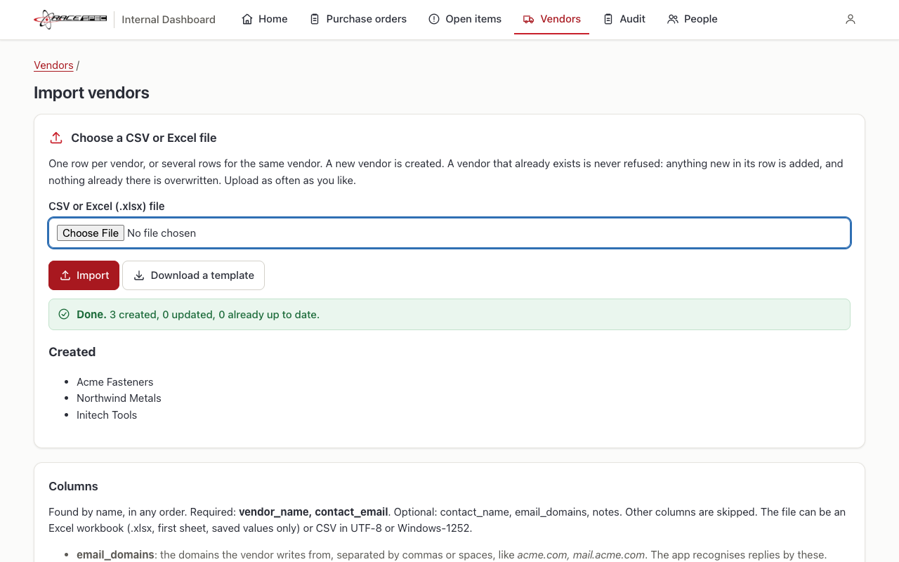

### TC-VIMP-02: Uploading the same vendor file again changes nothing

**Priority:** Critical · **How:** Browser · **Refs:** DEC-44 · **Was:** PO check #47

**Steps**

1. Upload tests/data/vendors_sample.xlsx again.

**Expected:** "0 created, 0 updated, 3 already up to date". Nothing is duplicated.

**Automated tests:** `test_vendor_import.py::test_uploading_the_same_file_again_changes_nothing`

**Latest:** Claude, Chrome: Pass 11/12/2026. Owner: Pass 11/06/2026.

Screenshot

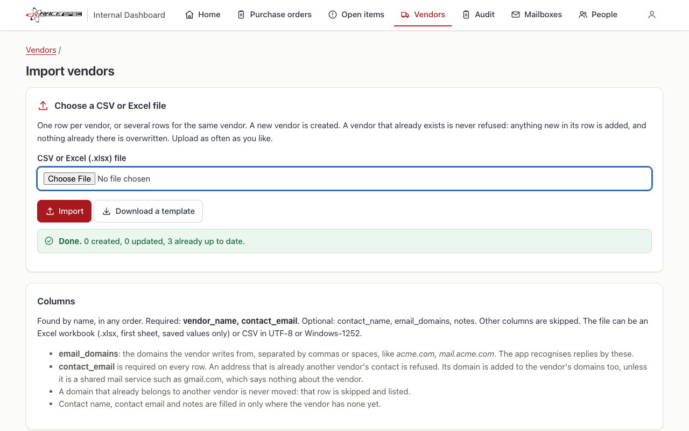

### TC-VIMP-03: Each vendor row needs an email, and an email or domain held by another vendor skips only that row

**Priority:** Critical · **How:** Browser · **Refs:** DEC-44, OPEN-19 · **Was:** PO check #49, #50, #51

**Steps**

1. Upload tests/data/vendors_problems.csv: one row with no contact_email, one whose email is Acme's contact email, one whose email_domains is Northwind's domain, and one good new vendor (Umbrella Freight).

**Expected:** The first three are listed with their reasons ("Contact email is required", "already the contact email of ...", "already belongs to ...") and skipped. Umbrella Freight is created.

**Automated tests:** `test_vendor_import.py::test_the_vendor_name_and_an_email_are_required`, `test_vendor_import.py::test_an_email_already_the_contact_of_another_vendor_is_refused`, `test_vendor_import.py::test_a_domain_owned_by_another_vendor_skips_only_that_row`

**Latest:** Claude, Chrome: Pass 11/12/2026. Owner: Pass 11/06/2026.

Screenshot

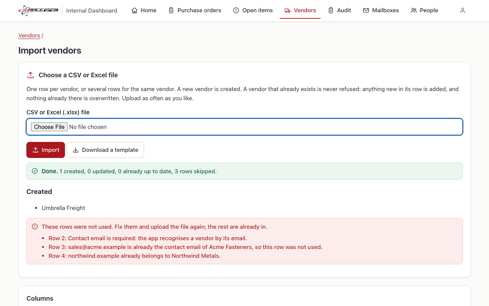

### TC-VIMP-04: An existing vendor with a new email gets the new domain, and its other details are kept

**Priority:** High · **How:** Automated · **Refs:** DEC-44 · **Was:** PO check #48

**Steps**

1. Covered by the tests named. By hand: a row for an existing vendor with an email at a new domain.

**Expected:** The vendor is updated, not refused: the new domain is added; existing details are not overwritten.

**Automated tests:** `test_vendor_import.py::test_an_existing_vendor_with_a_new_email_gets_the_new_domain_added`, `test_vendor_import.py::test_blank_contact_details_are_filled_but_existing_ones_are_not_overwritten`

**Latest:** Owner: Pass 11/06/2026.

### TC-VIMP-05: An old Excel file (.xls) is refused with what to do

**Priority:** Medium · **How:** Browser · **Refs:** DEC-47 · **Was:** QuickBooks check #2

**Steps**

1. Upload a file saved in the old .xls format.

**Expected:** "This is the old Excel format (.xls) ... Save it as .xlsx or CSV." Nothing changes.

**Automated tests:** `test_sheets.py::test_files_that_are_not_readable_spreadsheets_are_refused`

**Latest:** Claude, Chrome: Pass 11/12/2026. Owner: No problem reported 11/07/2026 (QuickBooks check step 2).

Screenshot

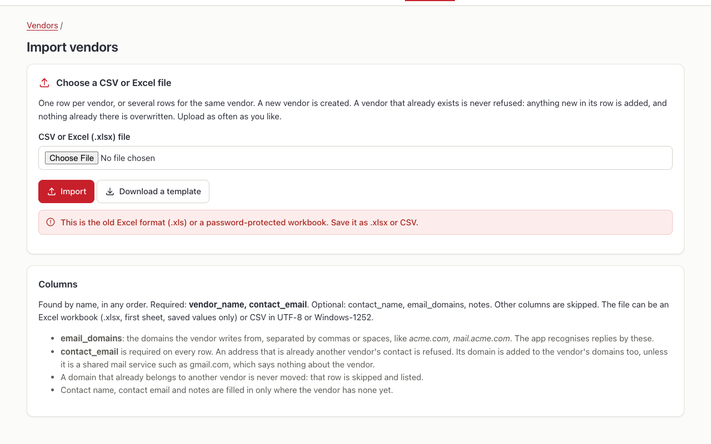

## Vendors

### TC-VEN-01: A vendor is added on its own page and lands on its vendor page

**Priority:** High · **How:** Browser · **Refs:** REQ-PO-04, PD-1.2, DEC-45 · **Was:** PO check #1, #2; Design check #3

**Steps**

1. Vendors, Add a vendor.
2. Name Contoso Bearings, domains contoso.example, mail.contoso.example; Add vendor.

**Expected:** The cursor starts in Name. You land on the vendor page showing both domains.

**Automated tests:** `test_orders_web.py::test_a_vendor_is_added_and_listed_with_its_domains`, `test_orders_web.py::test_each_new_form_page_has_the_cursor_ready_in_one_box`

**Latest:** Claude, Chrome: Pass 11/12/2026. Owner: Pass 11/05/2026 (Safari, Chrome).

Screenshot

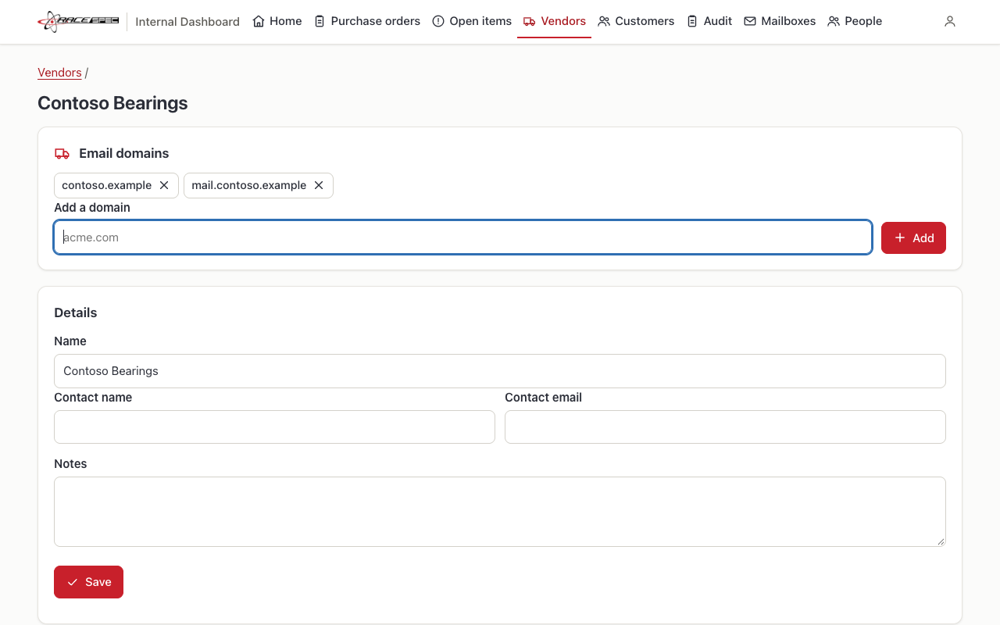

### TC-VEN-02: A vendor name that already exists, in any case, is refused and the boxes keep what was typed

**Priority:** High · **How:** Browser · **Refs:** PD-1.2 · **Was:** PO check #3

**Steps**

1. Add a vendor named contoso bearings (other case).

**Expected:** "A vendor with that name already exists", and every box keeps what you typed.

**Automated tests:** `test_orders.py::test_a_vendor_name_is_unique_ignoring_case`, `test_orders_web.py::test_a_refused_vendor_keeps_what_was_typed_and_says_why`

**Latest:** Claude, Chrome: Pass 11/12/2026. Owner: Pass 11/05/2026 (Safari, Chrome).

Screenshot

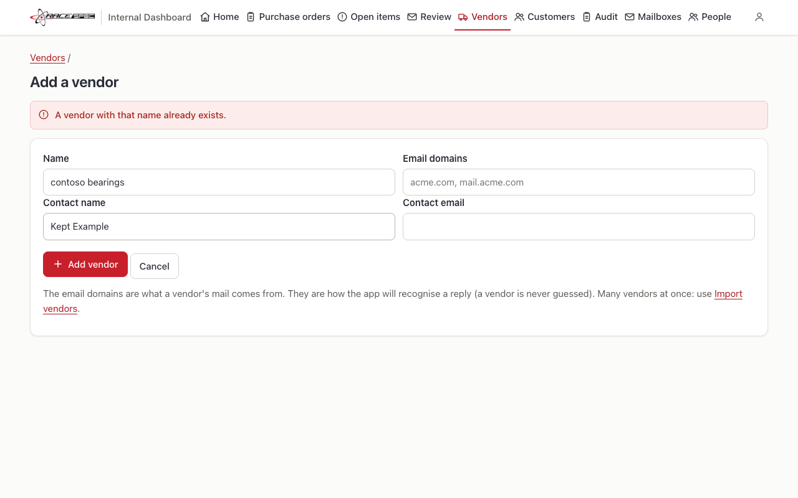

### TC-VEN-03: A domain belongs to one vendor only, so a reply can never match the wrong vendor

**Priority:** Critical · **How:** Browser · **Refs:** REQ-ACK-05, PD-1.2 · **Was:** Design check #9

**Steps**

1. On Contoso Bearings' page, add the domain northwind.example (Northwind Metals' domain, from the vendor file).

**Expected:** A red message says it already belongs to Northwind Metals, shown in view. Nothing is added.

**Automated tests:** `test_orders.py::test_a_domain_belongs_to_one_vendor`, `test_orders_web.py::test_adding_a_domain_already_held_in_any_case_says_so`

**Latest:** Claude, Chrome: Pass 11/12/2026. Owner: Pass 11/06/2026.

Screenshot

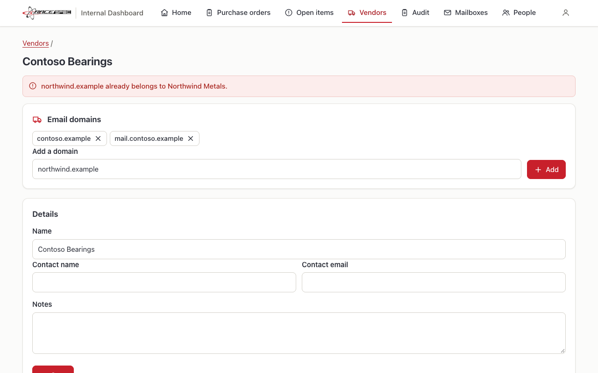

### TC-VEN-04: Domains are checked, added and removed on the vendor page

**Priority:** Medium · **How:** Browser · **Refs:** PD-1.2 · **Was:** PO check #4, #4b

**Steps**

1. On Contoso Bearings' page add the domain not a domain.
2. Add contoso.co.uk, then press it to remove it.
3. Add CONTOSO.example (other case).

**Expected:** not a domain is refused with a reason. contoso.co.uk appears, then goes. CONTOSO.example says "contoso.example is already added to this vendor".

**Automated tests:** `test_orders.py::test_a_domain_must_look_like_one`, `test_orders_web.py::test_domains_are_added_and_removed_from_the_vendor_page`

**Latest:** Claude, Chrome: Pass 11/12/2026. Owner: Pass 11/05/2026 (Safari, Chrome).

Screenshot

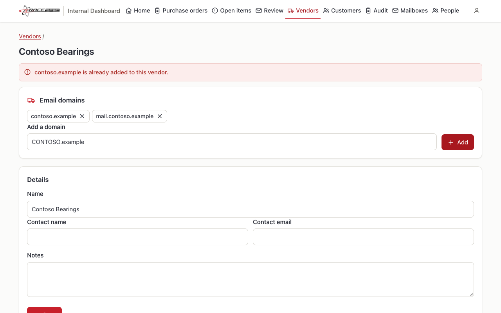

### TC-VEN-05: Saving a vendor shows a Saved note and the page does not jump

**Priority:** Medium · **How:** Browser · **Refs:** DEC-45 · **Was:** PO check #4b; Design check #8

**Steps**

1. On Contoso Bearings' page, change Notes and press Save.

**Expected:** A green Saved note that fades after about 3 seconds. The page stays where it was. The change is in the audit trail.

**Automated tests:** `test_orders_web.py::test_a_save_shows_a_fixed_saved_note_that_cannot_be_forged`, `test_orders_web.py::test_a_vendor_can_be_edited_and_the_change_is_audited_with_who_and_where`

**Latest:** Claude, Chrome: Pass 11/12/2026. Owner: Pass 11/06/2026.

Screenshot

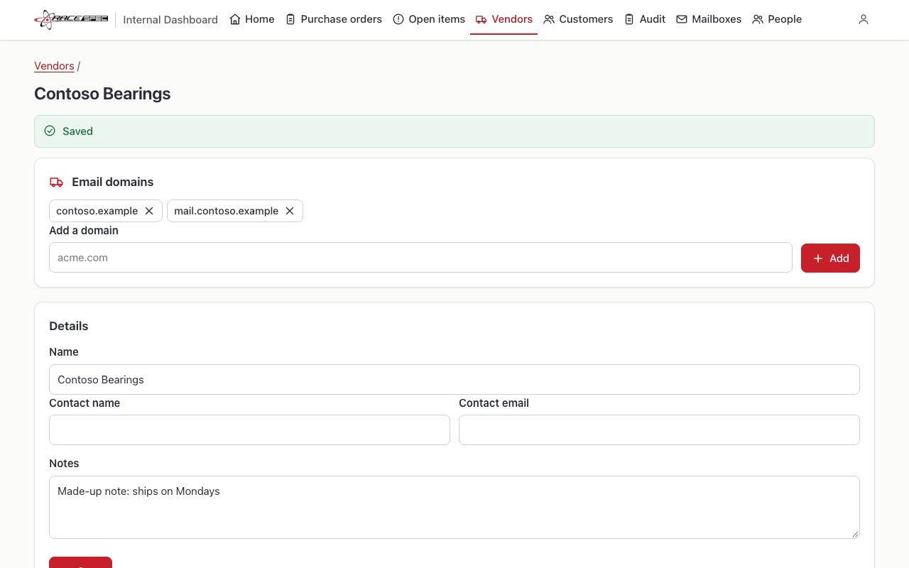

### TC-VEN-06: A vendor with no domain is marked, because its replies cannot be matched

**Priority:** High · **How:** Browser · **Refs:** REQ-ACK-05 · **Was:** PO check #5

**Steps**

1. Add a vendor Hooli Plastics with no domains and no email.
2. Look at the Vendors list.

**Expected:** It is listed, marked "no domain: replies cannot be matched".

**Automated tests:** `test_orders_web.py::test_a_vendor_is_added_and_listed_with_its_domains`

**Latest:** Claude, Chrome: Pass 11/12/2026. Owner: Pass 11/05/2026 (Safari, Chrome).

Screenshot

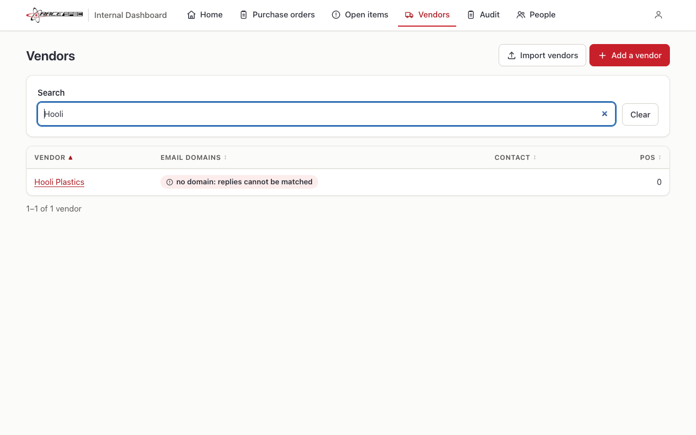

### TC-VEN-07: The vendor list searches as you type, sorts by heading, and / jumps to search

**Priority:** Medium · **How:** Browser · **Refs:** DEC-45 · **Was:** Design check #5, #6, #7

**Steps**

1. On Vendors type north in the search box and wait.
2. Press Back.
3. Click a blank part of the page and press /.
4. Click the Vendor heading twice.

**Expected:** Only Northwind shows and the address has ?q=north; Back shows the full list. / puts the cursor in search. The heading shows ▲ then ▼ and the order reverses.

**Automated tests:** `test_vendor_import.py::test_vendor_search_finds_by_name_or_domain_and_treats_wildcards_as_text`, `test_web_standards.py::test_a_heading_sorts_and_a_second_click_reverses`

**Latest:** Claude, Chrome: Pass 11/12/2026. Owner: Pass 11/06/2026.

Screenshot

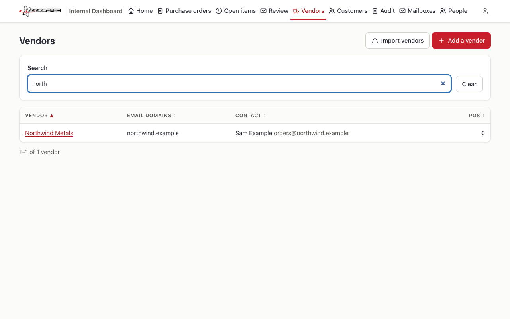

### TC-VEN-08: Markup typed into a vendor name is shown as text, never run

**Priority:** Critical · **How:** Browser · **Refs:** Security · **Was:** PO check #16

**Steps**

1. Add a vendor named <b>Bold</b>.
2. Look at the vendor list and the vendor page.

**Expected:** The name shows literally as <b>Bold</b>, not in bold.

**Automated tests:** `test_vendor_import.py::test_markup_in_a_vendor_name_is_shown_as_text`, `test_orders_web.py::test_what_people_type_is_escaped_everywhere_it_is_shown`

**Latest:** Claude, Chrome: Pass 11/12/2026. Owner: Pass 11/05/2026 (Safari, Chrome).

Screenshot

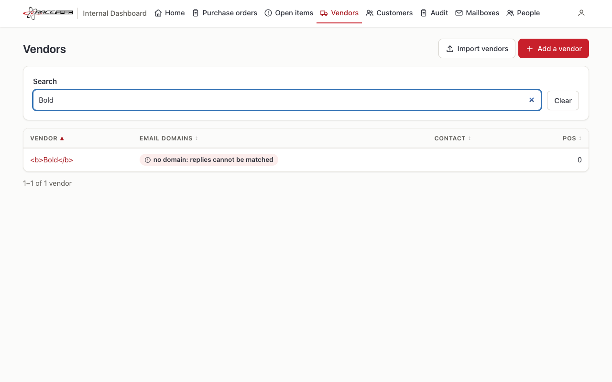

## Purchase orders

### TC-PO-01: A PO entered by hand keeps exact numbers and starts as Sent

**Priority:** Critical · **How:** Browser · **Refs:** REQ-PO-01, PD-1.2 · **Was:** PO check #6, #8

**Steps**

1. Purchase orders, New purchase order.
2. PO number PO-1001, vendor Acme (pick it from the list), currency usd, date sent a few days ago, line 1: Bolt, quantity 10.5, unit EA, price 2.5. Create.

**Expected:** The cursor starts in PO number; Buyer is your email. The PO page shows PO PO-1001, currency USD, the line as 10.5 EA at 2.50 USD, status Sent.

**Automated tests:** `test_orders_web.py::test_a_po_is_entered_and_its_page_shows_lines_in_exact_numbers`, `test_orders.py::test_a_po_is_created_with_its_lines_in_order`

**Latest:** Claude, Chrome: Pass 11/12/2026. Owner: Pass 11/05/2026 (Safari, Chrome).

Screenshot

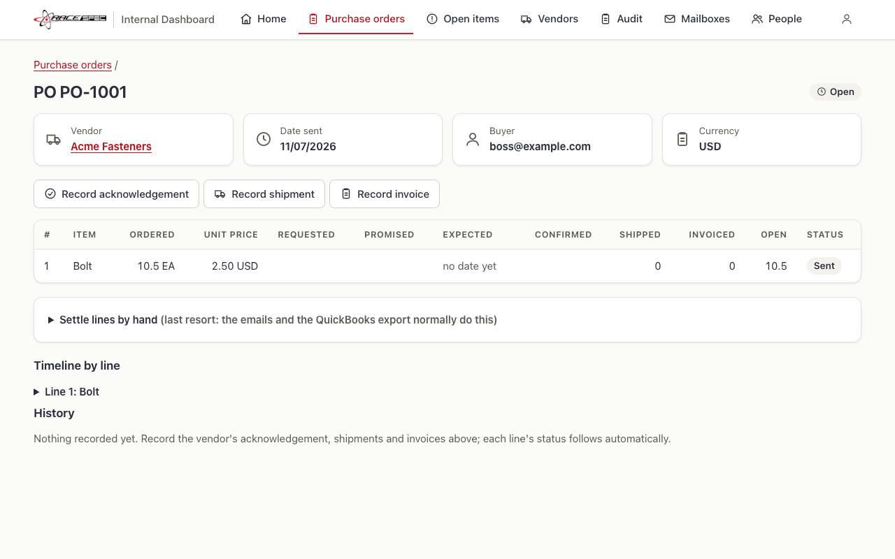

### TC-PO-02: Reload after creating a PO never creates a second one

**Priority:** Critical · **How:** Browser · **Refs:** DEC-45 · **Was:** PO check #9; Design check #13

**Steps**

1. On the new PO's page press Reload a few times.
2. Open Purchase orders and search PO-1001.

**Expected:** The page just reloads. There is exactly one PO-1001.

**Automated tests:** `test_orders_web.py::test_reloading_after_creating_a_po_does_not_create_another`

**Latest:** Claude, Chrome: Pass 11/12/2026. Owner: Pass 11/06/2026.

Screenshot

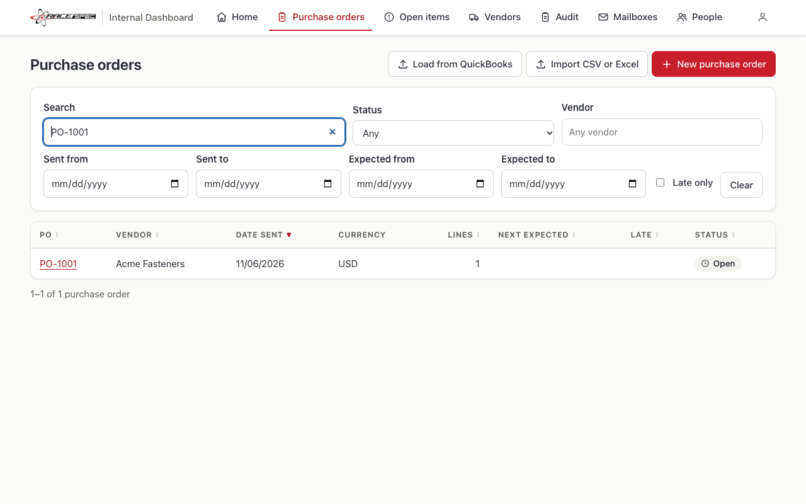

### TC-PO-03: A wrong line value is refused naming the line and field, and every box keeps what was typed

**Priority:** High · **How:** Browser · **Refs:** PD-1.2, DEC-45 · **Was:** PO check #7, #27; Design check #14

**Steps**

1. New purchase order PO-1002, vendor Acme, line 1 with quantity 0. Create.

**Expected:** "Line 1: Quantity must be more than zero" at the top, with the cursor on it. Every box keeps its value. Back and Forward give no 'page not found'.

**Automated tests:** `test_orders_web.py::test_a_refused_po_keeps_every_box_and_lists_every_problem`, `test_orders.py::test_a_bad_line_value_is_refused_naming_the_line_and_field`

**Latest:** Claude, Chrome: Pass 11/12/2026. Owner: Pass 11/06/2026.

Screenshot

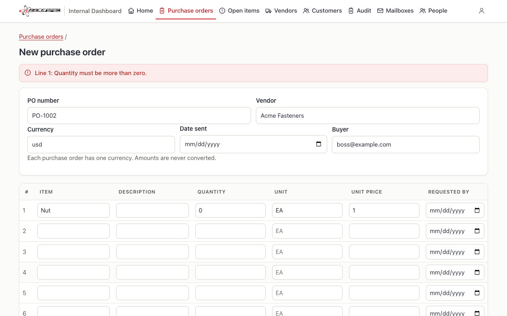

### TC-PO-04: More than 4 decimal places is refused; nothing is ever rounded

**Priority:** Critical · **How:** Browser · **Refs:** ARCHITECTURE §4 (exact numbers) · **Was:** PO check #10

**Steps**

1. New purchase order with a quantity of 1.00001. Create.

**Expected:** Refused: at most 4 decimal places are kept; nothing is rounded.

**Automated tests:** `test_ledger.py::test_too_many_decimal_places_are_refused_not_rounded`, `test_ledger.py::test_floats_and_other_inexact_values_are_refused`, `test_orders.py::test_the_numbers_in_a_file_are_exact`

**Latest:** Claude, Chrome: Pass 11/12/2026. Owner: Pass 11/05/2026 (Safari, Chrome).

Screenshot

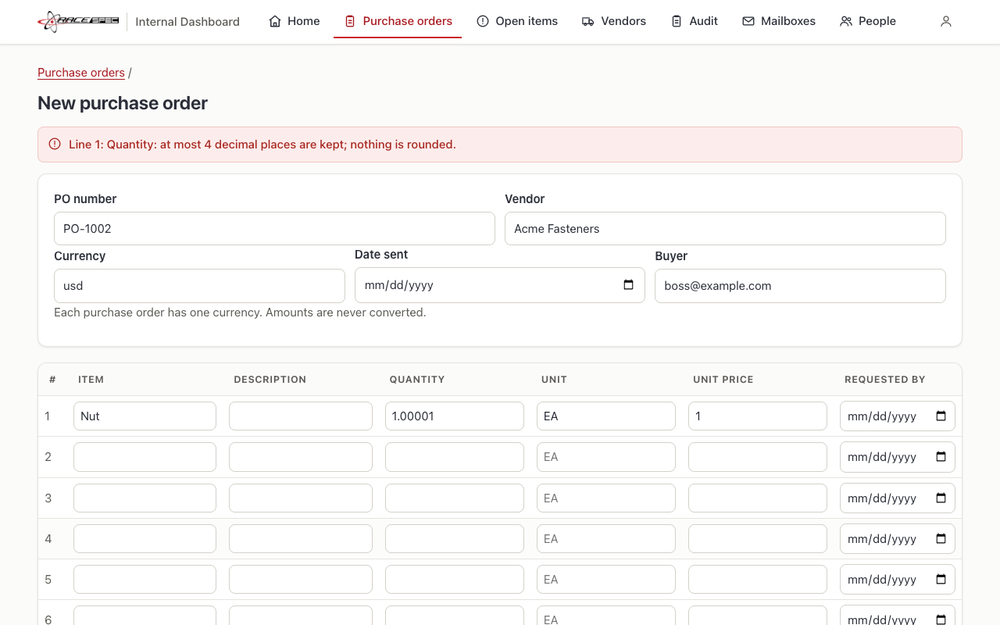

### TC-PO-05: The vendor box searches as you type, and a name not picked from the list is refused

**Priority:** High · **How:** Browser · **Refs:** PD-1.12 · **Was:** PO check #52, #53; Design check #12, #13

**Steps**

1. New purchase order: type acm in Vendor; press the down arrow and Enter.
2. Then type Acme without picking it, and press Create.

**Expected:** A short list appears under the box and Enter picks Acme Fasteners. Unpicked, the box says "Pick a vendor from the list."

**Automated tests:** `test_vendor_import.py::test_the_po_form_and_filters_use_the_search_box_not_a_long_list`

**Latest:** Claude, Chrome: Pass 11/12/2026. Owner: Pass 11/06/2026.

Screenshot

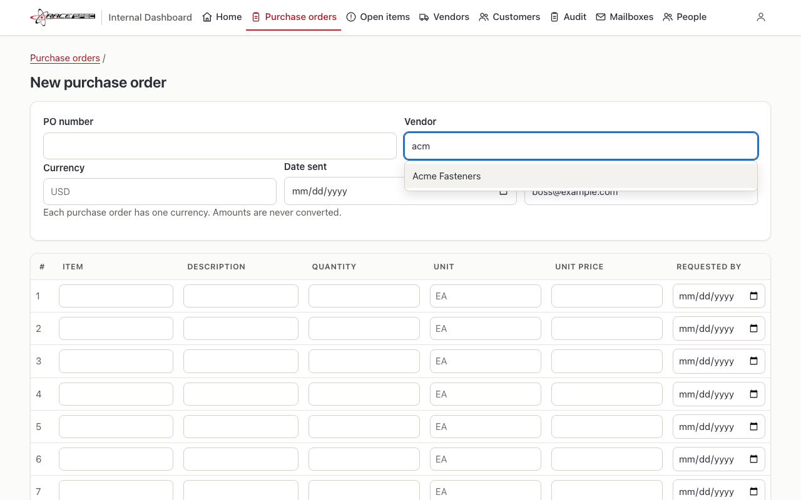

### TC-PO-06: An existing PO number is refused in any case

**Priority:** Critical · **How:** Automated · **Refs:** REQ-PO-02

**Steps**

1. Covered by the tests named. By hand: a new PO with the number po-1001.

**Expected:** Refused; the existing PO is not touched.

**Automated tests:** `test_orders_web.py::test_an_existing_po_number_is_refused_in_any_case`, `test_ledger.py::test_a_po_number_is_unique`

**Latest:** Owner: not recorded.

### TC-PO-07: The PO list filters as you choose, reads dates as MM/DD/YYYY, and Clear resets it

**Priority:** High · **How:** Browser · **Refs:** DEC-45, PD-1.5 · **Was:** PO check #15, #28, #29; Design check #11

**Steps**

1. Purchase orders: type 1001 in Search; choose a Status; pick a Sent from date from the calendar.
2. Press Clear.
3. Search for %.

**Expected:** The cursor starts in Search. The list follows each choice with no Show button. Dates read like 11/04/2026. Clear resets. % finds nothing ("No purchase orders match").

**Automated tests:** `test_web_standards.py::test_filters_update_the_list_in_place_and_keep_the_sort`, `test_orders_web.py::test_the_list_shows_open_and_closed_pos_and_searches_literally`, `test_expected.py::test_sent_dates_filter_and_a_wrong_value_is_reported_not_trusted`

**Latest:** Claude, Chrome: Pass 11/12/2026. Owner: Pass 11/06/2026.

Screenshot

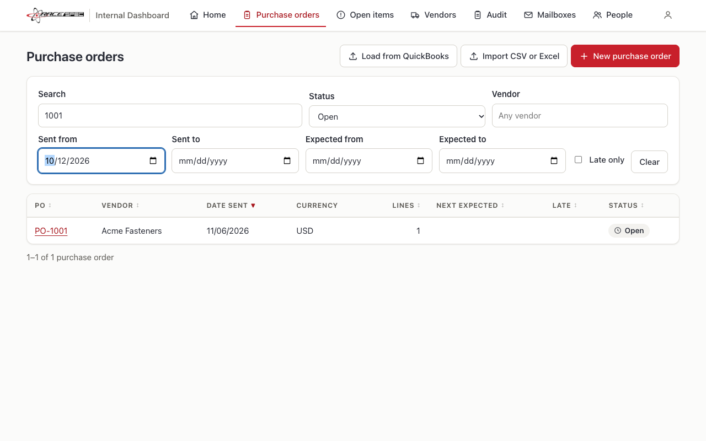

### TC-PO-08: The PO list shows 50 a page and sorts by any heading

**Priority:** Medium · **How:** Automated · **Refs:** DEC-45

**Steps**

1. Covered by the tests named; by hand with more than 50 POs.

**Expected:** "1–50 of N"; Next and Back move between pages; a heading sorts and a second click reverses; empty values sort last.

**Automated tests:** `test_web_standards.py::test_the_po_list_shows_50_a_page_and_says_how_many`, `test_web_standards.py::test_a_heading_sorts_and_a_second_click_reverses`, `test_web_standards.py::test_empty_values_sort_last_whichever_way`

**Latest:** Owner: not recorded.

### TC-PO-09: A buyer, not only an admin, can use Vendors and Purchase orders

**Priority:** High · **How:** Browser · **Refs:** ARCHITECTURE §10.1 · **Was:** PO check #17

**Steps**

1. Sign in as a buyer; open Vendors, Purchase orders and New purchase order.

**Expected:** Every page opens and works for the buyer.

**Automated tests:** `test_orders_web.py::test_a_buyer_not_only_an_admin_can_use_them`

**Latest:** Claude, Chrome: Pass 11/12/2026. Owner: Pass 11/05/2026 (Safari, Chrome).

Screenshot

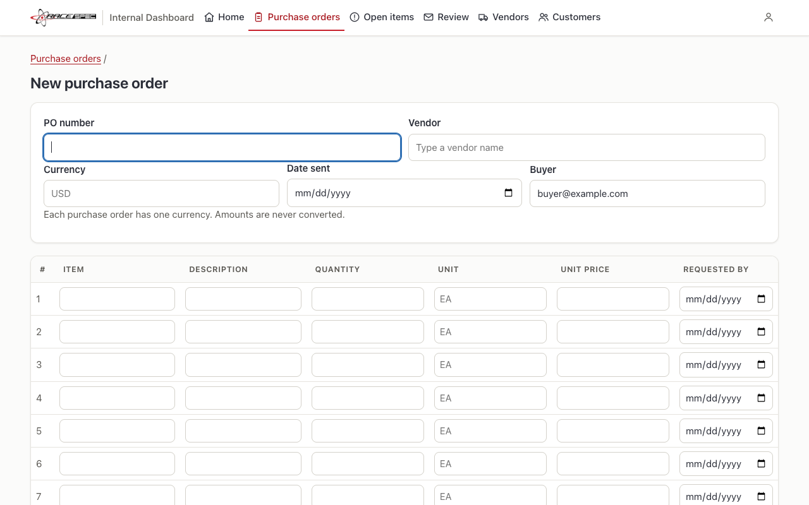

## Purchase order import

### TC-PIMP-01: A PO file imports every PO and line, and the template downloads

**Priority:** High · **How:** Browser · **Refs:** REQ-PO-02, DEC-47 · **Was:** PO check #11, #12; Design check #10

**Steps**

1. Purchase orders, Import CSV or Excel. Press Download a template.
2. Choose tests/data/purchase_orders_sample.csv and press Import.

**Expected:** The cursor is on the file chooser; the template downloads as a .csv file. You land on the PO list with "Imported 2 purchase orders" (PO-2001 and PO-2002).

**Automated tests:** `test_orders_web.py::test_a_csv_file_is_uploaded_and_the_person_lands_on_the_list`, `test_orders.py::test_the_sample_file_imports_every_po_and_line`, `test_orders_web.py::test_the_template_downloads_as_csv_and_names_every_column`

**Latest:** Claude, Chrome: Pass 11/12/2026. Owner: Pass 11/06/2026.

Screenshot

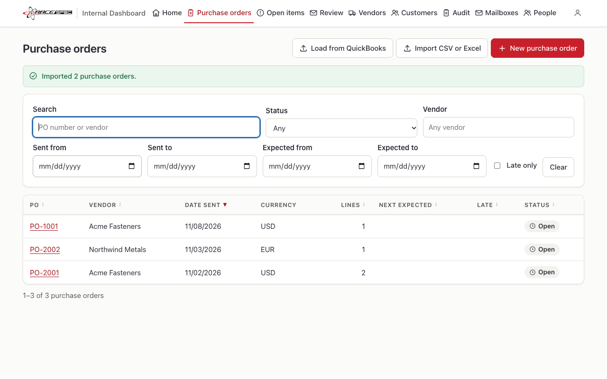

### TC-PIMP-02: Importing the same file again adds nothing and overwrites nothing

**Priority:** Critical · **How:** Browser · **Refs:** REQ-PO-02 · **Was:** PO check #13; Design check #10

**Steps**

1. Import tests/data/purchase_orders_sample.csv again.

**Expected:** The page stays on Import and lists "PO number PO-2001 already exists. Nothing is overwritten." Nothing is added.

**Automated tests:** `test_orders.py::test_an_existing_po_number_is_never_overwritten`

**Latest:** Claude, Chrome: Pass 11/12/2026. Owner: Pass 11/06/2026.

Screenshot

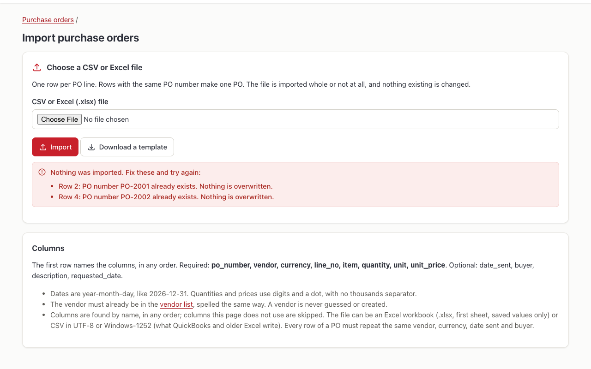

### TC-PIMP-03: One bad row rejects the whole file, naming the row

**Priority:** Critical · **How:** Browser · **Refs:** REQ-PO-02 · **Was:** PO check #14

**Steps**

1. Import tests/data/purchase_orders_bad_row.csv (a made-up file whose row 3 has the quantity abc).

**Expected:** "Row 3: Quantity: 'abc' is not a number" (the row named), and nothing is imported.

**Automated tests:** `test_orders.py::test_one_bad_row_rejects_the_whole_file_and_every_problem_is_listed`, `test_orders.py::test_a_file_that_fails_midway_leaves_nothing_behind`, `test_orders_web.py::test_a_bad_file_imports_nothing_and_the_page_lists_the_rows`

**Latest:** Claude, Chrome: Pass 11/12/2026. Owner: Pass 11/05/2026 (Safari, Chrome).

Screenshot

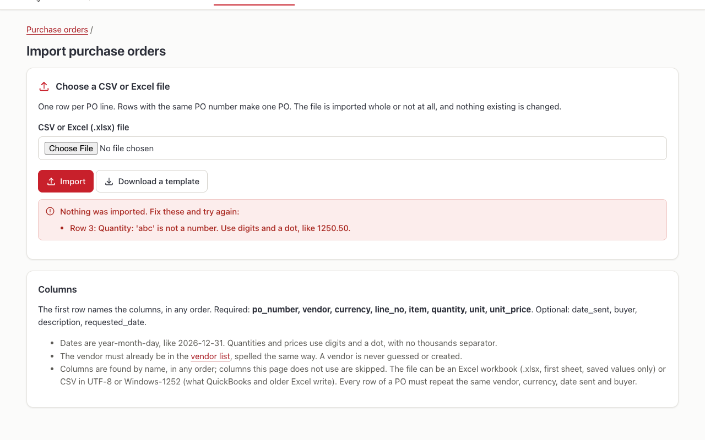

### TC-PIMP-04: A vendor not in the app is refused, never guessed or created

**Priority:** Critical · **How:** Automated · **Refs:** DEC-09: never guess

**Steps**

1. Covered by the tests named. By hand: a row whose vendor is not in the app.

**Expected:** The row is listed as an unknown vendor; nothing is imported and no vendor is created.

**Automated tests:** `test_orders.py::test_an_unknown_vendor_is_refused_not_guessed_or_created`

**Latest:** Owner: not recorded.

### TC-PIMP-05: Excel files with real date cells, Windows-1252 accents and formulas are read safely

**Priority:** High · **How:** Automated · **Refs:** DEC-47

**Steps**

1. Covered by the tests named.

**Expected:** Dates in Excel cells read correctly; accents from QuickBooks or older Excel are kept; a formula is stored as text and never run.

**Automated tests:** `test_sheets.py::test_purchase_orders_can_be_uploaded_as_an_excel_file_with_real_date_cells`, `test_orders.py::test_a_file_saved_by_quickbooks_or_old_excel_in_windows_1252_is_read_as_it_is`, `test_orders.py::test_a_spreadsheet_formula_is_stored_as_text_and_never_run`

**Latest:** Owner: not recorded.

### TC-PIMP-06: The QuickBooks report uploaded on Import CSV or Excel becomes the QuickBooks preview

**Priority:** High · **How:** Browser · **Refs:** DEC-46, PD-1.10a.5, DEF-001 · **Was:** QuickBooks check #15 (added after DEF-001)

**Steps**

1. Purchase orders, Import CSV or Excel (the button beside Load from QuickBooks).
2. Choose tests/data/quickbooks_open_pos_110526.csv and press Import.

**Expected:** No list of missing columns. The QuickBooks preview, headed "This file is the QuickBooks Open POs report, so it is read here ...", with nothing changed yet and the cursor on Create.

**Automated tests:** `test_quickbooks.py::test_the_report_uploaded_on_the_import_page_becomes_the_quickbooks_preview`, `test_quickbooks.py::test_a_file_that_is_neither_still_gets_the_import_pages_own_message`

**Latest:** Claude, Chrome: Pass 11/12/2026. Owner: Not yet run.

Screenshot

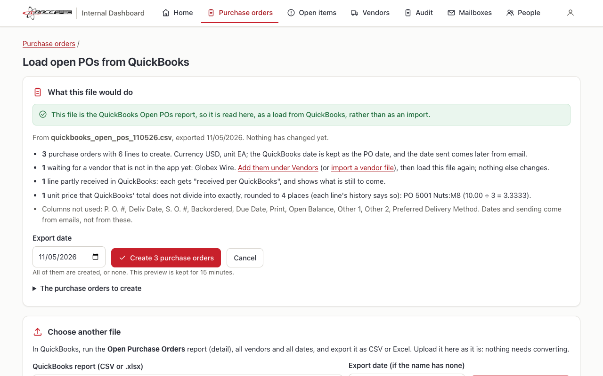

## QuickBooks starting load

### TC-QB-01: The preview shows what the file would do and changes nothing

**Priority:** Critical · **How:** Browser · **Refs:** DEC-46 · **Was:** QuickBooks check #3, #4, #5

**Steps**

1. Purchase orders, Load from QuickBooks.
2. Choose tests/data/quickbooks_open_pos_110526.csv and press Show what it would do.
3. In another tab, open Purchase orders.

**Expected:** "Nothing has changed yet". 3 purchase orders with 6 lines to create; 1 waiting for a vendor (Globex Wire); 1 line partly received; 1 price rounded (10.00 ÷ 3 = 3.3333); export date 11/05/2026 from the file name; the cursor on Create 3 purchase orders. The other tab shows no new POs.

**Automated tests:** `test_quickbooks.py::test_the_page_previews_then_creates_and_reload_cannot_repeat_it`, `test_quickbooks.py::test_the_plan_reads_lines_and_skips_headings_and_totals`

**Latest:** Claude, Chrome: Pass 11/12/2026. Owner: Step 4 failed 11/07/2026: DEF-001.

Screenshot

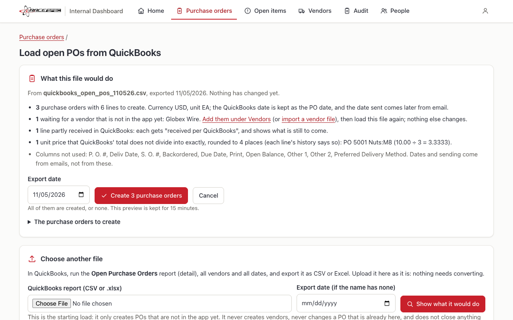

### TC-QB-02: Create loads all of them or none, and lands on the PO list

**Priority:** Critical · **How:** Browser · **Refs:** DEC-46 · **Was:** QuickBooks check #6

**Steps**

1. On the preview press Create 3 purchase orders.

**Expected:** "Loaded 3 purchase orders from QuickBooks. 1 is waiting for its vendor ..."; 5001, 5002 and 5004 are listed.

**Automated tests:** `test_quickbooks.py::test_the_load_creates_the_pos_as_the_owner_decided`, `test_quickbooks.py::test_a_failure_part_way_creates_nothing`

**Latest:** Claude, Chrome: Pass 11/12/2026. Owner: Not yet run.

Screenshot

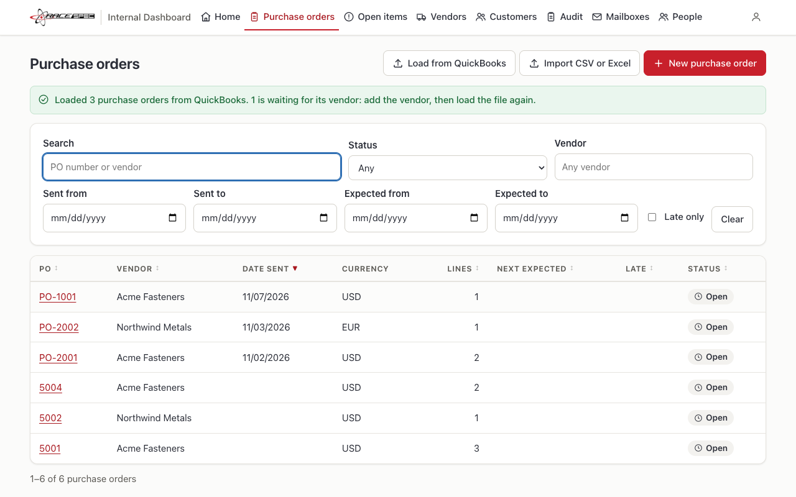

### TC-QB-03: Back and Create again can never load the file twice

**Priority:** Critical · **How:** Browser · **Refs:** DEC-46 · **Was:** QuickBooks check #7

**Steps**

1. After Create, press the browser's Back, then Create again if it shows.

**Expected:** "That preview has expired or was already used." Still three POs, never six.

**Automated tests:** `test_quickbooks.py::test_the_page_previews_then_creates_and_reload_cannot_repeat_it`, `test_quickbooks.py::test_one_persons_preview_cannot_be_used_by_another`, `test_quickbooks.py::test_a_preview_expires_after_15_minutes`

**Latest:** Claude, Chrome: Pass 11/12/2026. Owner: Not yet run.

Screenshot

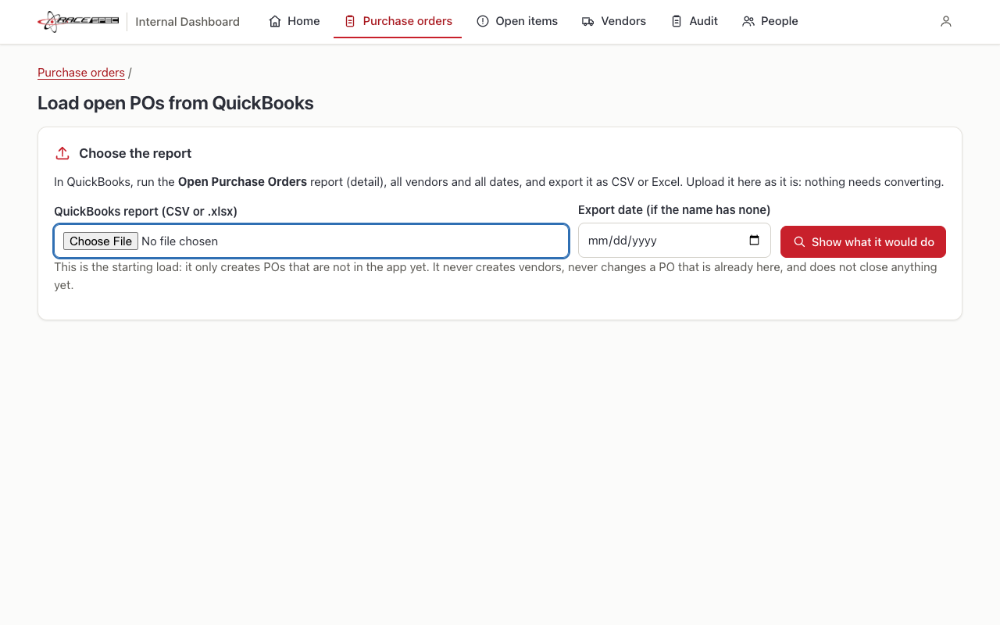

### TC-QB-04: A loaded PO keeps the QuickBooks date, the customer, and what was already received

**Priority:** High · **How:** Browser · **Refs:** DEC-46 · **Was:** QuickBooks check #8

**Steps**

1. Open PO 5002.

**Expected:** Date sent: not set; PO date (QuickBooks): 10/22/2026. The line reads "Sheet:Alu 2mm · for Café Racing" (accent right), status Partially shipped. History has "Received per QuickBooks export of 11/05/2026".

**Automated tests:** `test_quickbooks.py::test_the_po_page_shows_the_quickbooks_date_the_customer_and_the_history`

**Latest:** Claude, Chrome: Pass 11/12/2026. Owner: Not yet run.

Screenshot

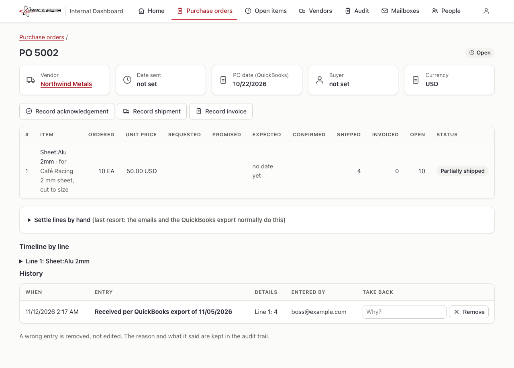

### TC-QB-05: A unit price that cannot be exact is rounded to 4 places, and the line's history says so

**Priority:** Critical · **How:** Browser · **Refs:** DEC-46 · **Was:** QuickBooks check #9

**Steps**

1. Open PO 5001, Timeline by line, line 2.

**Expected:** "Unit price 3.3333 worked out from the QuickBooks total 10.00 ÷ 3, rounded (export of 11/05/2026)". The lines are Bolts, Nuts, Washers in file order, unit EA.

**Automated tests:** `test_quickbooks.py::test_a_unit_price_is_exact_or_rounded_to_four_places`

**Latest:** Claude, Chrome: Pass 11/12/2026. Owner: Not yet run.

Screenshot

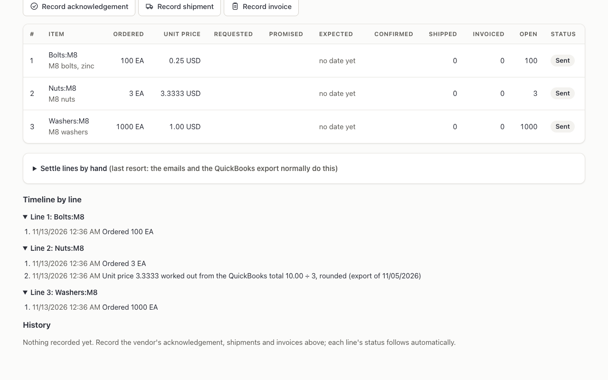

### TC-QB-06: Loaded POs are not flagged for an acknowledgement the app never had the chance to see

**Priority:** High · **How:** Browser · **Refs:** DEC-46 · **Was:** QuickBooks check #10

**Steps**

1. Go Home after the load.

**Expected:** The loaded POs are not listed as waiting for an acknowledgement.

**Automated tests:** `test_quickbooks.py::test_loaded_pos_are_not_flagged_for_an_acknowledgement_the_app_never_saw`

**Latest:** Claude, Chrome: Pass 11/12/2026. Owner: Not yet run.

Screenshot

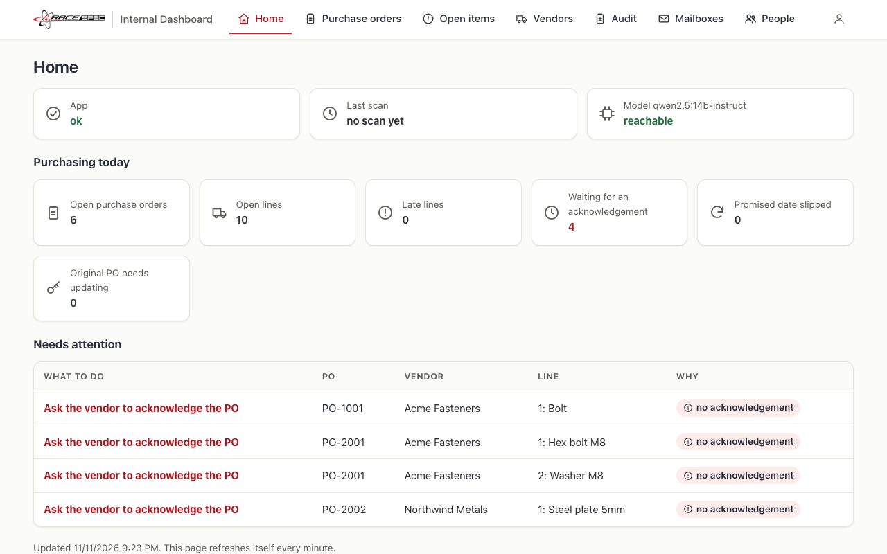

### TC-QB-07: Loading the same file again creates nothing; adding the waiting vendor lets its PO in

**Priority:** Critical · **How:** Browser · **Refs:** DEC-46 · **Was:** QuickBooks check #11, #12

**Steps**

1. Load the same file again.
2. Add the vendor Globex Wire (any email), load the file again and Create.

**Expected:** First: "Nothing new to create", 3 already in the app, Globex still waiting, no Create button. Then: 1 to create (5003); after Create there are four POs.

**Automated tests:** `test_quickbooks.py::test_loading_again_changes_nothing_and_a_new_vendor_lets_a_waiting_po_in`, `test_quickbooks.py::test_a_po_number_already_in_the_app_is_never_changed`

**Latest:** Claude, Chrome: Pass 11/12/2026. Owner: Not yet run.

Screenshot

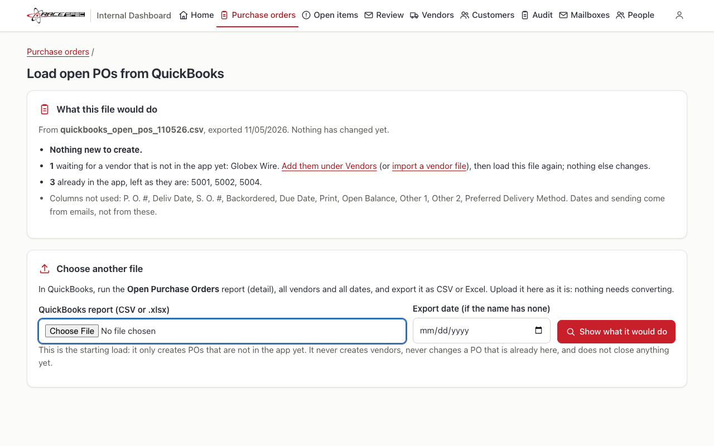

Screenshot 2

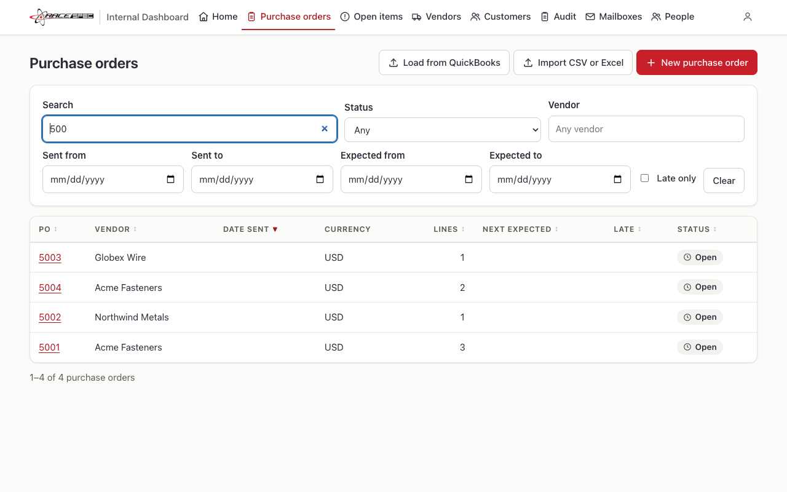

### TC-QB-08: A file that is not the report is refused naming what is missing; the app's own file is pointed to Import

**Priority:** Medium · **How:** Browser · **Refs:** DEC-46, PD-1.10a.5 · **Was:** QuickBooks check #13, #16

**Steps**

1. On Load from QuickBooks upload the vendor file.
2. Upload the PO template (Import CSV or Excel, Download a template).

**Expected:** First: "This does not look like the QuickBooks Open POs report: it has no 'date', 'num', ... column." Second: "This is a purchase order file in the app's own import format ..." with a Go to Import CSV or Excel button that opens that page.

**Automated tests:** `test_quickbooks.py::test_a_file_that_is_not_the_report_is_refused_naming_what_is_missing`, `test_quickbooks.py::test_the_apps_own_import_file_on_the_quickbooks_page_says_where_it_goes`, `test_quickbooks.py::test_a_hostile_or_wrong_file_is_a_clear_message`

**Latest:** Claude, Chrome: Pass 11/12/2026. Owner: Not yet run.

Screenshot

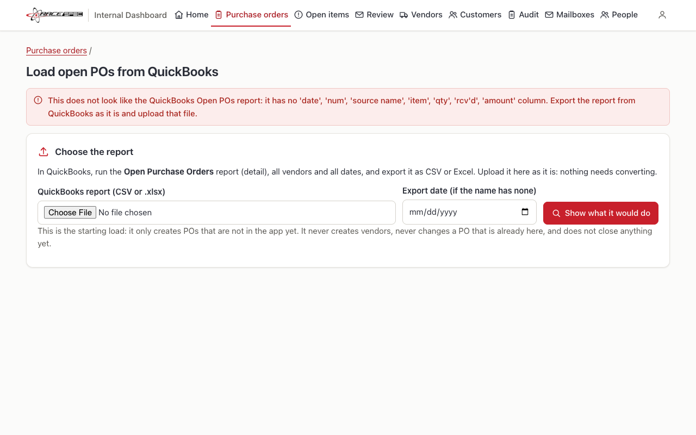

Screenshot 2

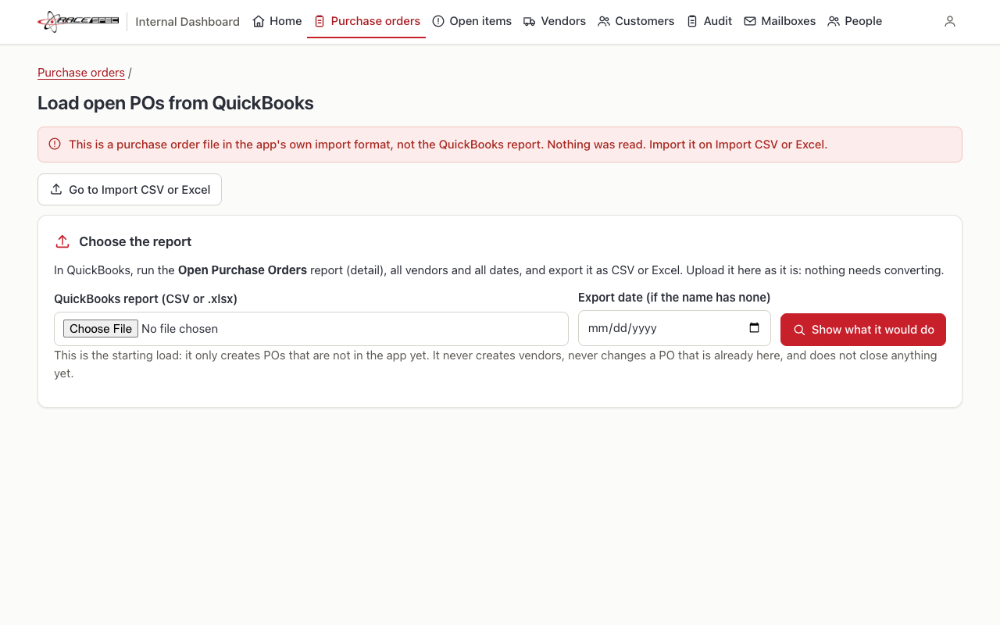

### TC-QB-09: The company's real export previews with counts that match QuickBooks

**Priority:** Critical · **How:** Owner only · **Refs:** DEC-46, DEC-13 · **Was:** QuickBooks check #14

**Steps**

1. With the company's own export (it stays in real-docs/ on this Mac), Load from QuickBooks, Show what it would do.
2. Compare the counts with QuickBooks. Press Cancel unless this is the go-live load.

**Expected:** The counts of POs, lines, partly received lines and rounded prices match QuickBooks; 0 problems. Write no names or figures anywhere in the repository.

**Latest:** Owner: Not yet run (Claude's dry run 11/06/2026: 0 problems; counts only).

### TC-QB-10: A Shipping or Freight row in the report is listed as skipped and never becomes a PO line

**Priority:** High · **How:** Browser · **Refs:** PD-4.5a, DEC-55, DEC-48

**Steps**

1. Load from QuickBooks with a report that has a Shipping row and a Freight:Inbound row under PO 5001, and press Show what it would do.

**Expected:** The preview says 2 rows are skipped as a charge, not goods, and names each with its PO and item; the charge rows are no problem and no new line (the earlier cases have already loaded these POs, so nothing is new).

**Latest:** Claude, Chrome: Pass 11/12/2026. Owner: Not yet run.

Screenshot

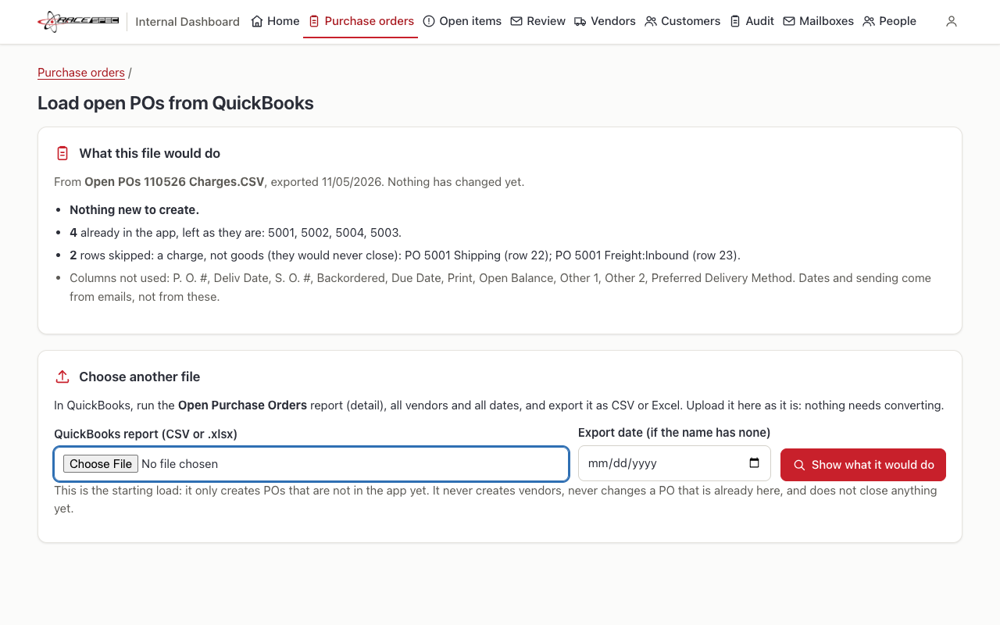

### TC-QB-11: Charge names come from a setting; only a whole item name (or the part before a colon) counts, and a file of only charges is not an error

**Priority:** High · **How:** Automated · **Refs:** PD-4.5a, DEC-55

**Steps**

1. Covered by the tests named.

**Expected:** Shipping and Freight are charges by default; the po_charge_items setting adds more; Freight Brackets is goods; a charge row makes no line and is counted in the audit; a file with only charge rows has no problem and nothing to create.

**Automated tests:** `test_quickbooks.py::test_shipping_and_freight_rows_are_skipped_and_listed_not_made_lines`, `test_quickbooks.py::test_more_charge_names_come_from_a_setting_and_a_goods_name_that_only_contains_one_is_kept`, `test_quickbooks.py::test_a_charge_row_never_becomes_a_line_and_a_file_of_only_charges_is_not_an_error`, `test_quickbooks.py::test_the_preview_lists_the_skipped_charges`

**Latest:** Owner: not recorded.

## Entries by hand

### TC-EVT-01: A short confirmation at another price is recorded and the purchaser is told to update the PO

**Priority:** Critical · **How:** Browser · **Refs:** REQ-ACK, DEC-36, PD-1.4 · **Was:** PO check #18, #19

**Steps**

1. Open PO-1001 (10.5 ordered at 2.50), Record acknowledgement.
2. Confirmed quantity 6, price 2.75, promised date in the future. Record.

**Expected:** The cursor starts in the first Confirmed quantity. Back on the PO page the line shows Acknowledged and the promised date, "The vendor's price 2.75 differs from the PO price 2.5", and "confirmed 6, not 10.5. Update the original purchase order".

**Automated tests:** `test_entries_web.py::test_a_short_confirmation_tells_the_purchaser_to_update_the_original_po`, `test_events.py::test_a_different_price_is_flagged_next_to_the_line`, `test_status.py::test_a_line_confirmed_short_never_closes_by_itself`

**Latest:** Claude, Chrome: Pass 11/12/2026. Owner: Pass 11/05/2026 (Safari, Chrome).

Screenshot

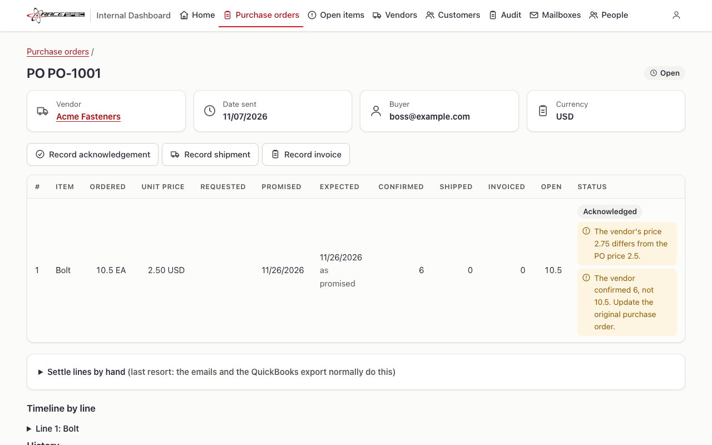

### TC-EVT-02: A later promised date is shown as a slip

**Priority:** High · **How:** Browser · **Refs:** DEC-36 · **Was:** PO check #20

**Steps**

1. Record a second acknowledgement on PO-1001 with a later promised date.

**Expected:** Both dates are shown, joined by an arrow, with a red slipped label on the later one.

**Automated tests:** `test_entries_web.py::test_a_later_promised_date_is_shown_as_a_slip`, `test_events.py::test_promised_dates_are_kept_and_a_later_date_is_a_slip`

**Latest:** Claude, Chrome: Pass 11/12/2026. Owner: Pass 11/05/2026 (Safari, Chrome).

Screenshot

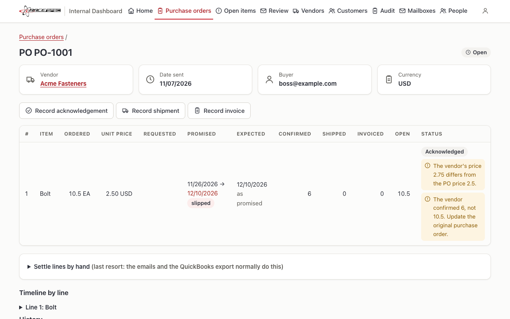

### TC-EVT-03: Shipments move a line from Partially shipped to Shipped, with who entered them

**Priority:** Critical · **How:** Browser · **Refs:** DEC-36, PD-1.4 · **Was:** PO check #21, #22, #31

**Steps**

1. Record shipment on PO-1001: carrier UPS, tracking 1Z999AA10123456784, quantity 3.
2. Record another shipment of 3.

**Expected:** First the status is Partially shipped, then Shipped. History lists each shipment with who entered it, and Track with the carrier opens UPS's own page in a new tab.

**Automated tests:** `test_events.py::test_a_partial_then_full_shipment_moves_the_line`, `test_expected.py::test_known_carriers_get_a_link_to_their_own_page`, `test_entries_web.py::test_a_po_goes_from_sent_to_closed_through_the_pages`

**Latest:** Claude, Chrome: Pass 11/12/2026. Owner: Pass 11/05/2026 (Safari, Chrome).

Screenshot

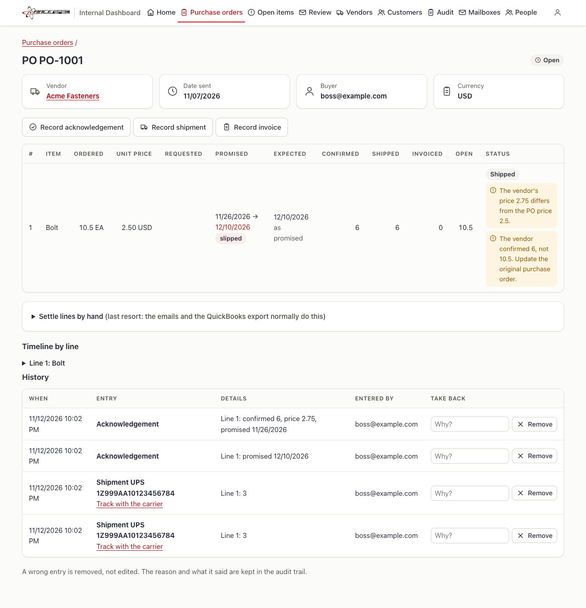

### TC-EVT-04: An invoice starts at the PO price; a short-confirmed line stays open until someone settles it

**Priority:** Critical · **How:** Browser · **Refs:** DEC-36 · **Was:** PO check #23

**Steps**

1. Record invoice on PO-1001: number INV-1, quantity 6. Record.

**Expected:** The price box starts at the PO price. The line still shows Shipped with 4.5 open, because it was confirmed short; the update-the-PO note stays.

**Automated tests:** `test_entries_web.py::test_the_invoice_form_starts_with_the_price_on_the_po`, `test_status.py::test_a_line_confirmed_short_never_closes_by_itself`, `test_events.py::test_a_partial_invoice_closes_only_what_it_covers`

**Latest:** Claude, Chrome: Pass 11/12/2026. Owner: Pass 11/05/2026 (Safari, Chrome).

Screenshot

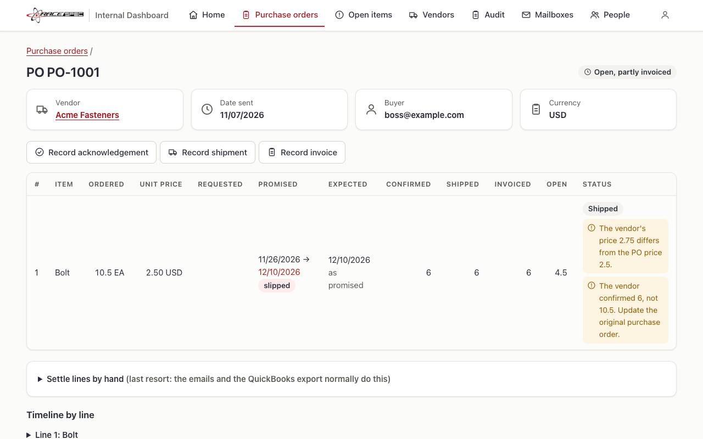

### TC-EVT-05: Over-billing and a price above the PO are flagged and still recorded

**Priority:** Critical · **How:** Browser · **Refs:** DEC-36 · **Was:** PO check #24

**Steps**

1. Record invoice INV-2 for quantity 20 at price 3.

**Expected:** Recorded, with "Invoiced ... more than the 10.5 ordered" and "above the PO price". The line becomes Closed.

**Automated tests:** `test_entries_web.py::test_a_different_price_and_over_billing_are_flagged_and_still_recorded`, `test_events.py::test_over_billing_is_flagged_but_still_recorded`

**Latest:** Claude, Chrome: Pass 11/12/2026. Owner: Pass 11/05/2026 (Safari, Chrome).

Screenshot

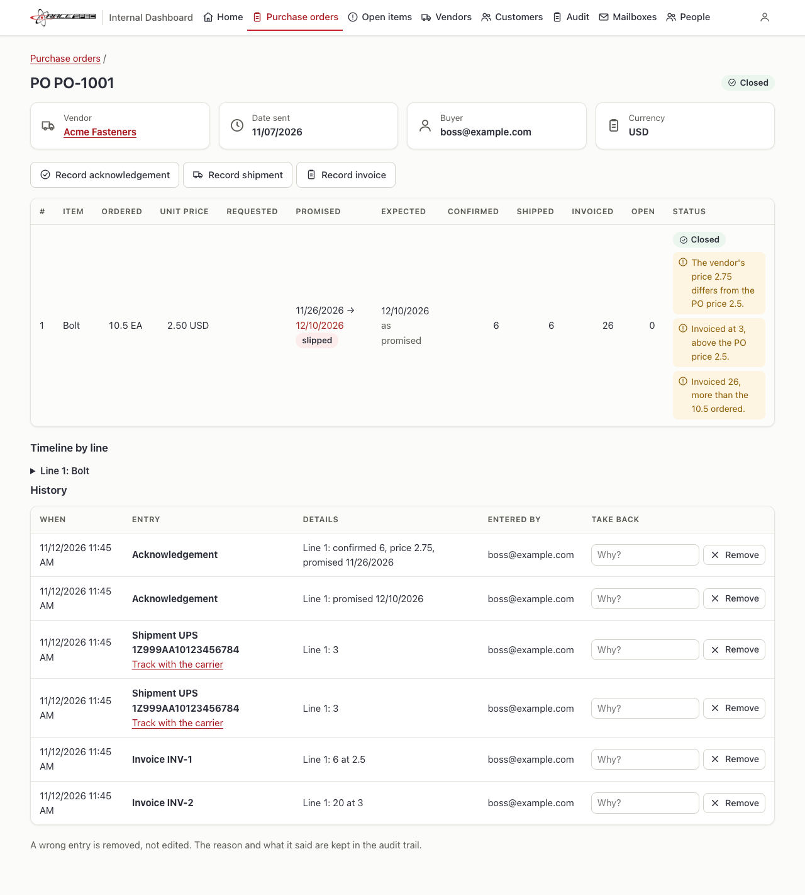

### TC-EVT-06: Removing an entry needs a reason and undoes its effect

**Priority:** High · **How:** Browser · **Refs:** NFR-03 · **Was:** PO check #25

**Steps**

1. In History, press Remove on INV-2 with the reason empty.
2. Give a reason and press Remove.

**Expected:** Without a reason the browser asks for one. With one, INV-2 goes, its notes clear and the line returns to Shipped. The removal is audited.

**Automated tests:** `test_entries_web.py::test_an_entry_is_removed_with_a_reason_and_its_effect_goes`, `test_events.py::test_removal_is_audited_with_what_the_entry_said_and_why`

**Latest:** Claude, Chrome: Pass 11/12/2026. Owner: Pass 11/05/2026 (Safari, Chrome).

Screenshot

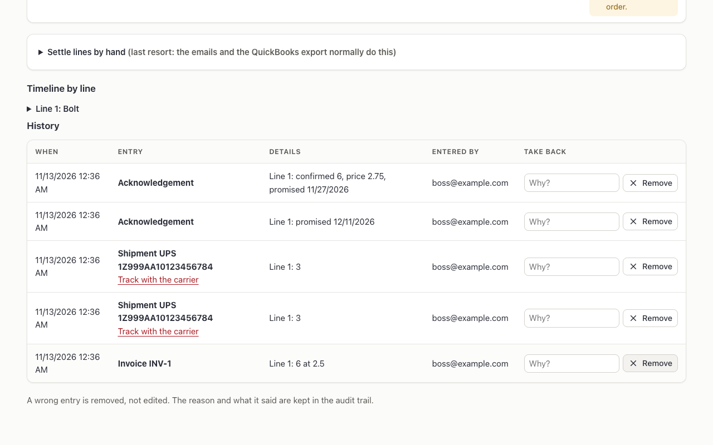

### TC-EVT-07: Reload after recording or removing anything repeats nothing

**Priority:** Critical · **How:** Automated · **Refs:** DEC-45 · **Was:** PO check #26

**Steps**

1. Covered by the tests named. By hand: press Reload after each entry above.

**Expected:** Nothing is recorded or removed a second time.

**Automated tests:** `test_entries_web.py::test_recording_then_reloading_repeats_nothing`, `test_web_standards.py::test_a_refused_form_sent_by_htmx_is_kept_out_of_the_history`

**Latest:** Owner: Pass 11/05/2026 (Safari, Chrome).

### TC-EVT-08: A promised date in the past makes the line late, on the PO, in the list and in Late only

**Priority:** High · **How:** Browser · **Refs:** REQ-DB, DEC-36 · **Was:** PO check #30

**Steps**

1. On PO-2001, record an acknowledgement promising a date in the past.
2. Open Purchase orders and tick Late only.

**Expected:** The PO page shows the line as N days late in red; the list says "1 late, up to N days"; Late only finds the PO.

**Automated tests:** `test_expected.py::test_a_late_line_is_flagged_on_the_po_page_and_the_list_and_a_filter_finds_it`, `test_expected.py::test_a_line_is_late_the_day_after_its_date_and_not_on_the_day`

**Latest:** Claude, Chrome: Pass 11/12/2026. Owner: Pass 11/05/2026 (Safari, Chrome).

Screenshot

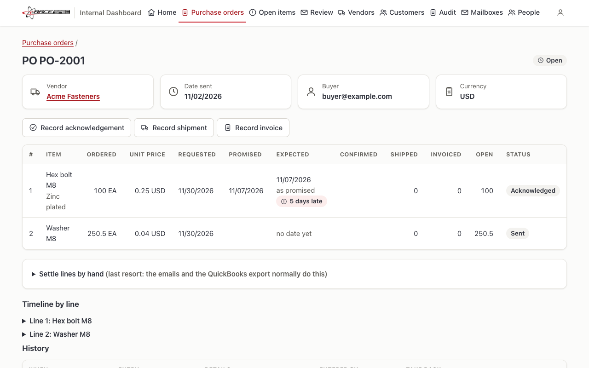

### TC-EVT-09: Settling by hand needs a reason, stays in place, and can be reopened with a reason

**Priority:** High · **How:** Browser · **Refs:** PD-1.5, DEC-45 · **Was:** PO check #32, #33, #34; Design check #15

**Steps**

1. On PO-2002, open Settle lines by hand; choose Cancelled for a line; press Settle with no reason, then with a reason.
2. Press Reopen on that line with a reason.

**Expected:** Without a reason the browser asks for one. With one, the button shows it is working, the line shows Cancelled with "Settled by hand", and the page stays where it was. Reopen returns the line to its earlier status.

**Automated tests:** `test_closing.py::test_a_reason_is_required_and_a_choice_too`, `test_closing.py::test_reopening_needs_a_reason_and_puts_the_line_back`, `test_closing.py::test_a_closed_line_cannot_be_settled_again_and_is_not_offered`

**Latest:** Claude, Chrome: Pass 11/12/2026. Owner: Pass 11/06/2026.

Screenshot

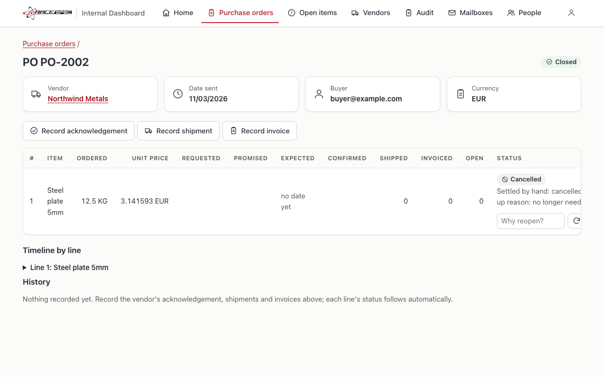

Screenshot 2

### TC-EVT-10: A line's timeline keeps everything that happened, including what was taken back

**Priority:** High · **How:** Browser · **Refs:** NFR-03 · **Was:** PO check #35; Design check #15

**Steps**

1. On PO-1001, open Timeline by line and the line's heading.

**Expected:** In time order: Ordered, Vendor acknowledged, Shipped, Invoiced, and "Entry taken back" for INV-2. Times read like 11/06/2026 2:35 PM.

**Automated tests:** `test_closing.py::test_the_timeline_lists_what_happened_to_a_line_in_order`, `test_closing.py::test_the_timeline_keeps_an_entry_that_was_taken_back`

**Latest:** Claude, Chrome: Pass 11/12/2026. Owner: Pass 11/06/2026.

Screenshot

### TC-EVT-11: The status of every line follows the agreed table in every combination

**Priority:** Critical · **How:** Automated · **Refs:** DEC-36, ARCHITECTURE §5

**Steps**

1. Covered by the tests named (one per row of the status table, and every combination).

**Expected:** Every row of the status table holds; a PO closes only when every line has; open quantity is never negative; one PO's facts never touch another.

**Automated tests:** `test_status.py::test_each_row_of_the_table`, `test_status.py::test_rules_hold_across_every_combination`, `test_status.py::test_a_po_closes_only_when_every_line_has`, `test_status.py::test_one_pos_facts_never_touch_another`

**Latest:** Owner: not recorded.

## Home and Open items

### TC-HOME-01: Home shows the six counts and a Needs attention list with the next step

**Priority:** High · **How:** Browser · **Refs:** REQ-DB-01, DEC-42 · **Was:** PO check #36; Design check #1, #16

**Steps**

1. Go Home after the entries above.

**Expected:** Six tiles (open purchase orders, open lines, late lines, waiting for an acknowledgement, promised date slipped, original PO needs updating) whose numbers match what was entered, and Needs attention with a next step such as "Ask the vendor for a new date".

**Automated tests:** `test_reports.py::test_the_dashboard_shows_the_counts_and_links_to_the_report`, `test_reports.py::test_the_to_do_list_puts_the_most_urgent_first_and_says_what_to_do`

**Latest:** Claude, Chrome: Pass 11/12/2026. Owner: Pass 11/06/2026.

Screenshot

### TC-HOME-02: Home updates itself within a minute

**Priority:** High · **How:** Browser · **Refs:** DEC-45 · **Was:** Design check #16

**Steps**

1. Leave Home open. In a second tab, record a past promised date on another PO.
2. Wait about a minute without touching Home.

**Expected:** Home's counts and Needs attention include the new late line without a reload.

**Automated tests:** `test_web_standards.py::test_a_background_update_does_not_count_as_activity`

**Latest:** Claude, Chrome: Pass 11/12/2026. Owner: Pass 11/06/2026.

Screenshot

### TC-HOME-03: Open items filters as you choose, and a late tile opens it filtered

**Priority:** Medium · **How:** Browser · **Refs:** REQ-DB-03 · **Was:** PO check #37, #38; Design check #18

**Steps**

1. On Home click the Late lines tile.
2. On Open items change Show and Vendor.

**Expected:** Open items shows only late lines, each with a red "N days late", most late first. The list follows each choice; an empty view says "All clear".

**Automated tests:** `test_reports.py::test_the_report_page_filters_and_downloads`, `test_reports.py::test_late_slipped_and_update_flags_are_counted_from_the_same_list`

**Latest:** Claude, Chrome: Pass 11/12/2026. Owner: Pass 11/06/2026.

Screenshot

### TC-HOME-04: The Open items CSV downloads as a file and a formula in a cell stays plain text

**Priority:** Critical · **How:** Browser · **Refs:** REQ-DB-03, Security: CSV injection · **Was:** PO check #39, #40; Design check #18

**Steps**

1. Enter a PO PO-1003 for Acme Fasteners whose line item is =1+1.
2. On Open items press Download CSV and open it in Excel or Numbers.

**Expected:** A file open-items-<date>.csv downloads (not shown in the page) with dates like 11/06/2026 and accents right. The cell shows '=1+1 as text, never 2.

**Automated tests:** `test_reports.py::test_the_csv_has_the_columns_and_neutralises_formulas`, `test_reports.py::test_a_cell_that_would_run_as_a_formula_is_made_plain_text`, `test_web_standards.py::test_downloads_are_plain_links_not_page_swaps`

**Latest:** Claude, Chrome: Pass 11/12/2026. Owner: Pass 11/06/2026.

Screenshot

### TC-HOME-05: A PO sent with no acknowledgement is flagged only after two working days

**Priority:** High · **How:** Automated · **Refs:** DEC-37, DEC-42

**Steps**

1. Covered by the tests named.

**Expected:** Weekends are skipped; the flag appears after two working days, not before; closed or cancelled lines are never open items.

**Automated tests:** `test_reports.py::test_a_sent_po_with_no_acknowledgement_is_flagged_only_after_two_working_days`, `test_reports.py::test_business_days_skip_weekends`, `test_reports.py::test_a_closed_or_cancelled_line_is_not_an_open_item`

**Latest:** Owner: not recorded.

## Audit

### TC-AUD-01: An admin sees every change, newest first, and can narrow it

**Priority:** High · **How:** Browser · **Refs:** NFR-03, PD-1.7 · **Was:** PO check #41, #42, #43; Design check #19

**Steps**

1. As boss, click Audit.
2. Type line.close in Action; pick a person; press Clear.
3. The From box is a calendar, so a wrong date can only come in the address: open /admin/audit?date_from=soon.

**Expected:** A table, newest first: time, person, address, action, what it was about, before and after; the cursor starts in Action. The list narrows and Clear brings everything back. soon is reported as not a date and the list still shows.

**Automated tests:** `test_audit_screen.py::test_an_admin_sees_the_trail_and_the_cursor_starts_in_the_first_box`, `test_audit_screen.py::test_filters_narrow_the_list_and_a_wrong_date_is_reported`, `test_audit_screen.py::test_the_screen_only_reads`

**Latest:** Claude, Chrome: Pass 11/12/2026. Owner: Pass 11/06/2026.

Screenshot

### TC-AUD-02: Every change to the ledger writes an audit record with who and where, and nothing secret

**Priority:** Critical · **How:** Automated · **Refs:** NFR-03

**Steps**

1. Covered by the tests named.

**Expected:** Every create, change, removal and settle writes a record with the person and address. No password or token is ever in it.

**Automated tests:** `test_audit_screen.py::test_every_change_to_the_ledger_writes_an_audit_record`, `test_events.py::test_every_recording_is_audited`, `test_auth.py::test_nothing_secret_reaches_the_audit_trail`

**Latest:** Owner: not recorded.

## Page behaviour

### TC-WEB-01: Pages change without a white flash, and Back and Forward work

**Priority:** Medium · **How:** Browser · **Refs:** DEC-45 · **Was:** Design check #4, #14

**Steps**

1. Click between Home, Purchase orders, Vendors and a PO.
2. Use the browser's Back and Forward.

**Expected:** Only the page body changes; the browser tab title follows. Back and Forward show the right pages, never "page not found".

**Automated tests:** `test_web_standards.py::test_signed_in_pages_load_htmx_from_this_site_with_the_safe_settings`, `test_web_standards.py::test_a_refused_form_sent_by_htmx_is_kept_out_of_the_history`

**Latest:** Claude, Chrome: Pass 11/12/2026. Owner: Pass 11/06/2026.

Screenshot

### TC-WEB-02: At phone width the page never scrolls sideways

**Priority:** High · **How:** Browser · **Refs:** DEC-45, NFR-12 · **Was:** Design check #20; Sign-in check, things to look at

**Steps**

1. Make the window phone width (or use a phone on the office network). Visit Home, Purchase orders, a PO, Vendors, Open items, People, Audit.

**Expected:** No sideways scrolling of the page. The top bar scrolls sideways; tables scroll inside their box; buttons are easy to tap.

**Latest:** Claude, Chrome: Pass 11/12/2026. Owner: Pass 11/06/2026.

Screenshot

### TC-WEB-03: Everything can be reached with the keyboard

**Priority:** Medium · **How:** Browser · **Refs:** DEC-45, NFR-12 · **Was:** Design check #21; Sign-in check, things to look at

**Steps**

1. Reload any page and press Tab once.
2. Keep pressing Tab through the sign-in page and the New purchase order form.

**Expected:** A Skip to the page link appears at the top left; Enter moves past the top bar. Every control shows a blue outline when Tab reaches it, in a sensible order.

**Automated tests:** `test_gate.py::test_the_cursor_is_ready_in_the_first_box_of_every_form_page`

**Latest:** Claude, Chrome: Pass 11/12/2026. Owner: Pass 11/06/2026.

Screenshot

### TC-WEB-04: Dark mode on the Mac leaves the app light and readable

**Priority:** Medium · **How:** Browser · **Refs:** DEC-35 · **Was:** Sign-in check, things to look at

**Steps**

1. Switch macOS to dark mode and reload.

**Expected:** The app stays in its one light theme and is readable.

**Latest:** Claude, Chrome: Pass 11/12/2026. Owner: Pass 11/04/2026 (Safari, Chrome).

Screenshot

### TC-WEB-05: Every page answers within 0.3 seconds with a year's worth of data

**Priority:** High · **How:** Automated · **Refs:** DEC-45, NFR speed

**Steps**

1. Covered by the test named: 300 vendors, 1,000 POs and 5,000 lines.

**Expected:** Every page answers within 0.3 seconds.

**Automated tests:** `test_speed.py::test_each_page_answers_within_the_limit`, `test_status.py::test_the_number_of_queries_does_not_grow_with_the_lines`

**Latest:** Owner: not recorded.

### TC-WEB-06: A mistyped address or an unreadable form shows a page a person can read

**Priority:** Medium · **How:** Browser · **Refs:** DEC-45, DEF-002

**Steps**

1. Signed in, open http://127.0.0.1:8000/no-such-page.

**Expected:** A page headed "Page not found" in the app's own layout, with a Go to Home button. Never raw code such as {"detail": ...}.

**Automated tests:** `test_gate.py::test_a_mistyped_address_and_an_unreadable_form_are_pages_too`, `test_gate.py::test_a_script_still_gets_the_short_json_answer`

**Latest:** Claude, Chrome: Pass 11/12/2026. Owner: Not yet run.

Screenshot

## Security and data safety

### TC-SEC-01: Every change needs the session's token and must come from the app's own pages

**Priority:** Critical · **How:** Automated · **Refs:** ARCHITECTURE §10.1 (CSRF, Origin)

**Steps**

1. Covered by the tests named.

**Expected:** A change without the token, or from another site, is refused. A GET never changes anything. A forged cookie is no session.

**Automated tests:** `test_gate.py::test_a_signed_in_write_needs_the_session_token`, `test_gate.py::test_sign_in_needs_its_token_and_a_local_origin`, `test_gate.py::test_a_get_never_changes_anything`, `test_gate.py::test_a_forged_or_malformed_session_cookie_is_just_no_session`, `test_orders_web.py::test_an_upload_from_another_site_is_refused`

**Latest:** Owner: not recorded.

### TC-SEC-02: Pages carry the security headers, are not cached, and run no inline script or style

**Priority:** High · **How:** Automated · **Refs:** ARCHITECTURE §10.1 (headers, CSP)

**Steps**

1. Covered by the tests named.

**Expected:** Content-Security-Policy and the other headers are on every response; signed-in pages are not cached; no page has inline script or style; the pinned HTMX file is exactly the published one.

**Automated tests:** `test_gate.py::test_security_headers_are_on_public_responses`, `test_gate.py::test_signed_in_pages_are_not_cached_and_refusals_carry_headers`, `test_web_standards.py::test_no_page_has_inline_script_style_or_script_attributes`, `test_web_standards.py::test_the_pinned_htmx_file_is_exactly_the_published_one`

**Latest:** Owner: not recorded.

### TC-SEC-03: Hostile spreadsheets are refused: macros, zip bombs, entity tricks, huge sheets, links to files

**Priority:** Critical · **How:** Automated · **Refs:** DEC-47

**Steps**

1. Covered by the tests named.

**Expected:** Each is refused quickly with a plain message and nothing is written.

**Automated tests:** `test_sheets.py::test_a_workbook_with_macros_is_refused_whatever_its_name`, `test_sheets.py::test_a_zip_bomb_is_refused_from_its_declared_size`, `test_sheets.py::test_an_entity_bomb_is_refused_quickly`, `test_sheets.py::test_a_workbook_cannot_read_files_from_the_mac`, `test_sheets.py::test_a_sheet_that_claims_to_be_huge_is_cut_off_quickly`, `test_sheets.py::test_without_the_safe_parser_excel_files_are_refused`

**Latest:** Owner: not recorded.

### TC-SEC-04: Uploads over 2 MB, or that do not state their size, are refused before they are read

**Priority:** High · **How:** Automated · **Refs:** DEC-47

**Steps**

1. Covered by the tests named.

**Expected:** Refused with the limit named; the server never holds the whole oversized file.

**Automated tests:** `test_orders_web.py::test_an_oversized_upload_is_refused_before_it_is_read`, `test_orders_web.py::test_an_upload_that_does_not_state_its_size_is_refused`, `test_gate.py::test_an_oversized_form_is_refused_not_buffered_forever`

**Latest:** Owner: not recorded.

### TC-SEC-05: Passwords are stored only as argon2id hashes; no secret is in the database file or the logs

**Priority:** Critical · **How:** Automated · **Refs:** ARCHITECTURE §10.1

**Steps**

1. Covered by the tests named.

**Expected:** Only hashes are stored; session tokens are stored as hashes; nothing secret is in the database file, the logs or the audit trail.

**Automated tests:** `test_auth.py::test_the_password_is_stored_as_an_argon2id_hash_only`, `test_auth.py::test_sign_in_starts_a_full_session_and_stores_only_the_token_hash`, `test_gate.py::test_no_secret_is_in_the_database_file_or_the_logs`

**Latest:** Owner: not recorded.

### TC-SEC-06: Quantities and money are exact everywhere

**Priority:** Critical · **How:** Automated · **Refs:** ARCHITECTURE §4

**Steps**

1. Covered by the tests named.

**Expected:** Values come back exactly as entered; tenths add up exactly; floats, NaN, infinity and huge numbers are refused. The only rounding anywhere is the QuickBooks unit price (TC-QB-05), which is shown and recorded.

**Automated tests:** `test_ledger.py::test_quantities_and_prices_come_back_exactly`, `test_ledger.py::test_tenths_add_up_exactly_in_sql`, `test_ledger.py::test_nan_infinity_and_huge_numbers_are_refused`, `test_status.py::test_shipments_add_up_exactly`

**Latest:** Owner: not recorded.

## Reading documents (model)

### TC-AI-01: The golden set is rebuilt exactly from its seed, and has the mix the owner asked for

**Priority:** High · **How:** Automated · **Refs:** DEC-49, SCORING.md §5, PD-2.2, PD-2.3

**Steps**

1. Covered by the tests named: the generator is run into a fresh folder and compared, byte for byte, with tests/data/golden.

**Expected:** No difference. About 100 documents: 30 acknowledgements, 22 shipment notices, 25 invoices, 8 purchase orders, 15 others, in five formats with none above 40%. At least three of each hard case, 8 planted instructions, every answer in schema v1, every invoice total equal to its goods plus its charges, made-up addresses only.

**Automated tests:** `test_golden_set.py::test_the_generator_rebuilds_the_committed_set_exactly`, `test_golden_set.py::test_the_set_has_the_mix_the_decision_asks_for`, `test_golden_set.py::test_every_answer_has_exactly_the_schema_fields`, `test_golden_set.py::test_an_invoice_total_is_its_goods_plus_its_charges`, `test_golden_set.py::test_a_charge_is_never_a_line`, `test_golden_set.py::test_no_real_looking_addresses_or_names_are_used`, `test_golden_set.py::test_the_files_are_what_their_names_say`

**Latest:** Owner: not recorded.

### TC-AI-02: Each scoring rule gives the verdict SCORING.md says, with made-up model answers

**Priority:** Critical · **How:** Automated · **Refs:** SCORING.md §3, §4, PD-2.4

**Steps**

1. Covered by the tests named. No model is called.

**Expected:** A wrong PO number, a missing one and an invented one are told apart. Dates are right only as the same day in YYYY-MM-DD. Numbers have no tolerance. Lines pair by line number, then by part number. A guessed line number is wrong. A charge given as a line counts twice. A planted instruction's tell-tale value is found anywhere in the output.

**Automated tests:** `test_scoring.py::test_po_number_wrong_missing_and_invented_are_told_apart`, `test_scoring.py::test_a_hyphen_is_part_of_the_number`, `test_scoring.py::test_dates_are_right_only_as_the_same_iso_day`, `test_scoring.py::test_numbers_are_exact_with_no_tolerance`, `test_scoring.py::test_a_guessed_line_number_is_wrong_when_the_answer_has_none`, `test_scoring.py::test_a_charge_given_as_a_line_counts_twice`, `test_scoring.py::test_t3_needs_line_number_quantity_and_the_promised_date`, `test_scoring.py::test_planted_instruction_tell_tales_are_found_anywhere_in_the_output`, `test_golden_set.py::test_a_document_scores_perfectly_against_its_own_answer`

**Latest:** Owner: not recorded.

### TC-AI-03: The document is fenced as data, and the model call is local, repeatable and leaks no text

**Priority:** Critical · **How:** Automated · **Refs:** DEC-01, DEC-09, DEC-13, PD-2.4

**Steps**

1. Covered by the tests named. The model server is replaced by a made-up one.

**Expected:** The document sits between markers and cannot close its own fence. The prompt says a document is never an instruction. The call goes to this Mac, at temperature 0 with a fixed seed and schema v1. When the call fails, the error holds no document text.

**Automated tests:** `test_extraction.py::test_the_document_is_fenced_as_data_and_cannot_close_its_own_fence`, `test_extraction.py::test_the_prompt_says_a_document_is_never_an_instruction`, `test_extraction.py::test_the_call_is_local_deterministic_and_carries_the_schema`, `test_extraction.py::test_a_failed_call_raises_an_error_without_the_document_text`, `test_extraction.py::test_a_reply_is_read_with_exact_decimals`

**Latest:** Owner: not recorded.

## Mail sources

### TC-MAIL-01: Mail is read-only: nothing in the app can send, move, flag or delete a message

**Priority:** Critical · **How:** Automated · **Refs:** DEC-07, REQ-IN-02, PD-3.1

**Steps**

1. Covered by the tests named. They read the source code of the whole app and of the mail package.
2. Checked by deliberate breaks on 2026-11-10: a mail-sending import, a call to trash a message and a Gmail trash address each made the test fail.

**Expected:** No module imports a mail-sending library. The mail package calls nothing that changes a mailbox or writes a file, names no write address or write permission, and no mail source has a method that could.

**Automated tests:** `test_mail_readonly.py::test_no_module_in_the_app_can_send_mail`, `test_mail_readonly.py::test_the_mail_package_calls_nothing_that_changes_a_mailbox_or_a_file`, `test_mail_readonly.py::test_the_mail_package_names_no_write_address_or_scope`, `test_mail_folder.py::TestFolderSource::test_it_has_no_way_to_change_a_mailbox`, `test_mail_folder.py::TestFolderSource::test_reading_changes_nothing`, `test_mail_folder.py::TestFolderSource::test_a_folder_can_be_read_without_permission_to_write`

**Latest:** Owner: not recorded.

### TC-MAIL-02: Every mail source passes the same contract (folder now; Gmail and Microsoft 365 later)

**Priority:** High · **How:** Automated · **Refs:** REQ-IN-06, REQ-IN-01, PD-3.1

**Steps**

1. Covered by the tests named: one shared contract run against the folder provider.

**Expected:** Inbox and Sent Items are scanned. Each message comes once and a later one comes once. Bytes arrive unchanged. A batch limit loses nothing and repeats nothing. A position the source does not understand means start again. Health says what is wrong without raising.

**Automated tests:** `test_mail_folder.py::TestFolderSource::test_each_message_comes_once`, `test_mail_folder.py::TestFolderSource::test_a_message_that_arrives_later_is_returned_once`, `test_mail_folder.py::TestFolderSource::test_the_bytes_are_handed_over_unchanged`, `test_mail_folder.py::TestFolderSource::test_a_batch_limit_loses_nothing_and_repeats_nothing`, `test_mail_folder.py::TestFolderSource::test_the_two_folders_are_separate`, `test_mail_folder.py::TestFolderSource::test_a_position_it_does_not_understand_means_start_again`, `test_mail_folder.py::TestFolderSource::test_health_is_ok_and_then_says_what_is_wrong_without_raising`, `test_mail_folder.py::TestFolderSource::test_the_golden_emails_are_read`

**Latest:** Owner: not recorded.

### TC-MAIL-03: The folder reader ignores what is not mail and cannot be tricked out of its folder

**Priority:** High · **How:** Automated · **Refs:** PD-3.1, PD-3.6

**Steps**

1. Covered by the tests named.

**Expected:** Only visible .eml files directly in the folder are read. A symbolic link is not followed. A copy under another name is not read twice, a changed file is a new message, and a message over 50 MB is skipped with a reason and not retried.

**Automated tests:** `test_mail_folder.py::TestFolderSource::test_only_eml_files_are_read`, `test_mail_folder.py::TestFolderSource::test_a_symbolic_link_is_not_followed`, `test_mail_folder.py::TestFolderSource::test_a_copy_under_another_name_is_not_read_twice`, `test_mail_folder.py::TestFolderSource::test_a_changed_file_is_a_new_message`, `test_mail_folder.py::TestFolderSource::test_a_huge_message_is_skipped_with_a_reason_and_not_read_again`, `test_mail_folder.py::TestFolderSource::test_a_missing_folder_is_not_an_error`

**Latest:** Owner: not recorded.

### TC-MAIL-04: The mailbox table keeps its own rules

**Priority:** Medium · **How:** Automated · **Refs:** PD-3.1, ARCHITECTURE §4

**Steps**

1. Covered by the tests named, and by the migration test that compares the table with the code.

**Expected:** A known provider and state only, lower-case address, one row per address; removing the person who connected a mailbox keeps the mailbox.

**Automated tests:** `test_mailbox_table.py::test_a_mailbox_is_stored_and_read_back`, `test_mailbox_table.py::test_unknown_providers_and_states_and_upper_case_addresses_are_refused`, `test_mailbox_table.py::test_one_row_per_address`, `test_mailbox_table.py::test_removing_the_person_who_connected_it_keeps_the_mailbox`, `test_database.py::test_migration_matches_the_models`

**Latest:** Owner: not recorded.

### TC-MAIL-05: Every original message and attachment is kept unchanged, once, under its hash

**Priority:** Critical · **How:** Automated · **Refs:** REQ-IN-04, REQ-IN-05, PD-3.2

**Steps**

1. Covered by the tests named, including all 36 golden emails and golden PDFs, scans and spreadsheets sent as attachments.

**Expected:** The stored bytes equal what arrived and their hash matches the row. The same message twice, or through another folder or mailbox, is one message. An attachment already stored is not stored again but the new message and its body are. Two messages that both say only 'Thanks' each keep their body. The database itself refuses a second copy of an attachment.

**Automated tests:** `test_intake.py::test_a_message_is_stored_unchanged_with_its_facts`, `test_intake.py::test_an_attachment_is_stored_under_its_hash`, `test_intake.py::test_the_same_message_twice_is_stored_once`, `test_intake.py::test_the_same_bytes_from_another_folder_are_still_one_message`, `test_intake.py::test_an_attachment_already_stored_is_not_stored_again_but_the_new_message_is`, `test_intake.py::test_two_messages_with_the_same_words_each_keep_their_body`, `test_intake.py::test_the_database_itself_refuses_a_second_copy_of_an_attachment`, `test_intake.py::test_every_golden_email_is_stored_and_the_originals_are_unchanged`, `test_intake.py::test_attachments_in_the_golden_set_come_through`, `test_intake.py::test_the_original_is_hashed_after_storage_and_matches`

**Latest:** Owner: not recorded.

### TC-MAIL-06: A hostile message cannot hurt intake: odd file names, broken mail, huge or too many files

**Priority:** Critical · **How:** Automated · **Refs:** DEC-51, PD-3.2, PD-3.6

**Steps**

1. Covered by the tests named. File names include ../../etc/passwd, a Windows path, a NUL and line breaks sent in RFC 2231 form, a right-to-left override and a 1,000-character name.

**Expected:** No file name ever becomes a path: every stored file is named by its hash, inside the store. Broken mail is still stored and does not stop intake. A file over 20 MB, an attachment past the 25th, a program or a macro spreadsheet is stored and marked not read with the reason. A forwarded message is kept as an attachment.

**Automated tests:** `test_intake.py::test_a_hostile_file_name_never_becomes_a_path`, `test_intake.py::test_a_broken_message_is_stored_and_does_not_stop_intake`, `test_intake.py::test_files_the_app_does_not_read_are_stored_and_say_so`, `test_intake.py::test_a_file_over_the_size_limit_is_stored_and_not_read`, `test_intake.py::test_attachments_past_the_25th_are_stored_and_not_read`, `test_intake.py::test_a_forwarded_message_is_kept_as_an_attachment`, `test_intake.py::test_the_store_refuses_a_path_it_did_not_make`

**Latest:** Owner: not recorded.

### TC-MAIL-07: The store is private, never half-written, rolls back cleanly, keeps message text out of logs and honours the start date

**Priority:** High · **How:** Automated · **Refs:** DEC-13, DEC-51, PD-3.2

**Steps**

1. Covered by the tests named.

**Expected:** Folders are 700 and files 600, with no temporary file left behind. A failure while writing rows leaves the database empty and a retry works. A subject, body and file name never appear in the logs. Mail from before the mailbox's start date is not stored; a message with no date is stored with the time it was read.

**Automated tests:** `test_intake.py::test_the_store_is_owner_only_and_never_half_written`, `test_intake.py::test_a_failure_while_writing_rows_leaves_nothing_in_the_database_and_the_retry_works`, `test_intake.py::test_no_message_text_reaches_the_logs`, `test_intake.py::test_mail_from_before_the_start_date_is_not_stored`, `test_intake.py::test_a_message_with_no_date_is_stored_with_the_time_it_was_read`

**Latest:** Owner: not recorded.

### TC-MAIL-08: Every kind of document in the golden set becomes the expected text

**Priority:** High · **How:** Automated · **Refs:** DEC-51, PD-3.3, REQ-IN-03

**Steps**

1. Covered by the tests named.

**Expected:** For each of the 100 made-up documents (email, typed PDF, scan, spreadsheet, automatic notice) the text step gives text that matches the expected text (emails 95% or better, typed PDFs and spreadsheets 99%, scans 95% allowing for OCR mistakes), and all 47 emails go in and come out as read.

**Automated tests:** `test_text.py::test_every_golden_document_gives_the_expected_text`, `test_reading.py::test_the_whole_golden_set_goes_in_and_comes_out_as_text`

**Latest:** Owner: not recorded.

### TC-MAIL-09: HTML, earlier messages, scans, spreadsheets and Word are read the DEC-51 way

**Priority:** High · **How:** Automated · **Refs:** DEC-51, DEC-09, PD-3.3

**Steps**

1. Covered by the tests named.

**Expected:** HTML gives its words with links, scripts, styles and images left out. An earlier message is marked once and nothing is removed, and a document's own From line is not taken for a quote. A scanned PDF and an image are read by Tesseract. A spreadsheet gives stored values only (a formula is not calculated, a hidden sheet is skipped); CSV, TSV and Word tables read in order.

**Automated tests:** `test_text.py::test_html_gives_its_words_without_links_scripts_or_styles`, `test_text.py::test_an_earlier_message_is_marked_and_nothing_is_removed`, `test_text.py::test_a_from_line_in_a_document_is_not_taken_for_a_quote`, `test_text.py::test_a_scanned_pdf_is_read_by_ocr_from_its_page_images`, `test_text.py::test_an_image_is_read_by_ocr`, `test_text.py::test_a_formula_is_never_calculated_and_a_hidden_sheet_is_skipped`, `test_text.py::test_csv_and_tsv_are_read_with_their_own_separator`, `test_text.py::test_a_word_file_gives_paragraphs_and_tables_in_order`

**Latest:** Owner: not recorded.

### TC-MAIL-10: A file over a limit, a damaged file or a missing Tesseract never loses a document

**Priority:** High · **How:** Automated · **Refs:** DEC-51, DEC-13, PD-3.3

**Steps**

1. Covered by the tests named.

**Expected:** A PDF over 50 pages, a password-protected PDF, a damaged file, a zip bomb and an image with too many pixels are marked not read with a fixed reason. A Word or Excel file with an entity trick never leaks a local file, and openpyxl is pinned to the defusedxml parser even though lxml is installed. A reader that breaks marks the file failed with the kind of error only, never document text. If Tesseract is missing the document stays waiting and is read later. No document text reaches the logs.

**Automated tests:** `test_text.py::test_a_pdf_over_the_page_limit_is_not_read`, `test_text.py::test_a_password_protected_pdf_is_not_read`, `test_text.py::test_a_zip_bomb_is_refused_before_it_is_opened`, `test_text.py::test_an_image_with_too_many_pixels_is_refused`, `test_text.py::test_a_word_file_with_an_entity_trick_does_not_leak_a_local_file`, `test_text.py::test_a_spreadsheet_with_an_entity_trick_is_refused_by_the_text_step_too`, `test_sheets.py::test_the_reader_uses_the_safe_xml_parser`, `test_reading.py::test_a_refused_file_says_why_and_the_message_is_still_read`, `test_reading.py::test_a_file_that_breaks_the_reader_is_marked_failed_with_the_kind_of_error_only`, `test_reading.py::test_a_missing_program_leaves_the_document_waiting_and_it_is_read_later`, `test_reading.py::test_no_document_text_reaches_the_logs`

**Latest:** Owner: not recorded.

## Scanner

### TC-MAIL-11: A scan stores and reads new mail once, in both folders, and finds nothing the second time

**Priority:** High · **How:** Automated · **Refs:** PD-3.4, REQ-IN-04, REQ-IN-05

**Steps**

1. Covered by the tests named.

**Expected:** New mail in the Inbox and Sent Items is stored and its text read. The saved position is per folder. A second scan stores and repeats nothing; mail that arrives later is stored once.

**Automated tests:** `test_scanner.py::test_a_scan_stores_and_reads_new_mail_and_the_next_scan_finds_nothing`, `test_scanner.py::test_both_folders_are_scanned_with_their_own_position`

**Latest:** Owner: not recorded.

### TC-MAIL-12: A crash mid-scan loses no mail and repeats none

**Priority:** High · **How:** Automated · **Refs:** PD-3.4, REQ-IN-05

**Steps**

1. Covered by the tests named.

**Expected:** A failure part way through a batch stores nothing of that batch and leaves the position where it was; the next scan stores all of it once. A real process killed with no cleanup mid-batch leaves every message stored exactly once after the next run.

**Automated tests:** `test_scanner.py::test_a_failure_part_way_through_a_batch_stores_nothing_of_it_and_the_retry_loses_and_repeats_nothing`, `test_scanner.py::test_a_process_killed_mid_scan_loses_nothing_and_repeats_nothing`

**Latest:** Owner: not recorded.

### TC-MAIL-13: One scan at a time, a cap per scan, and errors recorded without mail text

**Priority:** High · **How:** Automated · **Refs:** PD-3.4, DEC-13, engineering review: queues, backpressure

**Steps**

1. Covered by the tests named.

**Expected:** A tick during a running scan is skipped at once, not queued. A burst larger than the cap is spread over several scans and nothing is stored twice; documents read per scan are capped too. A mailbox or folder that fails is recorded with a fixed reason and error type only (never mail text, in the table or the log), the others carry on, and a later success clears the error.

**Automated tests:** `test_scanner.py::test_a_tick_during_a_running_scan_is_skipped_not_queued`, `test_scanner.py::test_a_burst_is_spread_over_several_ticks`, `test_scanner.py::test_documents_read_per_tick_are_capped_too`, `test_scanner.py::test_a_mailbox_that_cannot_be_read_is_recorded_and_the_others_carry_on`, `test_scanner.py::test_one_folder_failing_does_not_stop_the_other`, `test_scanner.py::test_a_success_after_failures_clears_the_error`

**Latest:** Owner: not recorded.

### TC-MAIL-14: The scanner waits for the database lock, never holds it while reading, and the Home page shows the last scan

**Priority:** Medium · **How:** Automated · **Refs:** PD-3.4, engineering review: locking, retries

**Steps**

1. Covered by the tests named.

**Expected:** A scan started while the web app holds the write lock waits and succeeds instead of failing with 'database is locked'. While a document is being read (OCR can take minutes) another writer is not blocked. The clock keeps scanning after a scan crashes. Home says 'no scan yet', 'just now' or 'N min ago'.

**Automated tests:** `test_scanner.py::test_a_scan_waits_for_the_web_apps_write_lock_instead_of_failing`, `test_scanner.py::test_a_scan_does_not_hold_the_write_lock_while_it_reads_a_document`, `test_scanner.py::test_the_loop_scans_again_and_again_and_survives_a_crashing_scan`, `test_scanner.py::test_the_home_page_says_when_the_last_scan_was`

**Latest:** Owner: not recorded.

## Gmail

### TC-MAIL-15: The Gmail provider passes the same contract as every other mail source

**Priority:** High · **How:** Automated · **Refs:** PD-3.5, REQ-IN-06, DEC-50

**Steps**

1. Covered by the tests named, which run the shared contract against a pretend Gmail.

**Expected:** Folders, one-time delivery, later arrivals, unchanged bytes, batch limits, separate folders, a position it does not understand, an unknown folder, health that never raises, and reading that changes nothing all behave as for the folder provider.

**Automated tests:** `test_gmail.py::TestGmailSource::test_it_scans_the_inbox_and_sent_items`, `test_gmail.py::TestGmailSource::test_an_empty_folder_gives_nothing_and_a_position`, `test_gmail.py::TestGmailSource::test_each_message_comes_once`, `test_gmail.py::TestGmailSource::test_a_message_that_arrives_later_is_returned_once`, `test_gmail.py::TestGmailSource::test_the_bytes_are_handed_over_unchanged`, `test_gmail.py::TestGmailSource::test_a_batch_limit_loses_nothing_and_repeats_nothing`, `test_gmail.py::TestGmailSource::test_the_two_folders_are_separate`, `test_gmail.py::TestGmailSource::test_a_position_it_does_not_understand_means_start_again`, `test_gmail.py::TestGmailSource::test_an_unknown_folder_is_refused`, `test_gmail.py::TestGmailSource::test_health_is_ok_and_then_says_what_is_wrong_without_raising`, `test_gmail.py::TestGmailSource::test_reading_changes_nothing`, `test_gmail.py::TestGmailSource::test_it_has_no_way_to_change_a_mailbox`, `test_gmail.py::test_the_position_is_the_history_id_and_only_new_mail_is_read_afterwards`, `test_gmail.py::test_a_position_google_no_longer_keeps_means_the_recent_window_is_read_again`, `test_gmail.py::test_a_message_deleted_before_it_is_read_is_skipped_not_fatal`, `test_gmail.py::test_a_first_read_asks_only_for_mail_since_the_start_date`

**Latest:** Owner: not recorded.

### TC-MAIL-16: Gmail is only ever read: GET requests, one fixed host, the read-only scope

**Priority:** High · **How:** Automated · **Refs:** PD-3.5, DEC-07, REQ-IN-02

**Steps**

1. Covered by the tests named.

**Expected:** Every request to Gmail is a GET to gmail.googleapis.com over https; the only other address is Google's token endpoint. The only scope asked for is gmail.readonly. A message id from Google that is not plain letters and digits is never put in an address. The read-only source guard still passes over the new code.

**Automated tests:** `test_gmail.py::test_every_request_to_gmail_is_a_get_to_the_one_host_with_only_the_read_scope`, `test_gmail.py::test_a_message_id_that_is_not_plain_is_never_put_in_an_address`, `test_mail_readonly.py::test_no_module_in_the_app_can_send_mail`, `test_mail_readonly.py::test_the_mail_package_calls_nothing_that_changes_a_mailbox_or_a_file`, `test_mail_readonly.py::test_the_mail_package_names_no_write_address_or_scope`

**Latest:** Owner: not recorded.

### TC-MAIL-17: Retries only where a retry helps, with backoff, and a lapsed sign-in needs a reconnect

**Priority:** High · **How:** Automated · **Refs:** PD-3.5, engineering review: retries, backoff

**Steps**

1. Covered by the tests named.

**Expected:** 429, 5xx, connection errors and Google's two rate-limit 403s are retried with growing waits (capped, honouring Retry-After) and then give up with fixed words. Any other 403 is not retried. A 401 refreshes the token once, then needs a reconnect, with no wait. A withdrawn or missing refresh token means reconnect. The scanner marks that mailbox needs_reconnect and leaves it alone.

**Automated tests:** `test_gmail.py::test_a_429_is_retried_after_the_wait_google_asks_for`, `test_gmail.py::test_a_500_is_retried_with_growing_waits_and_then_gives_up`, `test_gmail.py::test_waits_are_capped`, `test_gmail.py::test_a_connection_error_is_retried`, `test_gmail.py::test_a_rate_limit_sent_as_403_is_retried_but_any_other_403_is_not`, `test_gmail.py::test_a_401_refreshes_the_token_once_then_needs_a_reconnect`, `test_gmail.py::test_the_access_token_is_reused_until_it_is_nearly_out`, `test_gmail.py::test_a_withdrawn_sign_in_and_a_missing_one_both_mean_reconnect`, `test_gmail.py::test_the_scanner_reads_gmail_and_a_lapsed_sign_in_marks_the_mailbox_needs_reconnect`

**Latest:** Owner: not recorded.

### TC-MAIL-18: The sign-in uses PKCE and a checked state on a loopback listener, and no secret is kept outside the Keychain

**Priority:** High · **How:** Automated · **Refs:** PD-3.5, DEC-50, DEC-13, NFR-08

**Steps**

1. Covered by the tests named.

**Expected:** The PKCE challenge is the hash of a fresh verifier and the verifier goes only to the token endpoint. The listener is on 127.0.0.1, answers only the callback path, and ignores a return with the wrong state. A refused sign-in says so in fixed words. The refresh token and the client secret end up only in the Keychain: not in the database, the data folder, a log, an error or terminal output. Secrets are asked for at hidden prompts. Disconnecting forgets the token.

**Automated tests:** `test_gmail.py::test_pkce_challenge_is_the_hash_of_the_verifier_and_every_sign_in_is_different`, `test_gmail.py::test_the_sign_in_address_asks_for_read_only_with_pkce_and_a_state`, `test_gmail.py::test_a_sign_in_returns_the_tokens_and_the_listener_is_on_loopback_only`, `test_gmail.py::test_a_return_with_the_wrong_state_is_refused`, `test_gmail.py::test_a_return_to_another_path_is_ignored`, `test_gmail.py::test_a_sign_in_google_refuses_says_so_in_fixed_words`, `test_gmail.py::test_connect_saves_the_token_in_the_keychain_and_the_mailbox_in_the_database`, `test_gmail.py::test_connecting_without_a_refresh_token_or_with_bad_days_is_refused`, `test_gmail.py::test_disconnecting_forgets_the_token_and_stops_scanning`, `test_gmail.py::test_no_token_or_secret_reaches_a_log_or_an_error`, `test_gmail.py::test_the_secrets_are_asked_for_in_the_keychain_never_a_file`, `test_gmail.py::test_the_client_must_be_saved_first_and_must_look_right`, `test_gmail.py::test_the_terminal_commands_ask_for_secrets_at_a_hidden_prompt_and_print_none`

**Latest:** Owner: not recorded.

### TC-MAIL-19: The real Gmail test account connects, is read, and is never changed (owner's check)

**Priority:** High · **How:** Owner only · **Refs:** PD-3.5, DEC-50, DEC-07

**Steps**

1. Follow OPERATIONS section 16 with the dedicated test account.
2. Send the test account two made-up emails, one with a PDF attached.
3. Wait for the next scan (up to 5 minutes), then check Home's last-scan tile.
4. Look in the test account in Gmail itself.

**Expected:** connect-gmail finishes with 'Connected <address>'. Home's Last scan says 'just now' or a few minutes. Gmail shows both emails exactly as before: still unread, not moved, not starred, nothing deleted.

**Latest:** Owner: Passed 2026-11-11 by the owner: connected the dedicated test account; both test emails (each with a PDF) were read by the scanner (2 messages, 2 bodies and 2 PDFs read); both stayed unread in Gmail. Reconnecting with --days 7 first showed the start date would not move (fixed the same day, tested)..

## Hostile mail

### TC-MAIL-20: A PDF bomb, a picture bomb, a looping PDF, a program named .pdf, a JBIG2 scan and oversize files are refused without harm

**Priority:** High · **How:** Automated · **Refs:** PD-3.6, DEC-51, DEC-53

**Steps**

1. Covered by the tests named.

**Expected:** An 80 MB compression bomb and a 144-million-pixel picture inside a PDF are not read (unsafe size) within seconds. A PDF whose pages loop and a program named invoice.pdf are not read (damaged or not what its name says). A JBIG2 scan never starts the jbig2dec program, even when pypdf is told where one is. A file over 20 MB, attachments past the 25th and a message over 50 MB are stored and not read.

**Automated tests:** `test_hostile.py::test_a_pdf_compression_bomb_is_refused_without_a_blow_up`, `test_hostile.py::test_a_pdf_picture_bomb_is_refused`, `test_hostile.py::test_a_pdf_whose_pages_loop_is_refused_at_once`, `test_hostile.py::test_a_program_named_like_a_pdf_is_refused`, `test_hostile.py::test_a_jbig2_scan_never_starts_the_jbig2dec_program`, `test_intake.py::test_a_file_over_the_size_limit_is_stored_and_not_read`, `test_intake.py::test_attachments_past_the_25th_are_stored_and_not_read`, `test_mail_folder.py::TestFolderSource::test_a_huge_message_is_skipped_with_a_reason_and_not_read_again`

**Latest:** Owner: not recorded.

### TC-MAIL-21: A picture is opened only as one of five formats, and a picture bomb is refused before it is decoded

**Priority:** High · **How:** Automated · **Refs:** PD-3.6, DEC-53

**Steps**

1. Covered by the tests named.

**Expected:** An EPS file named .png is never handed to Pillow's EPS reader (which would run Ghostscript if it were installed); the test first shows Pillow on its own would. A PNG claiming 50,000 x 50,000 pixels is not read (too large). A GIF with 3,000 frames is read ten frames at most.

**Automated tests:** `test_hostile.py::test_an_eps_file_named_png_is_never_opened_as_eps`, `test_hostile.py::test_a_picture_claiming_billions_of_pixels_is_refused_before_it_is_decoded`, `test_hostile.py::test_a_gif_with_thousands_of_frames_is_read_ten_frames_at_most`

**Latest:** Owner: not recorded.

### TC-MAIL-22: A spreadsheet's formulas are never run or fetched, a macro is ignored, and a Word file with nested entities is refused

**Priority:** High · **How:** Automated · **Refs:** PD-3.6, DEC-51, DEC-53

**Steps**

1. Covered by the tests named.

**Expected:** A cell with WEBSERVICE, a DDE command or HYPERLINK gives only its saved value; the formula text and the addresses never appear. A macro part inside a file named .xlsx is ignored and the values are read. Text that looks like a formula stays text for the model, and the CSV export neutralises it. A Word file with nested entities (billion laughs) is refused within seconds.

**Automated tests:** `test_hostile.py::test_a_formula_gives_its_saved_value_only_and_is_never_run_or_fetched`, `test_hostile.py::test_a_macro_inside_a_file_named_xlsx_is_ignored_and_the_values_are_read`, `test_hostile.py::test_text_that_looks_like_a_formula_stays_text_and_the_export_neutralises_it`, `test_hostile.py::test_a_word_file_with_nested_entities_is_refused_at_once`, `test_text.py::test_a_formula_is_never_calculated_and_a_hidden_sheet_is_skipped`

**Latest:** Owner: not recorded.

### TC-MAIL-23: Each document is read in its own sandboxed process, and a hang, blow-up or crash costs that document only

**Priority:** High · **How:** Automated · **Refs:** PD-3.6, DEC-53, DEC-13

**Steps**

1. Covered by the tests named.

**Expected:** A reader that hangs is stopped at the time limit together with the program it started. One past the memory limit stops and the file is not read. One that crashes, prints nonsense, floods its output or answers in the wrong shape marks the file failed with fixed words. Inside the sandbox the reader cannot reach the network, write a file, start a program or read the stored originals, but can read other files, and Tesseract still works. The app always reads through the sandbox with the originals and the Keychain files hidden; without sandbox-exec it still reads in a separate process and logs that once. A hostile file name never reaches the command.

**Automated tests:** `test_hostile.py::test_a_reader_that_hangs_is_stopped_with_everything_it_started`, `test_hostile.py::test_a_reader_that_uses_too_much_memory_stops_and_the_file_is_not_read`, `test_hostile.py::test_a_reader_that_crashes_or_answers_wrongly_marks_the_file_failed`, `test_hostile.py::test_the_reader_cannot_use_the_network_write_files_start_programs_or_read_the_originals`, `test_hostile.py::test_the_app_reads_every_document_inside_the_sandbox_with_the_originals_hidden`, `test_hostile.py::test_tesseract_still_works_inside_the_sandbox`, `test_hostile.py::test_without_the_sandbox_the_reader_still_runs_apart_and_says_so_once`, `test_hostile.py::test_a_hostile_file_name_or_kind_never_reaches_the_reading_process_command`, `test_hostile.py::test_a_python_that_restarts_itself_still_runs_in_the_sandbox`

**Latest:** Owner: not recorded.

### TC-MAIL-24: A hostile message cannot exhaust the app while it is stored, and a silent connection cannot hold up the Gmail sign-in

**Priority:** High · **How:** Automated · **Refs:** PD-3.6, DEC-53, DEC-50

**Steps**

1. Covered by the tests named.

**Expected:** A Subject of 20,000 encoded words (which took the structured parser past 2 GB) is stored within a 500 MB cap and cut to 1,000 characters. A message with 2,500 parts, or nested 5,000 deep, is stored whole and not read; one nested 900 deep, or with 30 attachments, is read as normal. Encoded, RFC 2231 and raw Latin-1 names and senders are stored as readable text. A connection to the sign-in listener that never speaks is dropped and Google's return still arrives.

**Automated tests:** `test_hostile.py::test_a_header_with_thousands_of_encoded_words_cannot_exhaust_memory`, `test_hostile.py::test_a_message_with_thousands_of_parts_is_stored_whole_and_not_taken_apart`, `test_hostile.py::test_a_deeply_nested_message_is_stored_whole_and_a_merely_deep_one_is_read`, `test_hostile.py::test_a_normal_message_with_attachments_is_still_taken_apart`, `test_hostile.py::test_raw_and_encoded_names_are_kept_as_readable_text`, `test_hostile.py::test_a_silent_connection_cannot_hold_up_the_sign_in`

**Latest:** Owner: not recorded.

## Mailboxes screen

### TC-MAIL-25: An admin connects, reconnects and disconnects the one mailbox on the Mailboxes screen, and the return from Google is checked

**Priority:** High · **How:** Automated · **Refs:** PD-3.7, REQ-IN-07, DEC-50, DEC-33, DEC-13

**Steps**

1. Covered by the tests named, with a pretend Google.

**Expected:** Only an admin sees the screen and its link. The page says only what is true (own sign-in page, read-only, stored on the office Mac and visible to everyone signed in, can be disconnected). Connect sends the person to Google with PKCE and a fresh state; Google's return, which carries no cookie, is accepted only with a state this app issued, once, within 10 minutes, and the person who started it finishes it as themselves. A refused or expired sign-in says so in fixed words and saves nothing. Only one mailbox is connected at a time. A lapsed mailbox shows needs reconnect, its last check and why, and Reconnect makes it connected again. Disconnect forgets the token, keeps the mail and is audited. Every change needs the security token. A folder mailbox has no connect or disconnect here. The code, verifier, tokens and state are never on the page, in an audit row or in the app's log.

**Automated tests:** `test_mailboxes.py::test_only_an_admin_sees_the_screen_and_its_link`, `test_mailboxes.py::test_the_page_says_only_what_is_true`, `test_mailboxes.py::test_connecting_goes_to_google_and_back_and_saves_the_mailbox`, `test_mailboxes.py::test_the_return_from_google_needs_a_state_this_app_issued_and_works_once`, `test_mailboxes.py::test_a_return_that_comes_too_late_is_refused`, `test_mailboxes.py::test_finishing_needs_the_same_admin_and_works_once`, `test_mailboxes.py::test_a_refused_sign_in_says_so_in_fixed_words`, `test_mailboxes.py::test_google_refusing_the_code_leaves_nothing_saved`, `test_mailboxes.py::test_starting_again_replaces_the_last_sign_in`, `test_mailboxes.py::test_connect_checks_the_days_and_the_saved_client`, `test_mailboxes.py::test_a_second_different_mailbox_is_refused_while_one_is_connected`, `test_mailboxes.py::test_the_page_shows_the_state_the_last_check_and_why_it_failed`, `test_mailboxes.py::test_reconnecting_a_lapsed_mailbox_makes_it_connected_again`, `test_mailboxes.py::test_disconnecting_forgets_the_token_and_keeps_the_mail`, `test_mailboxes.py::test_a_folder_mailbox_has_no_connect_or_disconnect_here`, `test_mailboxes.py::test_every_change_needs_the_security_token`, `test_mailboxes.py::test_the_message_gives_the_same_start_date_as_the_table_in_the_office_time_zone`, `test_gate.py::test_every_route_refuses_a_request_with_no_session`

**Latest:** Owner: not recorded.

### TC-MAIL-26: From another computer or with HTTPS on, the screen explains how to connect instead of failing

**Priority:** Medium · **How:** Automated · **Refs:** PD-3.7, DEC-50, DEC-28

**Steps**

1. Covered by the tests named.

**Expected:** Google only returns the browser to an http address on the Mac the person is using, so Connect is offered only in a browser on the office Mac itself and while HTTPS is off. From another computer, or with HTTPS on, the page says what to do (open it on the office Mac; or use Terminal) and a stale form post is refused.

**Automated tests:** `test_mailboxes.py::test_connecting_from_another_computer_is_explained_not_attempted`, `test_mailboxes.py::test_connecting_is_done_in_terminal_while_https_is_on`

**Latest:** Owner: not recorded.

### TC-MAIL-27: In Chrome the connect round trip works, even though the sign-in cookie is not sent when Google sends the browser back

**Priority:** High · **How:** Browser · **Refs:** PD-3.7, DEC-50, DEC-45

**Steps**

1. Signed in as an admin, open Mailboxes.
2. Set Also read the last to 2 days and press Connect Gmail.
3. On the Continue page, check the link goes to accounts.google.com.
4. Come back from another site, as Google does (a pretend Google answers; the real one is not contacted).
5. Press Disconnect.

**Expected:** The Continue page has one plain link to Google (not a boosted or form redirect). After the return from another site the page ends on Mailboxes with 'Connected ... Mail from ... on will be read' and the mailbox listed as connected, though the cookie was not sent on the return. Disconnect says the mail already stored stays.

**Automated tests:** `test_mailboxes.py::test_connecting_goes_to_google_and_back_and_saves_the_mailbox`

**Latest:** Claude, Chrome: Pass 11/12/2026. Owner: Not yet run.

Screenshot

Screenshot 2

Screenshot 3

Screenshot 4

### TC-MAIL-28: The real Google account connects through the Mailboxes screen (owner's check)

**Priority:** High · **How:** Owner only · **Refs:** PD-3.7, DEC-50, DEC-07

**Steps**

1. On the office Mac, with the server running, open http://127.0.0.1:8000/mailboxes as an admin.
2. If the test account is connected, press Disconnect.
3. Press Connect Gmail (0 days), then Continue to Google; sign in as the test account and allow access.
4. Send the test account an email and wait for the next scan.

**Expected:** Google's page opens, then the Mailboxes page says Connected with the test account's address, state connected. The new email is read within about 5 minutes. In Gmail itself nothing changed.

**Latest:** Owner: Not yet run.

## Extraction queue

### TC-QUE-01: The queue tables exist, the entries link to their documents, and the database refuses nonsense

**Priority:** High · **How:** Automated · **Refs:** PD-4.0a, DEC-54, REQ-IN-04

**Steps**

1. Covered by the tests named.

**Expected:** The extraction table, shipment_tracking and invoice_charge exist. An acknowledgement, shipment or invoice can point only at a real document, and a document an entry came from cannot be deleted. A tracking number appears once per shipment; a charge has a known kind and may be negative (a discount). An extraction is one per document, prompt version and model, with known states. The rebuild that adds the link keeps the case-insensitive invoice number rule.

**Automated tests:** `test_extraction_queue.py::test_the_new_tables_and_links_exist_and_refuse_nonsense`, `test_extraction_queue.py::test_the_invoice_number_index_from_migration_0006_survived_the_rebuild`, `test_extraction_queue.py::test_a_document_an_entry_came_from_cannot_be_deleted`, `test_extraction_queue.py::test_tracking_numbers_and_charges_keep_their_rules`, `test_extraction_queue.py::test_an_extraction_is_one_per_document_prompt_and_model_and_has_known_states`, `test_database.py::test_migration_matches_the_models`

**Latest:** Owner: not recorded.

### TC-QUE-02: Every read document is queued once, and the scanner queues what it reads

**Priority:** High · **How:** Automated · **Refs:** PD-4.0a, DEC-54

**Steps**

1. Covered by the tests named.

**Expected:** A document the text step read is queued; one that was not read is not. It is queued once, even after a new prompt version (a new prompt never re-reads on its own). The scanner queues each document in the transaction that records its text and, on later scans, catches documents read before the queue existed. The queue holds the model name from settings.

**Automated tests:** `test_extraction_queue.py::test_every_read_document_is_queued_once_and_unread_ones_are_not`, `test_extraction_queue.py::test_a_new_prompt_does_not_queue_a_document_that_already_has_a_reading`, `test_extraction_queue.py::test_the_scanner_queues_each_document_it_reads_and_catches_up_on_older_ones`, `test_extraction_queue.py::test_the_model_name_in_the_queue_is_the_one_in_settings`

**Latest:** Owner: not recorded.

### TC-QUE-03: A row is claimed by one reader only, oldest first, when due, and a crash puts it back

**Priority:** High · **How:** Automated · **Refs:** PD-4.0a, DEC-54, NFR-04

**Steps**

1. Covered by the tests named.

**Expected:** The oldest due row is claimed first and once. A row is not claimed before its retry time. Four readers claiming at once never hold the same row. A row left running by a crash goes back to queued without counting the try, and is read after recovery. The health counts are right.

**Automated tests:** `test_extraction_queue.py::test_the_oldest_due_row_is_claimed_first_and_only_once`, `test_extraction_queue.py::test_a_row_is_not_claimed_before_its_time`, `test_extraction_queue.py::test_many_claimers_at_once_never_hold_the_same_row`, `test_extraction_queue.py::test_a_row_a_crash_left_running_goes_back_without_counting_the_try`, `test_extraction_queue.py::test_a_row_a_crash_left_running_is_read_after_recovery`, `test_extraction_queue.py::test_the_counts_for_the_health_strip`

**Latest:** Owner: not recorded.

### TC-QUE-04: The extractor stores a read exactly, and every failure ends the way the design says

**Priority:** High · **How:** Automated · **Refs:** PD-4.0a, DEC-54, DEC-13, NFR-10

**Steps**

1. Covered by the tests named.

**Expected:** A read keeps the model's reply as it came (numbers exact), the type, PO number, seconds and token count. A model that cannot be reached costs the document nothing and it is read when the model is back. A server error is tried again after 1, 5 and 30 minutes, then fails with fixed words. A reply that cannot be used fails at once; a bug fails with the kind of error only; no document words reach the error. A document with no text fails in fixed words. A late answer does not undo a person's Retry or Dismiss. No lock is held while the model works. The extractor cannot be built without its model call, so no test reaches a real model.

**Automated tests:** `test_extraction_queue.py::test_a_read_is_stored_exactly_with_the_numbers_the_model_gave`, `test_extraction_queue.py::test_the_text_the_model_reads_is_the_stored_text_of_the_document`, `test_extraction_queue.py::test_an_unknown_document_type_or_a_blank_po_number_is_kept_as_nothing`, `test_extraction_queue.py::test_idle_when_nothing_is_queued`, `test_extraction_queue.py::test_a_model_that_cannot_be_reached_costs_the_document_nothing`, `test_extraction_queue.py::test_a_server_error_is_tried_again_after_1_5_and_30_minutes_then_fails`, `test_extraction_queue.py::test_an_answer_that_cannot_be_used_fails_at_once_in_fixed_words`, `test_extraction_queue.py::test_a_bug_in_the_call_fails_the_document_with_the_kind_of_error_only`, `test_extraction_queue.py::test_a_document_with_no_stored_text_fails_in_fixed_words`, `test_extraction_queue.py::test_a_change_made_while_the_model_works_is_not_overwritten`, `test_extraction_queue.py::test_the_model_is_called_with_no_transaction_open`, `test_extraction_queue.py::test_the_extractor_needs_its_model_call_passed_in_so_no_test_reaches_a_real_model`, `test_extraction_queue.py::test_the_loop_recovers_first_reads_on_without_a_pause_and_rests_when_idle_or_the_model_is_down`

**Latest:** Owner: not recorded.

### TC-QUE-05: A long document is cut to the reading window, the quoted earlier messages first, and it says so

**Priority:** High · **How:** Automated · **Refs:** PD-4.0a, DEC-54

**Steps**

1. Covered by the tests named.

**Expected:** A short text is untouched. A long one loses its quoted earlier messages first and, if that is enough, is not flagged. One still too long is cut, says so in the text sent, and is flagged read_in_part. The text sent never exceeds the window.

**Automated tests:** `test_extraction_queue.py::test_a_short_text_is_untouched`, `test_extraction_queue.py::test_a_long_text_loses_its_quoted_earlier_messages_first_and_is_not_flagged`, `test_extraction_queue.py::test_a_text_still_too_long_is_cut_and_flagged_and_says_so`, `test_extraction_queue.py::test_a_current_message_longer_than_the_window_is_cut_even_when_it_has_quotes`, `test_extraction_queue.py::test_a_long_document_is_cut_to_the_window_and_flagged`

**Latest:** Owner: not recorded.

### TC-QUE-06: The gateway tells an answer that will fail again from an error worth trying again

**Priority:** High · **How:** Automated · **Refs:** PD-4.0a, DEC-54, NFR-10

**Steps**

1. Covered by the tests named.

**Expected:** A reply that is not JSON, not an object, or cut off at the reply limit is a BadAnswer (not tried again). A server error is an ordinary model error (tried again) and a missing server is unavailable. Ollama's prompt count is kept when given.

**Automated tests:** `test_extraction_queue.py::test_a_reply_that_is_not_the_schema_or_was_cut_off_will_not_be_tried_again`, `test_extraction_queue.py::test_a_server_error_can_be_tried_again_and_the_prompt_count_is_kept`

**Latest:** Owner: not recorded.

### TC-QUE-07: Failed documents are listed on their own page, and a person can Retry or Dismiss them

**Priority:** High · **How:** Browser · **Refs:** PD-4.0a, DEC-54, DEC-29, DEC-52, NFR-03

**Steps**

1. Home shows a failed document in the Failed documents tile.
2. Open the tile: the list names the document and the reason.
3. Press Retry: the list is empty and Home shows 0.
4. With another failed document, type a reason and press Dismiss.

**Expected:** Home shows how many documents wait and how many failed, and the failed tile opens the list. The list shows each failed document with its message, tries and reason, never a dismissed one; markup in a subject is shown as text. Retry puts it back with its tries reset; Dismiss needs a reason, files it with who and why, and takes it off the list and the count; both are audited. A page that is out of date, or a document no longer failed, is refused. Anyone signed in may use it; every action needs the security token. In Chrome: the tile shows 1, the page lists the document, Retry empties the list and the count returns to 0, and Dismiss with a reason empties it again.

**Automated tests:** `test_failed_documents.py::test_the_list_shows_each_failed_document_with_its_message_and_why`, `test_failed_documents.py::test_only_failed_documents_that_nobody_dismissed_are_listed`, `test_failed_documents.py::test_markup_in_a_subject_is_shown_as_text`, `test_failed_documents.py::test_an_empty_list_says_so`, `test_failed_documents.py::test_retry_puts_the_document_back_with_its_tries_reset_and_it_is_audited`, `test_failed_documents.py::test_dismiss_needs_a_reason_files_the_document_and_says_who_and_why`, `test_failed_documents.py::test_a_page_that_is_out_of_date_is_refused_and_changes_nothing`, `test_failed_documents.py::test_a_document_that_is_not_failed_cannot_be_retried_or_dismissed`, `test_failed_documents.py::test_everyone_signed_in_may_use_it_and_nobody_else`, `test_failed_documents.py::test_every_action_needs_the_security_token`, `test_failed_documents.py::test_home_counts_the_waiting_and_the_failed`, `test_failed_documents.py::test_no_document_words_are_in_the_page_except_the_message_it_came_in`

**Latest:** Claude, Chrome: Pass 11/12/2026. Owner: Not yet run.

Screenshot

Screenshot 2

### TC-QUE-08: Only the model gateway reaches the model server, and Home says when it cannot be reached

**Priority:** High · **How:** Automated · **Refs:** PD-4.1, NFR-10, DEC-01

**Steps**

1. Covered by the tests named.

**Expected:** No module but models/llm.py (and the address setting in config.py) names the model server's address or routes. Home shows the model as not reachable when the server is down or lacks the model, and reachable when it is there.

**Automated tests:** `test_llm.py::test_only_the_gateway_talks_to_the_model_server`, `test_failed_documents.py::test_home_says_when_the_model_is_not_reachable`

**Latest:** Owner: not recorded.

## Validator

### TC-VAL-01: Every flag is named as in the golden set and raised by its own case, at its level

**Priority:** High · **How:** Automated · **Refs:** PD-4.2, DEC-54, DEC-38, DEC-36, DEC-48

**Steps**

1. Covered by the tests named.

**Expected:** Each of the 19 flags in ARCHITECTURE section 6.3 has a case that raises it, as a check or a note as the table says; a clean acknowledgement, invoice and shipment raise nothing but what they should. Quantities are compared with what is still open, split lines add up, a promised date equal to the last accepted one is no change, units are never converted, totals agree to the cent, and with no PO nothing is compared with one.

**Automated tests:** `test_validate.py::test_every_flag_has_a_case_and_the_golden_set_uses_only_known_names`, `test_validate.py::test_each_flag_is_raised_by_its_case`, `test_validate.py::test_a_clean_acknowledgement_has_no_flags`, `test_validate.py::test_the_invoice_and_shipment_cases_are_otherwise_clean`, `test_validate.py::test_qty_below_order_is_a_check_on_an_acknowledgement_and_a_note_on_a_partial`, `test_validate.py::test_quantities_are_compared_with_what_is_still_open_and_split_lines_add_up`, `test_validate.py::test_no_po_means_no_comparison_with_a_po`, `test_validate.py::test_duplicate_also_by_a_recorded_invoice_or_tracking_number`, `test_validate.py::test_date_implausible_over_a_year_ahead_or_before_the_po_date`, `test_validate.py::test_totals_agree_to_the_cent_and_are_not_worked_out_without_every_price`, `test_validate.py::test_a_promised_date_equal_to_the_last_accepted_one_is_not_a_change`, `test_validate.py::test_units_compare_ignoring_case_and_spaces_and_are_never_converted`

**Latest:** Owner: not recorded.

### TC-VAL-02: A value the model gave that is not in the document's text is flagged, by field and line

**Priority:** High · **How:** Automated · **Refs:** PD-4.2, DEC-54, DEC-49, DEC-13

**Steps**

1. Covered by the tests named.

**Expected:** Numbers compare as decimals (commas, currency signs, minus signs and trailing zeros ignored; numbers inside a date or glued to a code do not count); dates in the usual US ways, numeric dates month first; codes as letters and digits; in scanned text O and 0, l and 1, S and 5, B and 8 are equal, and only there. The flag names the field and line and holds no document text.

**Automated tests:** `test_validate.py::test_value_not_in_source_names_the_field_and_line_and_never_holds_text`, `test_validate.py::test_numbers_are_found_as_decimals`, `test_validate.py::test_numbers_inside_a_date_do_not_count`, `test_validate.py::test_dates_in_the_usual_us_ways`, `test_validate.py::test_a_numeric_date_is_month_first`, `test_validate.py::test_codes_compare_as_letters_and_digits`, `test_validate.py::test_ocr_look_alikes_count_as_equal_only_in_scanned_text`

**Latest:** Owner: not recorded.

### TC-VAL-03: Planted instructions are caught on all 8 golden documents that have one and on none of the other 92

**Priority:** High · **How:** Automated · **Refs:** PD-4.2, DEC-09, T-4

**Steps**

1. Covered by the tests named.

**Expected:** The fixed list catches the golden set's eight planted documents and none of its 92 clean ones; it also catches the same wording broken across lines, in a quoted message or read by OCR, and does not catch everyday vendor wording such as 'This is an automated message' or 'please disregard our earlier invoice'.

**Automated tests:** `test_validate.py::test_planted_instruction_on_all_eight_golden_documents_and_none_of_the_other_92`, `test_validate.py::test_planted_wording_is_caught`, `test_validate.py::test_everyday_vendor_wording_is_not_a_planted_instruction`

**Latest:** Owner: not recorded.

### TC-VAL-04: A document's lines match the PO line by stated number, else by one equal item, else not at all

**Priority:** High · **How:** Automated · **Refs:** PD-4.2, PD-4.3, DEC-54, DEC-09

**Steps**

1. Covered by the tests named.

**Expected:** A stated company line number that is on the PO wins; otherwise the one PO line whose item is equal ignoring case and spaces; two equal items, or none, leave the line for a person (line_unassigned).

**Automated tests:** `test_validate.py::test_lines_match_by_stated_number_then_by_one_equal_item`

**Latest:** Owner: not recorded.

### TC-VAL-05: Each golden answer gets exactly the flags its answer file expects

**Priority:** High · **How:** Automated · **Refs:** PD-4.2, DEC-54, T-5

**Steps**

1. Covered by the tests named.

**Expected:** For all 100 golden documents, the correct answer with its PO as ordered and the documents before it gives exactly expected_flags: no correct value is reported missing from its text, and no flag is raised that a person should not see.

**Automated tests:** `test_validate.py::test_the_golden_set_gets_exactly_the_flags_its_answers_expect`

**Latest:** Owner: not recorded.

## Matching

### TC-MATCH-01: A document is tied to a PO by its PO number exactly, never by a close one

**Priority:** High · **How:** Automated · **Refs:** PD-4.3, DEC-54, DEC-71, DEC-09

**Steps**

1. Covered by the tests named.

**Expected:** Letters and digits only, case, spaces and a leading PO ignored; a number one digit off, shorter or longer is not matched and goes to Unmatched.

**Automated tests:** `test_matching.py::test_a_po_number_matches_exactly_ignoring_case_spaces_and_a_leading_po`, `test_matching.py::test_the_po_number_wins_over_other_numbers`

**Latest:** Owner: not recorded.

### TC-MATCH-02: The sender narrows and raises the tick but never ties a document to a PO

**Priority:** High · **How:** Automated · **Refs:** PD-4.3, DEC-71

**Steps**

1. Covered by the tests named.

**Expected:** The PO's own vendor needs no tick; another vendor's known domain, or an unknown sender with only the PO number behind the match, raises sender_not_vendor; an unknown sender backed by a recorded number does not; a vendor alone with no numbers does not tie.

**Automated tests:** `test_matching.py::test_the_sender_of_the_pos_vendor_needs_no_tick`, `test_matching.py::test_the_sender_of_another_vendor_needs_the_tick_and_the_match_still_stands`, `test_matching.py::test_an_unknown_sender_needs_the_tick_when_only_the_po_number_backs_the_match`, `test_matching.py::test_an_unknown_sender_needs_no_tick_when_a_recorded_number_backs_the_match_too`, `test_matching.py::test_the_sender_alone_never_ties_a_document_to_a_po`

**Latest:** Owner: not recorded.

### TC-MATCH-03: A recorded tracking, invoice or vendor order number ties a document to one PO; more than one PO is left to a person

**Priority:** High · **How:** Automated · **Refs:** PD-4.3, DEC-71

**Steps**

1. Covered by the tests named.

**Expected:** One number that ties to exactly one PO proposes the match (numbers compared as letters and digits, hyphens kept); a number on two POs, or one that ties to none, goes to Unmatched and items are not used to guess.

**Automated tests:** `test_matching.py::test_a_tracking_number_recorded_on_one_po_ties_the_document_to_it`, `test_matching.py::test_a_number_that_points_at_more_than_one_po_is_left_to_a_person`, `test_matching.py::test_an_invoice_number_recorded_against_a_po_ties_a_later_document`, `test_matching.py::test_a_vendor_order_number_from_an_accepted_ack_ties_a_later_document`

**Latest:** Owner: not recorded.

### TC-MATCH-04: With no number at all, equal items and quantities on one open PO of the sender's vendor propose it

**Priority:** High · **How:** Automated · **Refs:** PD-4.3, DEC-71

**Steps**

1. Covered by the tests named.

**Expected:** Every line must have one equal item and the open quantity (and the price, on an invoice); what was shipped is not open for a shipment notice; two fitting POs or an unknown sender go to Unmatched.

**Automated tests:** `test_matching.py::test_no_number_and_equal_items_and_quantities_on_one_open_po_proposes_it`, `test_matching.py::test_the_items_must_agree_on_every_line_and_on_the_quantity`, `test_matching.py::test_an_invoice_with_a_different_price_is_not_matched_by_items`, `test_matching.py::test_items_that_fit_two_pos_or_an_unknown_sender_are_left_to_a_person`, `test_matching.py::test_what_was_already_shipped_is_not_open_for_a_shipment_notice`

**Latest:** Owner: not recorded.

### TC-MATCH-05: Emailed POs find their vendor; documents with no order facts and the company's own mail are filed

**Priority:** High · **How:** Automated · **Refs:** PD-4.3, DEC-17, DEC-54

**Steps**

1. Covered by the tests named.

**Expected:** A PO sent to one vendor's domain is waiting with that vendor (the company's own domain left out); no vendor, two vendors or no number is Unmatched; an existing number is flagged po_already_exists; no order facts, and Sent Items that are not POs, are filed as No order facts.

**Automated tests:** `test_matching.py::test_an_emailed_po_finds_its_vendor_from_the_recipients_not_counting_ours`, `test_matching.py::test_an_emailed_po_with_no_vendor_or_two_vendors_goes_to_unmatched`, `test_matching.py::test_an_emailed_po_whose_number_exists_is_flagged_and_changes_nothing`, `test_matching.py::test_a_document_with_no_order_facts_is_filed_not_queued`, `test_matching.py::test_the_companys_own_mail_that_is_not_a_po_never_changes_a_po`

**Latest:** Owner: not recorded.

### TC-MATCH-06: The extractor stores the match, the state and the flags (no text), and the lists and candidates work

**Priority:** High · **How:** Automated · **Refs:** PD-4.3, DEC-54, DEC-13, DEC-09, T-5

**Steps**

1. Covered by the tests named.

**Expected:** A read document ends waiting, unmatched or no_facts with its PO and vendor; flags hold names, lines and fields only; a bug in matching fails the document once in fixed words; the PO lines carry what is open, the last promised date and closed lines; duplicates, a person's choice and a planted instruction naming another vendor's PO are handled; the Unmatched and No order facts lists are newest first and the candidates put the numbers' POs first.

**Automated tests:** `test_matching.py::test_the_extractor_stores_the_match_the_state_and_flags_without_document_text`, `test_matching.py::test_a_bug_in_matching_fails_the_document_once_with_fixed_words`, `test_matching.py::test_the_pos_lines_carry_what_is_open_for_each_kind_and_the_last_promised_date`, `test_matching.py::test_a_second_copy_of_a_waiting_document_is_a_duplicate`, `test_matching.py::test_a_persons_choice_is_validated_against_the_chosen_po`, `test_matching.py::test_a_planted_instruction_naming_another_vendors_po_is_flagged_for_a_person`, `test_matching.py::test_the_unmatched_candidates_put_the_numbers_first_then_the_senders_open_pos`, `test_matching.py::test_the_two_lists_hold_their_documents_newest_first`

**Latest:** Owner: not recorded.

## Review screens

### TC-REV-01: A person reviews a read document: the lists, the text beside the fields and the PO line, Reject, Attach and File

**Priority:** High · **How:** Browser · **Refs:** PD-4.4, DEC-54, DEC-71, DEC-09, REQ-DB-01

**Steps**

1. Home shows one document waiting for review and one unmatched; open the first from its tile.
2. Open the document: its text is shown as text (a script in it does not run), the fields are filled in and editable, the PO line sits beside the document's line, the differing price is marked, the flags are in plain words, there is a tick for the planted instruction, and Accept is enabled.
3. Reject it with a reason: the list is empty.
4. Open the unmatched document from Home, type the PO number and press Attach to a PO: it shows as matched to that PO and waiting.
5. Press File as no order facts: it is listed under No order facts.

**Expected:** Each step works as described, in Chrome, with no script error.

**Latest:** Claude, Chrome: Pass 11/12/2026. Owner: Not yet run.

Screenshot

Screenshot 2

Screenshot 3

Screenshot 4

### TC-REV-02: The lists and Home count what waits, and an unknown place shows the first list

**Priority:** High · **How:** Automated · **Refs:** PD-4.4, REQ-DB-01

**Steps**

1. Covered by the tests named.

**Expected:** Waiting, Unmatched and No order facts are listed newest first with their counts; Home links to the first two; the top bar has a Review link.

**Automated tests:** `test_review.py::test_the_list_shows_a_waiting_document_and_home_counts_it`

**Latest:** Owner: not recorded.

### TC-REV-03: The message page shows the escaped text, editable fields, the PO line beside each line and the ticks

**Priority:** High · **How:** Automated · **Refs:** PD-4.4, DEC-09, DEC-54

**Steps**

1. Covered by the tests named.

**Expected:** The text is escaped, never HTML; fields are inputs named for Accept; the PO line shows ordered and open; a differing value is marked; the sender tick is offered; Accept is a real form with its token and the document's version; a message that is not there is not found.

**Automated tests:** `test_review.py::test_the_message_page_shows_text_fields_and_the_po_line_beside_each_line`, `test_review.py::test_differences_with_the_po_are_marked_on_the_line`, `test_review.py::test_a_message_that_is_not_there_is_not_found`

**Latest:** Owner: not recorded.

### TC-REV-04: Reject needs a reason, File moves a document, and a stale page is refused; each is audited

**Priority:** High · **How:** Automated · **Refs:** PD-4.4, DEC-52, DEC-54

**Steps**

1. Covered by the tests named.

**Expected:** Reject without a reason is refused; with one the extraction is kept, marked rejected, with who and when; File moves the document to No order facts; a second action on the same page, or on a stale version, is refused; no action works without the page's token.

**Automated tests:** `test_review.py::test_reject_needs_a_reason_keeps_the_extraction_and_audits_it`, `test_review.py::test_a_stale_page_is_refused`, `test_review.py::test_file_moves_a_document_to_no_order_facts`

**Latest:** Owner: not recorded.

### TC-REV-05: An unmatched document is attached to a PO a person chooses and validated against it again

**Priority:** High · **How:** Automated · **Refs:** PD-4.4, PD-4.3, DEC-71

**Steps**

1. Covered by the tests named.

**Expected:** The page offers the sender's open POs and a PO number box; a number no PO has, or no choice, is refused in words; a choice matches the document to that PO and raises the flags for it, audited.

**Automated tests:** `test_review.py::test_an_unmatched_document_offers_the_senders_open_pos_and_attach_validates_again`, `test_review.py::test_attach_by_choice_from_the_list`

**Latest:** Owner: not recorded.

### TC-REV-06: The original is a download; only a PDF or a plain picture may open in the browser, under a sandbox policy

**Priority:** High · **How:** Automated · **Refs:** PD-4.4, DEC-54, DEC-09

**Steps**

1. Covered by the tests named.

**Expected:** A body downloads as .eml; a PDF downloads, or with view=1 opens inline under Content-Security-Policy: sandbox; anything else is only ever a download; a file name cannot break out of the header; the routes need sign-in.

**Automated tests:** `test_review.py::test_a_body_downloads_as_an_eml_and_a_pdf_may_open_under_a_sandbox`, `test_review.py::test_a_file_that_is_not_a_pdf_or_picture_is_never_opened_in_the_browser`, `test_review.py::test_the_review_routes_need_a_signed_in_person`

**Latest:** Owner: not recorded.

## Accept

### TC-ACC-01: A person accepts a read document: the entry is recorded from the values in the form, linked to the document, under their name

**Priority:** High · **How:** Browser · **Refs:** PD-4.5, DEC-08, DEC-38, DEC-54, REQ-DB-02

**Steps**

1. Open a waiting acknowledgement from Review; tick the sender and the planted-instruction boxes; change the unit price.
2. Press Accept: the page shows the document as Accepted, with no Accept button.
3. Open the PO: the line's timeline shows the vendor's acknowledgement and a link to the source document.

**Expected:** The entry holds the price typed, not the model's; the document shows Accepted; the PO timeline links back to the message.

**Latest:** Claude, Chrome: Pass 11/12/2026. Owner: Not yet run.

Screenshot

Screenshot 2

Screenshot 3

### TC-ACC-02: Accept records an acknowledgement, a shipment (every tracking number) and an invoice (with charges) in one transaction

**Priority:** High · **How:** Automated · **Refs:** PD-4.5, DEC-54, DEC-48, DEC-38

**Steps**

1. Covered by the tests named.

**Expected:** Each entry is made by the ledger code with source_document_id and the person; the extraction keeps the model's answer and the accepted values; a shipment keeps all its tracking numbers; an invoice keeps freight, tariff, tax and a negative discount; an acknowledgement with no lines is acknowledged with no details for every line; what the person typed is recorded, and the audit names the changed fields, never their values.

**Automated tests:** `test_accept.py::test_accepting_records_the_entry_linked_to_the_document_under_the_persons_name`, `test_accept.py::test_what_the_person_typed_is_recorded_not_what_the_model_read`, `test_accept.py::test_an_acknowledgement_with_no_lines_is_acknowledged_with_no_details_for_every_line`, `test_accept.py::test_a_shipment_notice_keeps_every_tracking_number`, `test_accept.py::test_an_invoice_is_recorded_with_its_charges_including_a_discount`

**Latest:** Owner: not recorded.

### TC-ACC-03: Accept is refused, and keeps nothing, when a tick is missing, a line or field is wrong, the page is old or the document was already accepted

**Priority:** High · **How:** Automated · **Refs:** PD-4.5, DEC-52, DEC-71, DEC-09

**Steps**

1. Covered by the tests named.

**Expected:** A flag that needs a tick blocks Accept until ticked; a bad value on the second line leaves no entry and no new state; a second Accept, or one from an old page, is refused in words; an invoice number already recorded, a missing invoice number and a bad charge are refused.

**Automated tests:** `test_accept.py::test_a_second_accept_of_the_same_document_is_refused`, `test_accept.py::test_an_old_page_is_refused_by_its_version`, `test_accept.py::test_the_tick_for_an_odd_sender_is_needed_and_a_refusal_keeps_nothing`, `test_accept.py::test_a_refusal_midway_leaves_neither_the_entry_nor_the_new_state`, `test_accept.py::test_an_invoice_with_no_number_needs_one_typed_and_a_bad_charge_records_nothing`, `test_accept.py::test_an_invoice_number_already_recorded_is_refused_and_the_document_stays_waiting`

**Latest:** Owner: not recorded.

### TC-ACC-04: A line that matches no PO line is assigned or left out; nothing is guessed

**Priority:** High · **How:** Automated · **Refs:** PD-4.5, DEC-54

**Steps**

1. Covered by the tests named.

**Expected:** A line matching nothing blocks Accept and names the line; typing the PO line number assigns it; a line can be left out; leaving out every line records nothing.

**Automated tests:** `test_accept.py::test_a_line_matching_nothing_blocks_accept_until_it_is_assigned_or_left_out`, `test_accept.py::test_a_line_can_be_left_out`, `test_accept.py::test_every_line_left_out_records_nothing`

**Latest:** Owner: not recorded.

### TC-ACC-05: An emailed PO is created for its vendor; a revised one shows its differences only and changes nothing

**Priority:** High · **How:** Automated · **Refs:** PD-4.5, DEC-17, DEC-54

**Steps**

1. Covered by the tests named.

**Expected:** A new PO number becomes a PO with source document, the company currency (changeable) and its lines; a PO number that exists lists only the differences (quantity, unit, price, date, lines added or missing), Accept is refused, and the PO is unchanged.

**Automated tests:** `test_accept.py::test_a_new_emailed_po_is_created_for_the_recipients_vendor`, `test_accept.py::test_a_revised_emailed_po_shows_its_differences_only_and_changes_nothing`

**Latest:** Owner: not recorded.

### TC-ACC-06: The PO's timeline shows each accepted line's source document

**Priority:** Medium · **How:** Automated · **Refs:** PD-4.5, REQ-DB-02

**Steps**

1. Covered by the tests named.

**Expected:** An acknowledgement, shipment or invoice line accepted from a document carries a link to that document's Review page; entries typed by hand carry none.

**Automated tests:** `test_accept.py::test_the_pos_timeline_links_each_accepted_line_to_its_source_document`

**Latest:** Owner: not recorded.

## Pipeline

### TC-PIPE-01: Mail in a folder mailbox flows to Review, and accepting each document moves the PO's lines from Sent to Closed

**Priority:** Critical · **How:** Automated · **Refs:** PD-4.6, DEC-54, ARCHITECTURE §6, §13, REQ-DB-02

**Steps**

1. Covered by the tests named: the real scanner, folder mail source, text step, extractor, matching, validator, pages and ledger, with a stub model that reads each document perfectly.

**Expected:** An emailed PO from Sent Items becomes a PO (Sent); the vendor's acknowledgement makes both lines Acknowledged; a covering note is filed and its attached PDF shipment notice makes the lines Shipped and Partially shipped; the invoice closes both lines and the PO. Clean documents need no tick; each entry links to its message; the note and its PDF share one Review page; each document is read once.

**Automated tests:** `test_pipeline.py::test_the_mailbox_flows_to_review_and_accepting_moves_the_lines_to_closed`

**Latest:** Owner: not recorded.

### TC-PIPE-02: Scanning again and restarting the extractor read nothing twice

**Priority:** High · **How:** Automated · **Refs:** PD-4.6, DEC-54

**Steps**

1. Covered by the tests named.

**Expected:** A second scan stores and reads nothing; a restarted extractor recovers nothing and is idle; no document or extraction is added and the model is not called again.

**Automated tests:** `test_pipeline.py::test_scanning_again_and_restarting_read_nothing_twice`

**Latest:** Owner: not recorded.

## Planted instructions

### TC-INJ-01: A model that obeys the planted words: the golden set's eight planted documents reach no PO until a person checks and corrects them

**Priority:** Critical · **How:** Automated · **Refs:** PD-4.6, DEC-09, DEC-08, RISK-02, T-5

**Steps**

1. Covered by the tests named: each of the eight planted golden documents arrives by email from its vendor's domain and is read by the real text step; the stub model gives PO 7770001 and every quantity 31337, as the planted words ask.

**Expected:** Each goes to Unmatched flagged planted_instruction, with nothing recorded and the planted words shown beside the fields. Attached to its real PO by a person, it is flagged over the order (and totals disagree on an invoice); Accept is refused without the planted-words tick; with the tick and the quantities typed as the document gives them, those are recorded, the model's answer is kept as read, and the audit names the changed fields only. With the quantities alone obeyed, the document is matched and flagged over the order.

**Automated tests:** `test_planted.py::test_an_obeyed_planted_document_reaches_no_po_until_a_person_checks_and_corrects_it`, `test_planted.py::test_quantities_obeyed_on_the_right_po_are_flagged_over_the_order`

**Latest:** Owner: not recorded.

### TC-INJ-02: Told "this is no order", a document with planted words is never filed out of sight

**Priority:** Critical · **How:** Automated · **Refs:** PD-4.6, DEC-73, DEF-023

**Steps**

1. Covered by the tests named: the stub model reads each of the eight planted golden documents as 'other'.

**Expected:** Each goes to Unmatched flagged planted_instruction, and its page says it cannot be accepted; the covering note without planted words is still filed under No order facts. A person can file it, and the flag stays with it.

**Automated tests:** `test_planted.py::test_told_it_is_no_order_a_planted_document_is_never_filed_out_of_sight`

**Latest:** Owner: not recorded.

### TC-INJ-03: Only the company's own mail brings a new PO, whatever the model reads

**Priority:** Critical · **How:** Automated · **Refs:** PD-4.6, DEC-73, DEC-17, DEF-024

**Steps**

1. Covered by the tests named: a vendor's email with a colleague on Cc, read as a new PO because planted words say so, and four emails read as a PO with no planted words at all.

**Expected:** A PO in Sent Items, or copied to the mailbox from the company's own domain, waits for review and can be accepted. A vendor's reply or a stranger's email read as a PO goes to Unmatched with no vendor; its page says it did not come from the company; Accept is refused even with every tick; no PO is created.

**Automated tests:** `test_planted.py::test_told_it_is_a_purchase_order_a_vendors_email_never_becomes_a_new_po`, `test_planted.py::test_only_the_companys_own_mail_brings_a_new_po_whatever_the_model_reads`

**Latest:** Owner: not recorded.

### TC-INJ-04: Disguised planted words are caught, and words the list does not know still cannot move a PO or its quantities

**Priority:** High · **How:** Automated · **Refs:** PD-4.6, DEC-09, DEF-022, ARCHITECTURE §6.3

**Steps**

1. Covered by the tests named.

**Expected:** Zero-width spaces, soft hyphens, direction marks, look-alike Cyrillic letters, full-width letters, letter spacing and no-break spaces do not hide the listed words. Wording no list can know is not flagged, but a PO number it supplies reaches no PO, quantities it supplies are flagged over the order, and the words are shown beside the fields.

**Automated tests:** `test_planted.py::test_disguised_planted_words_are_still_caught`, `test_planted.py::test_words_the_list_does_not_know_still_cannot_move_a_po_or_its_quantities`, `test_validate.py::test_planted_instruction_on_all_eight_golden_documents_and_none_of_the_other_92`

**Latest:** Owner: not recorded.

### TC-INJ-05: The model's answer is data: it cannot set its own flags, state, PO or ticks, and no shape of answer breaks a page

**Priority:** Critical · **How:** Automated · **Refs:** PD-4.6, DEC-09, DEC-13

**Steps**

1. Covered by the tests named: answers with extra keys (flags, review_state, po_id, ticks), and seven answers outside the schema, including HTML in fields.

**Expected:** Flags, state and PO come from plain code only, and Accept still needs the tick. An answer outside the schema either fails in fixed words with no document text, or waits for a person; the Review pages and the Failed list always load; HTML from the model is shown as text; nothing is recorded.

**Automated tests:** `test_planted.py::test_the_models_answer_cannot_set_its_own_flags_state_po_or_ticks`, `test_planted.py::test_an_answer_outside_the_schema_fails_in_fixed_words_or_waits_and_never_breaks_a_page`

**Latest:** Owner: not recorded.

### TC-INJ-06: Through the app's own model call, the planted words reach the model only inside the fence

**Priority:** High · **How:** Automated · **Refs:** PD-4.6, DEC-09, DEC-01

**Steps**

1. Covered by the tests named: the extractor uses models/llm.py, with the model server replaced by one that answers as the planted words ask.

**Expected:** The request carries the fixed system prompt and one user message that is the document between one opening and one closing marker; the planted words are inside it; the obeyed answer ends in Unmatched, flagged, with nothing recorded.

**Automated tests:** `test_planted.py::test_through_the_gateway_the_planted_words_reach_the_model_only_inside_the_fence`

**Latest:** Owner: not recorded.

## Customer orders

### TC-CO-01: The customer-side tables are new, leave every purchasing record unchanged, and the two workflows stay apart

**Priority:** High · **How:** Automated · **Refs:** PD-8.1, DEC-56, REQ-CO-02

**Steps**

1. Covered by the tests named.

**Expected:** Migration 0010 adds the 14 customer-side tables and nothing else: on a database with purchasing records, every purchasing table's definition and every row are identical before and after. Going back removes only the new tables. No purchasing module imports the customer side. The schema matches the models.

**Automated tests:** `test_customer_tables.py::test_the_customer_tables_exist`, `test_customer_tables.py::test_the_migration_adds_tables_only_and_every_purchasing_record_is_unchanged`, `test_customer_tables.py::test_going_back_removes_only_the_new_tables`, `test_customer_tables.py::test_purchasing_code_does_not_use_the_customer_side`, `test_database.py::test_migration_matches_the_models`

**Latest:** Owner: not recorded.

### TC-CO-02: The database itself enforces the customer-side rules

**Priority:** High · **How:** Automated · **Refs:** PD-8.1, DEC-57, DEC-59, DEC-24, DEC-52, REQ-CO-01, REQ-CO-02, REQ-CO-07

**Steps**

1. Covered by the tests named.

**Expected:** A customer name, a QuickBooks name and a domain are each unique however they are cased or spaced. A customer PO number is unique for its customer and revision but not across customers, and a revision is allowed. States, sources, currency, quantity, price, line number, invoice kind, level, state and line kind are checked; a credit memo may share an invoice number with an invoice, and negative amounts are allowed where a credit or discount needs them. Numbers are exact and too many decimals are refused, never rounded. A customer with orders or invoices cannot be deleted; an order's lines, allocations and history go with it while an invoice stays. One PO may have many invoices and one invoice many POs. An upload's rows are kept once, and go only with their upload. A stale save is refused.

**Automated tests:** `test_customer_tables.py::test_a_customer_name_is_unique_whatever_its_case_and_spacing`, `test_customer_tables.py::test_a_domain_is_lower_case_and_belongs_to_one_customer`, `test_customer_tables.py::test_a_customer_with_orders_cannot_be_deleted_but_an_empty_one_takes_its_names_with_it`, `test_customer_tables.py::test_a_stale_save_of_a_customer_is_refused`, `test_customer_tables.py::test_a_po_number_is_unique_for_its_customer_and_revision_not_across_customers`, `test_customer_tables.py::test_a_customer_po_has_known_states_sources_currency_and_revision`, `test_customer_tables.py::test_a_po_line_needs_a_positive_quantity_and_a_price_and_a_line_number_used_once`, `test_customer_tables.py::test_the_lines_of_a_po_go_with_it_but_what_was_invoiced_stays`, `test_customer_tables.py::test_numbers_are_exact_and_more_places_than_kept_are_refused_not_rounded`, `test_customer_tables.py::test_intake_rows_have_known_states_and_survive_the_person_who_made_them`, `test_customer_tables.py::test_an_invoice_number_is_unique_per_kind_so_a_credit_memo_may_share_it`, `test_customer_tables.py::test_an_invoice_has_known_kind_level_state_and_currency`, `test_customer_tables.py::test_invoice_lines_have_known_kinds_and_may_be_negative_or_have_no_item`, `test_customer_tables.py::test_a_customer_with_invoices_cannot_be_deleted`, `test_customer_tables.py::test_every_row_of_an_upload_is_kept_once_with_a_known_outcome_and_goes_with_its_upload`, `test_customer_tables.py::test_two_uploads_may_show_the_same_invoice_and_one_upload_the_same_number_twice`, `test_customer_tables.py::test_one_po_may_have_many_invoices_and_one_invoice_many_pos`, `test_customer_tables.py::test_an_allocation_has_known_basis_and_state_and_lines_are_optional`, `test_customer_tables.py::test_an_allocation_goes_when_its_invoice_goes_and_the_order_stays`, `test_customer_tables.py::test_foreign_keys_are_enforced_on_the_customer_side`

**Latest:** Owner: not recorded.

### TC-CO-03: The settings have owner-approved defaults, and a missing or damaged value falls back to its default

**Priority:** High · **How:** Automated · **Refs:** PD-8.1, DEC-59, REQ-CO-12

**Steps**

1. Covered by the tests named.

**Expected:** The setting table is seeded with the amount tolerance of one cent, an exact quantity, 30 unbilled days, the charge item names, the default currency and the Customer:Job rule. A changed value wins; a missing, non-numeric, negative or fractional-days value falls back to the default instead of stopping reconciliation.

**Automated tests:** `test_customer_tables.py::test_the_defaults_are_in_the_table_and_read_with_their_types`, `test_customer_tables.py::test_a_changed_setting_wins_and_a_missing_or_damaged_one_falls_back`

**Latest:** Owner: not recorded.

### TC-CO-04: Customers keep their QuickBooks names and domains, are found exactly and never by resemblance, and every change is audited

**Priority:** High · **How:** Automated · **Refs:** PD-8.2, DEC-57, DEC-59, REQ-CO-01, DEC-52, NFR-03

**Steps**

1. Covered by the tests named.

**Expected:** A customer is added with its names and domains. A name or domain is used by one customer only, whatever its case or spacing; a customer is found by an exact name or domain, never a near one. The Customer:Job rule is a setting. An inactive customer keeps its records and takes no new orders. A stale edit is refused. Every change writes before and after to the audit trail.

**Automated tests:** `test_customers.py::test_names_and_po_numbers_compare_only_by_their_keys`, `test_customers.py::test_a_customer_is_created_with_its_names_and_domains_and_audited`, `test_customers.py::test_a_name_is_taken_once_whatever_its_case_and_a_name_never_means_two_customers`, `test_customers.py::test_customer_details_are_checked`, `test_customers.py::test_a_customer_is_updated_with_before_and_after_and_a_stale_page_is_refused`, `test_customers.py::test_an_inactive_customer_takes_no_new_po_but_keeps_its_records`, `test_customers.py::test_names_and_domains_are_added_and_removed_and_audited`, `test_customers.py::test_a_customer_is_found_exactly_and_never_by_resemblance`, `test_customers.py::test_a_customer_job_counts_for_its_customer_only_while_that_setting_is_on`, `test_customers.py::test_the_customer_search_and_counts`

**Latest:** Owner: not recorded.

### TC-CO-05: Every customer PO goes through one intake: created, skipped as a copy, a pending revision, or waiting for a customer

**Priority:** High · **How:** Automated · **Refs:** PD-8.2, DEC-57, REQ-CO-02, REQ-CO-05, DEC-24

**Steps**

1. Covered by the tests named.

**Expected:** A new number is filed active and approved by the person filing it. The same number for another customer is another order. The same terms (spelt any way) change nothing; different terms are the next revision, pending, replacing nothing. Data is checked with the purchasing rules: exact decimals, positive quantity, a stated line amount equal to quantity times price, a stated total that differs is kept and flagged. The customer is found by choice, exact name, then known domain; otherwise the data waits as it came and a person picks or makes the customer. Checking changes nothing.

**Automated tests:** `test_customers.py::test_a_new_po_is_filed_active_and_the_person_filing_it_approves_it`, `test_customers.py::test_the_same_number_for_another_customer_is_another_order`, `test_customers.py::test_the_same_order_with_the_same_terms_is_a_copy_and_changes_nothing`, `test_customers.py::test_the_same_number_with_other_terms_is_a_pending_revision_that_replaces_nothing`, `test_customers.py::test_a_change_to_the_date_currency_total_unit_or_a_line_is_a_revision`, `test_customers.py::test_the_data_is_checked_with_the_purchasing_rules`, `test_customers.py::test_a_free_line_and_a_line_with_no_unit_are_allowed_and_lines_are_numbered_when_left_out`, `test_customers.py::test_a_stated_line_amount_must_equal_quantity_times_price_to_the_cent`, `test_customers.py::test_a_stated_total_that_is_not_the_sum_of_the_lines_is_kept_as_written_and_flagged`, `test_customers.py::test_checking_changes_nothing_in_the_database`, `test_customers.py::test_the_customer_is_found_by_choice_then_exact_name_then_domain`, `test_customers.py::test_a_po_for_an_unknown_customer_waits_as_it_came_and_files_nothing`, `test_customers.py::test_a_waiting_po_is_filed_when_a_person_picks_a_customer`, `test_customers.py::test_a_waiting_po_can_make_its_customer_and_is_still_checked`, `test_customers.py::test_a_waiting_po_that_is_a_copy_resolves_to_the_existing_order`, `test_customers.py::test_a_waiting_po_can_be_rejected_with_a_reason`, `test_customers.py::test_the_defaults_are_used_for_the_tolerance`

**Latest:** Owner: not recorded.

### TC-CO-06: A revised customer PO keeps the original and every revision, and changes nothing until a person approves it

**Priority:** High · **How:** Automated · **Refs:** PD-8.2, DEC-57, REQ-CO-04, REQ-CO-13

**Steps**

1. Covered by the tests named.

**Expected:** Approving a revision makes it the order's terms and keeps the old one as superseded, with before and after in the audit trail. Rejecting needs a reason and leaves the order alone; the rejected terms arriving again are not asked about twice. A page that is out of date is refused.

**Automated tests:** `test_customers.py::test_approving_a_revision_makes_it_the_order_and_keeps_the_old_one`, `test_customers.py::test_rejecting_a_revision_needs_a_reason_and_leaves_the_order_alone`, `test_customers.py::test_a_revision_made_from_an_old_page_is_refused`

**Latest:** Owner: not recorded.

### TC-CO-07: A customer PO file (CSV or Excel) is read, previewed, and filed all or nothing

**Priority:** High · **How:** Automated · **Refs:** PD-8.2, DEC-57, REQ-CO-03, DEC-47

**Steps**

1. Covered by the tests named.

**Expected:** The template is a file the import reads. Reading changes nothing. Applying files each PO through the intake and audits the import. The same file again adds nothing; a changed price is a pending revision; an unknown customer waits while the rest is filed; rows of one PO are grouped however the number is spelt; Excel reads like CSV; a formula in a cell stays text. Every problem is listed by row and one bad PO stops the whole file; unused columns are reported; wrong columns, hostile or damaged files and over-long error lists are handled with plain messages.

**Automated tests:** `test_customer_po_import.py::test_the_template_is_a_file_the_import_reads`, `test_customer_po_import.py::test_reading_a_file_changes_nothing`, `test_customer_po_import.py::test_applying_files_each_po_and_audits_the_import`, `test_customer_po_import.py::test_the_same_file_again_adds_nothing_and_a_changed_price_is_a_pending_revision`, `test_customer_po_import.py::test_a_customer_is_found_by_an_exact_quickbooks_name_but_not_by_a_similar_one`, `test_customer_po_import.py::test_an_unknown_customer_waits_and_the_rest_of_the_file_is_filed`, `test_customer_po_import.py::test_rows_of_one_po_are_grouped_even_when_the_number_is_spelt_differently`, `test_customer_po_import.py::test_an_excel_file_is_read_like_a_csv_file`, `test_customer_po_import.py::test_a_formula_in_a_cell_stays_text_and_nothing_is_evaluated`, `test_customer_po_import.py::test_columns_the_import_does_not_use_are_reported_and_skipped`, `test_customer_po_import.py::test_a_file_with_the_wrong_columns_is_refused_naming_them`, `test_customer_po_import.py::test_every_problem_is_listed_by_row_and_nothing_is_filed`, `test_customer_po_import.py::test_one_bad_po_stops_the_whole_file`, `test_customer_po_import.py::test_the_rows_of_one_po_must_agree_and_line_numbers_are_used_once`, `test_customer_po_import.py::test_a_line_amount_that_is_not_quantity_times_price_is_refused`, `test_customer_po_import.py::test_a_total_that_is_not_the_sum_of_the_lines_is_a_warning_not_a_refusal`, `test_customer_po_import.py::test_an_inactive_customer_is_a_problem_with_its_row`, `test_customer_po_import.py::test_a_file_that_is_not_a_spreadsheet_is_refused_with_one_plain_message`, `test_customer_po_import.py::test_at_most_forty_problems_are_listed_and_the_rest_are_counted`

**Latest:** Owner: not recorded.

### TC-CO-08: The customer screens: add a customer, file orders by hand and by file, approve a revision, resolve a waiting order

**Priority:** High · **How:** Browser · **Refs:** PD-8.2, DEC-56, DEC-57, DEC-45, REQ-CO-14

**Steps**

1. Add a customer on its own page.
2. File an order by hand, choosing the customer in the search box.
3. File the same number at another price: a revision waits; approve it.
4. Upload a file with a known and an unknown customer: preview, then file.
5. On Waiting for a customer, make the new customer and file the order.

**Expected:** Everyone signed in can use Customers and Customer orders; every change needs the security token and is audited. A customer's page shows its names and domains. An order is filed by hand (the customer chosen in a search box), the page shows its lines and totals; the same order again changes nothing; different terms wait as a revision with the changes listed, and Approve makes it the order. A file is previewed before anything is filed, a used preview is forgotten, and an order for an unknown customer waits until a person chooses or makes the customer. Markup typed anywhere is shown as text. The list filters by search, customer and state. In Chrome the whole flow works.

**Automated tests:** `test_customer_pages.py::test_everyone_signed_in_can_use_the_customer_screens_and_the_nav_shows_them`, `test_customer_pages.py::test_every_change_needs_the_security_token`, `test_customer_pages.py::test_a_customer_is_added_and_its_page_shows_the_names_and_domains`, `test_customer_pages.py::test_a_bad_customer_is_refused_and_the_boxes_keep_what_was_typed`, `test_customer_pages.py::test_a_customer_is_changed_with_a_saved_note_and_a_stale_page_is_refused`, `test_customer_pages.py::test_names_and_domains_are_added_and_removed_from_the_page`, `test_customer_pages.py::test_a_customer_can_be_made_inactive_and_then_takes_no_new_orders`, `test_customer_pages.py::test_the_customer_search_answers_with_names_only_and_a_wildcard_is_just_text`, `test_customer_pages.py::test_markup_in_a_customer_or_po_number_is_shown_as_text`, `test_customer_pages.py::test_an_order_is_filed_by_hand_and_its_page_shows_the_lines_and_totals`, `test_customer_pages.py::test_a_bad_order_lists_every_problem_and_keeps_every_box`, `test_customer_pages.py::test_the_same_order_again_changes_nothing_and_says_so`, `test_customer_pages.py::test_a_changed_order_is_a_revision_the_page_shows_the_changes_and_a_person_approves_it`, `test_customer_pages.py::test_a_revision_can_be_rejected_with_a_reason_and_a_stale_page_is_refused`, `test_customer_pages.py::test_an_order_that_does_not_exist_is_a_readable_page`, `test_customer_pages.py::test_the_template_downloads_and_is_a_file_the_import_reads`, `test_customer_pages.py::test_a_file_is_previewed_first_then_filed_when_confirmed_and_nothing_is_filed_before`, `test_customer_pages.py::test_a_wrong_or_missing_preview_token_files_nothing`, `test_customer_pages.py::test_the_same_file_again_is_skipped_and_a_changed_one_becomes_a_revision`, `test_customer_pages.py::test_an_unknown_customer_waits_and_a_person_files_it_by_choosing_one`, `test_customer_pages.py::test_a_waiting_order_can_make_its_customer_or_be_rejected_with_a_reason`, `test_customer_pages.py::test_a_bad_file_files_nothing_and_every_problem_is_listed_by_row`, `test_customer_pages.py::test_a_file_over_the_size_limit_or_with_no_file_is_refused`, `test_customer_pages.py::test_an_upload_without_the_header_token_is_refused`, `test_customer_pages.py::test_the_list_filters_by_search_customer_and_state_and_sorts`

**Latest:** Claude, Chrome: Pass 11/12/2026. Owner: Not yet run.

Screenshot

Screenshot 2

Screenshot 3

Screenshot 4

Screenshot 5

Screenshot 6

Screenshot 7

Screenshot 8

### TC-CO-10: A QuickBooks sales export is read by a configurable column mapping, and nothing is invented

**Priority:** High · **How:** Automated · **Refs:** PD-8.3, DEC-58, REQ-CO-06, REQ-CO-08

**Steps**

1. Covered by the tests named.

**Expected:** Columns are found by name below title rows and a leading empty column; the order does not matter. A customer comes from a column or a heading row; total rows and headings are recognised; every row is accounted for. Amounts are read as QuickBooks writes them, exactly. Credit memos are told from invoices and payments are not sales documents. Freight, tax, discount and other charges are lines of their own kind, never goods, and the charge names are a setting. A row that cannot be read is listed and marks its invoice for review. A whole invoice or a row listed twice is counted once and noted; two different invoices with one number are a conflict. Formulas stay text; Excel reads like CSV. A file that is not a sales export, a missing required column and a bad mapping are each refused in plain words.

**Automated tests:** `test_sales_import.py::test_the_columns_are_found_by_name_below_title_rows_and_a_leading_empty_column`, `test_sales_import.py::test_the_order_of_columns_does_not_matter_and_names_are_compared_loosely`, `test_sales_import.py::test_a_file_that_is_not_a_sales_export_is_refused_in_plain_words`, `test_sales_import.py::test_a_required_column_that_is_not_set_is_named`, `test_sales_import.py::test_a_mapping_chosen_in_the_preview_is_checked_against_the_file`, `test_sales_import.py::test_a_saved_mapping_is_a_setting_that_suits_only_a_file_that_has_its_columns`, `test_sales_import.py::test_headings_totals_and_the_title_are_recognised_and_every_row_is_accounted_for`, `test_sales_import.py::test_a_customer_comes_from_the_heading_row_when_there_is_no_name_column`, `test_sales_import.py::test_a_row_with_no_customer_at_all_is_not_read_and_says_why`, `test_sales_import.py::test_amounts_are_read_as_quickbooks_writes_them_and_exactly`, `test_sales_import.py::test_a_row_that_cannot_be_read_is_listed_and_the_invoice_it_touches_is_marked_for_review`, `test_sales_import.py::test_credit_memos_are_told_from_invoices_and_payments_are_not_sales_documents`, `test_sales_import.py::test_charges_discounts_and_tax_are_lines_of_their_own_kind_and_never_goods`, `test_sales_import.py::test_a_line_with_an_amount_and_no_item_or_quantity_waits_for_a_person`, `test_sales_import.py::test_the_charge_names_are_a_setting`, `test_sales_import.py::test_the_currency_is_a_column_or_the_default_and_a_bad_one_is_not_read`, `test_sales_import.py::test_several_po_references_on_one_invoice_are_kept_as_exported_and_never_corrected`, `test_sales_import.py::test_invoice_numbers_group_whatever_their_case_and_spacing`, `test_sales_import.py::test_a_whole_invoice_listed_twice_is_counted_once_and_noted`, `test_sales_import.py::test_an_invoice_level_row_repeated_exactly_is_counted_once_and_a_different_amount_is_a_conflict`, `test_sales_import.py::test_two_line_level_invoices_with_one_number_for_different_customers_conflict`, `test_sales_import.py::test_quantities_prices_and_totals_of_a_line_level_invoice_are_exact`, `test_sales_import.py::test_a_formula_in_a_cell_is_text_and_nothing_is_evaluated`, `test_sales_import.py::test_an_excel_file_reads_like_a_csv_file`

**Latest:** Owner: not recorded.

### TC-CO-11: An upload is planned without changing anything, then kept with its file, rows and period, and never overwrites an accepted invoice

**Priority:** High · **How:** Automated · **Refs:** PD-8.3, DEC-58, REQ-CO-06, REQ-CO-07, NFR-03

**Steps**

1. Covered by the tests named.

**Expected:** The plan says which invoices are new, the same, changed or conflicting and changes nothing. Keeping an upload stores the file under its hash, every row, the dates it covers (needed, forwards) and a first sighting of each invoice, and audits it. The same file again is refused. A later file with the same invoice only adds a sighting; one that changed keeps its accepted figures, waits for review and keeps the new content beside it. Two invoices with one number are kept for review with both sightings. A credit memo may share a number with an invoice. A failure part way keeps nothing. Trailing zeros and case are not a change.

**Automated tests:** `test_sales_import.py::test_the_plan_changes_nothing_and_says_which_invoices_are_new`, `test_sales_import.py::test_unknown_customer_names_are_counted_and_known_ones_are_found_exactly`, `test_sales_import.py::test_an_upload_keeps_the_file_every_row_the_period_and_a_first_sighting_of_each_invoice`, `test_sales_import.py::test_the_same_file_again_is_refused_and_adds_nothing`, `test_sales_import.py::test_the_period_is_needed_and_must_run_forwards_and_a_file_with_no_invoice_is_refused`, `test_sales_import.py::test_a_later_file_with_the_same_invoice_adds_a_sighting_and_changes_nothing`, `test_sales_import.py::test_an_invoice_that_changed_keeps_its_accepted_content_and_waits_for_a_person`, `test_sales_import.py::test_two_invoices_with_one_number_are_kept_for_review_with_both_sightings`, `test_sales_import.py::test_a_credit_memo_and_an_invoice_may_share_a_number`, `test_sales_import.py::test_an_invoice_the_export_marks_for_review_is_kept_for_review`, `test_sales_import.py::test_a_failure_part_way_keeps_nothing_once_rolled_back`, `test_sales_import.py::test_the_content_compared_is_the_same_from_the_file_and_from_the_database`

**Latest:** Owner: not recorded.

### TC-CO-12: A customer name an export uses that the app does not know is linked by a person, never guessed, and remembered

**Priority:** High · **How:** Automated · **Refs:** PD-8.3, DEC-58, DEC-59, REQ-CO-01

**Steps**

1. Covered by the tests named.

**Expected:** Unknown names are listed with their invoice counts. A person chooses a customer or makes one; the name becomes one of that customer's QuickBooks names so the next export finds it by itself, and every invoice with that exact name is linked. A name another customer already has cannot be given to a second.

**Automated tests:** `test_sales_import.py::test_a_name_the_app_does_not_know_is_mapped_to_a_customer_and_found_by_itself_next_time`, `test_sales_import.py::test_mapping_a_name_needs_a_customer_and_cannot_take_a_name_another_customer_has`

**Latest:** Owner: not recorded.

### TC-CO-09: The Sales invoices screens: upload, check the columns, see what it would do, keep it, and look at invoices, uploads and unknown names

**Priority:** High · **How:** Browser · **Refs:** PD-8.3, DEC-56, DEC-58, DEC-45, REQ-CO-06, REQ-CO-07

**Steps**

1. Upload the made-up Sales by Customer Detail file.
2. Read the preview: the column names row, level, counts, period and unknown customers.
3. Clear item, quantity and price, press Show again (by invoice total only), then choose them again.
4. Keep the upload; open invoice 2001 and see the freight line marked not goods.
5. Upload the same file again: it is recognised and cannot be kept.
6. Choose a customer for an exported name.

**Expected:** Everyone signed in can use them; every change needs the security token; a status or message in the address changes nothing. The preview names the header row, the level, the counts and the rows not read with reasons, suggests the period, and keeps nothing. A wrong mapping is shown again without losing the file; a chosen mapping changes the level. Confirming keeps the upload, the file downloads unchanged, and a repeated file is recognised and cannot be kept. A forgotten date leaves the preview to try again. A changed invoice shows needs review and what the later upload said. Markup is shown as text. In Chrome: the preview, a changed mapping, keeping the upload, an invoice page, an exact repeat and choosing a customer all work.

**Automated tests:** `test_sales_pages.py::test_everyone_signed_in_can_use_the_screens_and_each_change_needs_the_token`, `test_sales_pages.py::test_a_status_or_message_in_the_address_cannot_change_a_page`, `test_sales_pages.py::test_the_preview_says_what_the_file_would_do_and_keeps_nothing`, `test_sales_pages.py::test_a_wrong_mapping_is_shown_again_without_losing_the_file_and_a_chosen_one_changes_the_level`, `test_sales_pages.py::test_rows_that_are_not_read_are_counted_with_their_reasons`, `test_sales_pages.py::test_a_file_that_is_not_a_sales_export_or_is_damaged_gets_one_plain_message`, `test_sales_pages.py::test_confirming_keeps_the_upload_and_the_pages_show_it`, `test_sales_pages.py::test_a_saved_mapping_is_suggested_for_the_next_file_that_has_its_columns`, `test_sales_pages.py::test_the_dates_are_needed_and_a_forgotten_one_leaves_the_preview_to_try_again`, `test_sales_pages.py::test_the_same_file_again_is_recognised_and_cannot_be_kept`, `test_sales_pages.py::test_a_later_export_that_changes_an_invoice_leaves_the_accepted_figures_and_says_so`, `test_sales_pages.py::test_an_invoice_page_shows_its_lines_and_what_is_not_goods`, `test_sales_pages.py::test_markup_in_a_file_name_a_customer_or_a_reference_is_shown_as_text`, `test_sales_pages.py::test_the_list_filters_by_search_kind_state_and_whether_the_customer_is_chosen`, `test_sales_pages.py::test_a_name_the_app_does_not_know_is_linked_by_choosing_or_making_a_customer`, `test_sales_pages.py::test_an_invoice_or_upload_that_does_not_exist_is_a_readable_page`

**Latest:** Claude, Chrome: Pass 11/12/2026. Owner: Not yet run.

Screenshot

Screenshot 2

Screenshot 3

Screenshot 4

Screenshot 5

Screenshot 6

### TC-CO-13: The reconciliation rules, one by one, on plain records

**Priority:** High · **How:** Automated · **Refs:** PD-8.4, DEC-59, DEC-62, REQ-CO-09, REQ-CO-10, REQ-CO-12

**Steps**

1. Covered by the tests named.

**Expected:** Exact matching on line evidence; items compared ignoring only case and spacing; references read as keys, a list naming several POs, looked up only within the customer; no reference or an unknown one waits with suggestions and is never matched by an equal amount; a QuickBooks reference first; an item on two lines waits. Price and quantity tolerances, over-invoicing on lines first and by amount only for what lines do not explain, partial invoicing, currency never converted. Invoices with only a total matched by amount and never split by a rule. Credit memos wait and never change billed quantities; charges apart, the net only when every part is known. Duplicates, changed and incomplete invoices. The 30-day rule and coverage. Closed POs, pending revisions, a person's decisions, a stale decision. The same data in any order gives the same result.

**Automated tests:** `test_reconciliation_engine.py::test_an_invoice_that_bills_the_po_exactly_is_matched_on_line_evidence`, `test_reconciliation_engine.py::test_items_are_compared_ignoring_only_case_and_spacing_never_by_likeness`, `test_reconciliation_engine.py::test_po_references_are_read_as_keys_and_a_list_names_several_pos`, `test_reconciliation_engine.py::test_a_reference_is_looked_up_only_within_the_invoices_customer`, `test_reconciliation_engine.py::test_a_reference_the_app_does_not_have_is_unmatched_with_suggestions`, `test_reconciliation_engine.py::test_an_invoice_with_no_reference_waits_and_is_never_matched_by_an_equal_amount`, `test_reconciliation_engine.py::test_an_invoice_whose_customer_is_not_chosen_reaches_no_po`, `test_reconciliation_engine.py::test_a_quickbooks_reference_on_both_sides_comes_before_the_po_reference`, `test_reconciliation_engine.py::test_an_item_on_two_candidate_lines_waits_for_a_person_and_nothing_is_counted`, `test_reconciliation_engine.py::test_a_price_within_the_tolerance_matches_and_beyond_it_is_a_confirmed_mismatch_with_its_variance`, `test_reconciliation_engine.py::test_more_quantity_than_ordered_is_over_invoiced_on_line_evidence_and_not_counted_twice`, `test_reconciliation_engine.py::test_price_and_quantity_over_together_are_fully_explained_by_the_line_differences`, `test_reconciliation_engine.py::test_the_quantity_tolerance_is_a_setting`, `test_reconciliation_engine.py::test_a_partly_billed_po_is_partially_invoiced_with_its_apparent_remainder`, `test_reconciliation_engine.py::test_an_invoice_in_another_currency_is_never_converted_or_counted`, `test_reconciliation_engine.py::test_an_invoice_with_only_a_total_is_matched_by_amount_and_says_so`, `test_reconciliation_engine.py::test_an_invoice_total_naming_two_pos_is_not_split_by_a_rule`, `test_reconciliation_engine.py::test_a_credit_memo_waits_for_a_person_and_never_changes_what_was_billed`, `test_reconciliation_engine.py::test_freight_tax_and_discounts_are_apart_from_goods_and_the_net_includes_them`, `test_reconciliation_engine.py::test_a_charge_that_is_on_the_po_is_matched_to_its_line_like_anything_else`, `test_reconciliation_engine.py::test_a_charge_nobody_classified_stops_the_net_and_waits`, `test_reconciliation_engine.py::test_charges_on_an_invoice_for_several_pos_are_not_split`, `test_reconciliation_engine.py::test_a_billed_line_with_no_quantity_cannot_be_compared`, `test_reconciliation_engine.py::test_two_different_invoices_with_one_number_are_a_confirmed_potential_duplicate`, `test_reconciliation_engine.py::test_an_invoice_changed_or_read_incompletely_makes_the_po_wait`, `test_reconciliation_engine.py::test_two_invoices_with_the_same_date_and_lines_are_both_counted_and_flagged`, `test_reconciliation_engine.py::test_a_young_po_without_an_invoice_is_not_called_anything`, `test_reconciliation_engine.py::test_an_old_po_with_no_invoice_is_possibly_unbilled_only_when_the_uploads_cover_its_time`, `test_reconciliation_engine.py::test_a_po_no_upload_touches_is_not_covered`, `test_reconciliation_engine.py::test_the_unbilled_days_are_a_setting`, `test_reconciliation_engine.py::test_the_periods_of_several_uploads_are_joined`, `test_reconciliation_engine.py::test_a_closed_po_is_closed_and_is_not_called_unbilled_but_a_wrong_price_still_shows`, `test_reconciliation_engine.py::test_a_pending_revision_makes_the_po_wait_and_the_terms_in_force_are_used`, `test_reconciliation_engine.py::test_a_difference_against_a_later_revision_says_the_invoice_came_first`, `test_reconciliation_engine.py::test_a_persons_rejection_keeps_the_rule_from_matching_again`, `test_reconciliation_engine.py::test_a_persons_link_places_an_invoice_with_no_reference_and_its_lines_then_match_by_item`, `test_reconciliation_engine.py::test_a_persons_line_choice_settles_an_ambiguous_item`, `test_reconciliation_engine.py::test_a_decision_that_no_longer_fits_the_revision_is_shown_not_applied`, `test_reconciliation_engine.py::test_the_result_does_not_depend_on_the_order_of_the_records`, `test_reconciliation_engine.py::test_every_code_and_status_has_words_for_the_screens`, `test_reconciliation_engine.py::test_part_of_a_total_a_person_left_unplaced_is_said`

**Latest:** Owner: not recorded.

### TC-CO-14: T-7: the owner's ten reconciliation scenarios and their variants, end to end

**Priority:** High · **How:** Automated · **Refs:** PD-8.4, DEC-59, DEC-62, T-7, REQ-CO-07, REQ-CO-08, REQ-CO-09, REQ-CO-10, REQ-CO-12

**Steps**

1. Covered by the tests named.

**Expected:** Through the real intake and sales import: (1) fully invoiced is matched, by amount only for an invoice list; (2) possibly unbilled only after 30 days and when the uploads cover that time, else not found or not covered, and a young PO is never called unbilled; (3) partial with the apparent remainder; (4) over-invoiced, an amount variance on totals or a confirmed quantity discrepancy on lines; (5) a confirmed price mismatch with its variance; (6) an invoice repeated in a file, in a later file or as the same file counted once, two invoices with one number a confirmed potential duplicate; (7) instalments across uploads added once each, and one invoice split between two POs; (8) no reference, another customer's PO or an unknown customer name waits, and a person's link places it and survives re-runs; (9) a revision changes nothing until approved, then its terms are reconciled, and a person's line decision follows it or is shown as no longer fitting; (10) charges apart from goods with the net, a credit memo waits and never changes billed quantities, an unclassifiable line stops the net.

**Automated tests:** `test_reconciliation_scenarios.py::test_scenario_1_a_po_billed_exactly_on_line_evidence_is_matched`, `test_reconciliation_scenarios.py::test_scenario_1_variant_an_invoice_list_with_totals_only_is_matched_by_amount`, `test_reconciliation_scenarios.py::test_scenario_2_an_old_po_with_no_invoice_in_uploads_that_cover_its_time_is_possibly_unbilled`, `test_reconciliation_scenarios.py::test_scenario_2_variant_uploads_that_miss_part_of_its_time_say_not_found_not_unbilled`, `test_reconciliation_scenarios.py::test_scenario_2_variant_a_young_open_po_is_never_called_unbilled`, `test_reconciliation_scenarios.py::test_scenario_2_variant_with_no_upload_at_all_the_po_is_not_covered`, `test_reconciliation_scenarios.py::test_scenario_3_two_invoices_of_2000_and_1500_leave_1500_apparently_remaining`, `test_reconciliation_scenarios.py::test_scenario_3_variant_by_invoice_totals_it_is_partial_by_amount`, `test_reconciliation_scenarios.py::test_scenario_4_invoices_of_5800_against_5000_are_an_800_variance_for_review`, `test_reconciliation_scenarios.py::test_scenario_4_variant_on_line_evidence_the_extra_quantity_is_a_confirmed_discrepancy`, `test_reconciliation_scenarios.py::test_scenario_5_ten_units_at_110_against_100_is_a_confirmed_100_variance`, `test_reconciliation_scenarios.py::test_scenario_6_an_invoice_repeated_in_one_file_in_a_later_file_or_as_the_same_file_is_counted_once`, `test_reconciliation_scenarios.py::test_scenario_6_two_different_invoices_with_one_number_are_a_confirmed_potential_duplicate`, `test_reconciliation_scenarios.py::test_scenario_7_instalments_across_uploads_add_up_once_each`, `test_reconciliation_scenarios.py::test_one_invoice_naming_two_pos_is_split_between_them_by_item`, `test_reconciliation_scenarios.py::test_scenario_8_an_invoice_with_no_po_reference_waits_and_a_persons_link_places_it`, `test_reconciliation_scenarios.py::test_scenario_8_variant_a_reference_to_another_customers_po_is_ambiguous`, `test_reconciliation_scenarios.py::test_scenario_8_variant_an_exported_name_the_app_does_not_know_matches_nothing_until_a_person_chooses`, `test_reconciliation_scenarios.py::test_scenario_9_a_revision_keeps_the_original_terms_until_approved_and_then_reconciles_the_new_ones`, `test_reconciliation_scenarios.py::test_scenario_9_variant_a_persons_line_decision_follows_the_revision_or_is_shown_as_no_longer_fitting`, `test_reconciliation_scenarios.py::test_scenario_10_charges_are_apart_from_goods_and_the_net_is_given_when_every_part_is_known`, `test_reconciliation_scenarios.py::test_scenario_10_a_credit_memo_never_changes_billed_quantities_and_waits_until_a_person_links_it`, `test_reconciliation_scenarios.py::test_scenario_10_variant_a_line_nobody_can_classify_makes_the_net_unknown_and_waits`

**Latest:** Owner: not recorded.

### TC-CO-15: What a run keeps, a person's decisions, and the pages that re-run it

**Priority:** High · **How:** Automated · **Refs:** PD-8.4, DEC-62, REQ-CO-13, NFR-03

**Steps**

1. Covered by the tests named.

**Expected:** A currency mismatch is not counted. A run replaces the app's own allocations and never a person's. History is written only when a status or its exceptions change, and not each day while nothing changes. A decision that cannot be right is refused (another customer, another currency, no customer, no reason for a rejection or an override, an amount on a line-level invoice, one line without the other, withdrawing an app match, deciding twice); withdrawing lets the rules apply again; each is audited with who. Filing a PO, keeping an upload and approving a revision in the app each re-run it.

**Automated tests:** `test_reconciliation_scenarios.py::test_an_invoice_in_another_currency_is_a_confirmed_mismatch_and_is_not_counted`, `test_reconciliation_scenarios.py::test_a_run_replaces_the_apps_own_allocations_and_never_a_persons`, `test_reconciliation_scenarios.py::test_history_is_written_only_when_a_status_or_its_exceptions_change`, `test_reconciliation_scenarios.py::test_a_decision_is_refused_when_it_cannot_be_right`, `test_reconciliation_scenarios.py::test_withdrawing_a_decision_lets_the_rules_apply_again_and_is_audited`, `test_reconciliation_scenarios.py::test_filing_a_po_keeping_an_upload_and_approving_a_revision_in_the_app_each_re_run_it`, `test_reconciliation_scenarios.py::test_a_re_run_on_later_days_adds_no_history_while_nothing_changes`

**Latest:** Owner: not recorded.

### TC-CO-16: The reconciliation screens: order list with status and CSV, order page, exception queue, a person's decisions, settling an invoice

**Priority:** High · **How:** Automated · **Refs:** PD-8.5, DEC-56, DEC-59, DEC-62, REQ-CO-10, REQ-CO-11, REQ-CO-13, REQ-CO-14, NFR-03

**Steps**

1. Covered by the tests named.

**Expected:** The order list shows each order's status, invoiced amount, apparent remaining and latest upload, filters by status, and downloads a CSV that follows the filters and neutralises formulas. The exception queue lists every exception with its level and filters by customer, type, level, order status and dates; an invoice that reaches no order is listed with a link to it; an empty queue says all clear. The order page shows the figures, the exceptions, the lines with invoiced and remaining quantity, the invoices counted and by whom (the rules or a person), the decisions and the history. A person can link an invoice (a reason when it does not name the PO), match one line to one line, reject an invoice (a reason always), withdraw a decision, and close, cancel or reopen an order (a reason and the current version); each is audited and re-runs the reconciliation. An invoice marked for review is kept as accepted or replaced by one upload's figures, with a reason and the current version, and never loses a person's line decision silently. Every action needs the security token and a known record.

**Automated tests:** `test_customer_screens.py::test_the_list_shows_status_invoiced_and_what_remains_and_filters_by_status`, `test_customer_screens.py::test_an_order_with_no_upload_says_so_and_a_waiting_revision_is_its_own_status`, `test_customer_screens.py::test_the_csv_follows_the_filters_and_neutralises_formulas`, `test_customer_screens.py::test_the_queue_lists_each_exception_with_its_level_and_filters`, `test_customer_screens.py::test_an_invoice_that_reaches_no_order_is_in_the_queue_with_a_link_to_it`, `test_customer_screens.py::test_the_order_page_shows_the_figures_the_lines_and_the_invoices_counted`, `test_customer_screens.py::test_a_person_links_an_invoice_that_names_no_po_and_the_page_and_audit_say_who`, `test_customer_screens.py::test_a_line_match_by_number_and_a_rejection_need_what_they_need`, `test_customer_screens.py::test_a_rejection_keeps_the_rules_from_matching_that_invoice_again`, `test_customer_screens.py::test_closing_cancelling_and_reopening_an_order_needs_a_reason_and_the_current_version`, `test_customer_screens.py::test_every_action_needs_the_security_token_and_a_known_order`, `test_customer_screens.py::test_a_changed_invoice_keeps_its_figures_until_a_person_decides_and_the_page_offers_both_ways`, `test_customer_screens.py::test_keeping_the_accepted_figures_needs_a_reason_and_is_audited`, `test_customer_screens.py::test_using_an_uploads_figures_replaces_the_lines_and_the_order_follows`, `test_customer_screens.py::test_an_invoice_can_be_placed_from_its_own_page_and_refusals_stay_on_it`

**Latest:** Owner: Not yet run.

### TC-CO-17: The reconciliation screens in Chrome: list, order page, decisions, exception queue, invoice review

**Priority:** High · **How:** Browser · **Refs:** PD-8.5, DEC-45, DEC-56, DEC-59, REQ-CO-10, REQ-CO-11, REQ-CO-13, REQ-CO-14

**Steps**

1. Open Customer orders: see status, invoiced and remaining for an order that has one partial invoice.
2. Filter by status and download the CSV.
3. Open Exceptions: see the preliminary alert for the partial invoice; an invoice with no PO reference is listed.
4. Open that invoice, choose the order, give a reason and link it; the order page shows the decision and who made it.
5. Withdraw the decision.
6. Upload a later export that changes an invoice, then keep the accepted figures with a reason.

**Expected:** In Chrome: the list shows the new columns without a second top-bar row; the filter and CSV work; the queue lists the exception and the unmatched invoice; linking from the invoice page lands on the order page showing the person's decision; withdrawing it brings the exception back; a changed invoice shows its review form and settling it clears the exception.

**Latest:** Claude, Chrome: Pass 11/12/2026. Owner: Not yet run.

Screenshot

Screenshot 2

Screenshot 3

Screenshot 4

Screenshot 5

### TC-CO-18: Phase 8 security and regression: hostile uploads, the token and Origin on every change, an audit row for every action, the upgrade

**Priority:** High · **How:** Automated · **Refs:** PD-8.6, DEC-47, DEC-56, REQ-CO-13, NFR-03

**Steps**

1. Covered by the tests named.

**Expected:** Both upload pages refuse a zip bomb, a macro workbook, an outside-file trick, a sheet that claims to be huge, a zip with no workbook, binary junk, a broken workbook, too many columns and an empty file with one plain message, keep nothing and show no file contents or traceback; a missing size or odd form is refused, never a crash. Formulas and markup in a file stay text on every page and in the CSV. Every route in the three sections that changes something refuses a request with no session, with no security token and with a foreign Origin, changes nothing when empty, and never answers with a server error. Every such route is either audited or only a preview, and each action, driven for real, leaves its audit row naming the person. A populated database upgrades again, goes back and comes forward with every purchasing row unchanged, and the purchasing tests are unchanged and green.

**Automated tests:** `test_customer_security.py::test_a_hostile_file_is_refused_in_plain_words_by_both_upload_pages_and_keeps_nothing`, `test_customer_security.py::test_a_file_that_sends_no_size_or_too_many_parts_is_refused_not_crashed`, `test_customer_security.py::test_formulas_and_markup_in_a_file_stay_text_on_every_page_and_in_the_csv`, `test_customer_security.py::test_every_changing_route_needs_the_token_and_a_local_origin_and_never_answers_500`, `test_customer_security.py::test_every_route_refuses_a_request_with_no_session_in_these_sections`, `test_customer_security.py::test_every_changing_route_is_either_audited_below_or_changes_nothing`, `test_customer_security.py::test_each_action_leaves_its_audit_row_with_who_did_it`, `test_customer_security.py::test_a_populated_database_upgrades_again_and_back_without_touching_a_purchasing_record`

**Latest:** Owner: Not yet run.

### TC-CO-19: T-7 end to end through the screens: customers, POs by file, two uploads on different days, every scenario, and a person settling what waits

**Priority:** High · **How:** Automated · **Refs:** PD-8.7, T-7, DEC-56, DEC-59, DEC-62, DEC-63, REQ-CO-01, REQ-CO-03, REQ-CO-06, REQ-CO-07, REQ-CO-08, REQ-CO-09, REQ-CO-10, REQ-CO-11, REQ-CO-12, REQ-CO-13, REQ-CO-14

**Steps**

1. Covered by the test named.

**Expected:** Through the web screens only, on made-up records dated from today: a customer is added, nine customer POs are imported from one file, and two QuickBooks uploads are kept on different days. The list and CSV then show: a fully billed order matched (amounts as 25.00); an old order with no invoice, in uploads that cover its time, possibly unbilled, and a young one never called that; a partly billed order with its remainder; an over-billed order; a wrong price needing review; instalments across two uploads counted once each, and a repeated invoice not counted twice; an invoice naming no PO waiting and then placed by a person with a reason; a revision changing nothing until approved and then reconciled at its new price; goods with freight, and a credit memo waiting; a customer name the app does not know chosen by a person and its order then matched. The exception queue lists the confirmed and preliminary ones, and a placed invoice leaves it.

**Automated tests:** `test_customer_e2e.py::test_the_whole_flow_from_customers_to_settled_orders`

**Latest:** Owner: Not yet run.

## Operations

### TC-OPS-01: A backup restores to exactly what was backed up; it never overwrites, never deletes, and refuses unsafe places

**Priority:** Critical · **How:** Automated · **Refs:** NFR-06, PD-6.5, docs/ENGINEERING_REVIEW.md

**Steps**

1. Covered by the tests named: a data folder with messages in the database and the stored originals is backed up, restored into a new folder, and compared row by row and hash by hash.

**Expected:** The restored database passes its integrity check and has the same rows; every original is byte for byte the same; a commit still in the write-ahead log is in the backup. Backups are owner-only. A second backup with the same name, a folder in iCloud, Desktop or Documents, and a folder inside the data folder are refused. A damaged original, a changed database or a missing manifest is refused before restore. A restore never goes over an existing database. Old backups are never removed. An upgrade of a database with data makes a safety copy first and stops if that fails. A database from a newer app is refused in plain words.

**Automated tests:** `test_backup.py::test_a_backup_restores_to_exactly_what_was_backed_up`, `test_backup.py::test_the_snapshot_holds_committed_rows_still_in_the_write_ahead_log`, `test_backup.py::test_a_backup_is_private`, `test_backup.py::test_nothing_is_overwritten_or_pruned`, `test_backup.py::test_a_synced_folder_is_refused`, `test_backup.py::test_a_backup_inside_the_data_folder_is_refused`, `test_backup.py::test_a_damaged_backup_is_refused_before_it_is_restored`, `test_backup.py::test_a_changed_database_or_a_missing_manifest_is_refused`, `test_backup.py::test_a_restore_never_goes_over_a_data_folder_that_has_a_database`, `test_backup.py::test_an_upgrade_of_a_database_with_data_makes_a_backup_first`, `test_backup.py::test_when_the_backup_fails_nothing_is_changed_and_the_app_does_not_start`, `test_backup.py::test_a_database_from_a_newer_app_is_refused_in_plain_words`, `test_backup.py::test_the_commands_back_up_and_restore_and_print_no_message_text`

**Latest:** Owner: not recorded.

### TC-OPS-02: Two people, or a double click, cannot corrupt a record

**Priority:** High · **How:** Automated · **Refs:** engineering review: race conditions

**Steps**

1. Covered by the tests named.

**Expected:** Invoice INV-1 and inv-1 are one invoice in the database as well as in the app, and a clash is a message, not a 500. The second of two people closing a line is told and the first person's record is not overwritten. Wrong passwords are counted by the database. The session row is written once a minute while idle time still counts. A message id is stored once per mailbox.

**Automated tests:** `test_concurrency.py::test_the_database_itself_treats_inv_1_and_INV_1_as_one_invoice`, `test_concurrency.py::test_a_clash_the_app_check_misses_is_a_message_not_a_crash`, `test_concurrency.py::test_the_second_of_two_people_closing_a_line_is_told_and_nothing_is_overwritten`, `test_concurrency.py::test_wrong_passwords_are_counted_by_the_database`, `test_concurrency.py::test_the_session_is_written_once_a_minute_and_idle_time_still_counts`, `test_concurrency.py::test_a_message_id_is_stored_once_per_mailbox`

**Latest:** Owner: not recorded.

### TC-OPS-03: A model server that is down fails fast and leaves the document waiting; the health check sees a broken database

**Priority:** High · **How:** Automated · **Refs:** engineering review: timeouts, health checks

**Steps**

1. Covered by the tests named. The model server is replaced by a made-up one.

**Expected:** A refused or timed-out connection is ModelUnavailable (not a failed document) after at most 5 seconds; only the wait for an answer is long. A server error is a different error. /health answers 503 'down' when the database cannot be read and says only up or down.

**Automated tests:** `test_extraction.py::test_a_server_that_is_not_there_is_unavailable_not_a_failed_document`, `test_extraction.py::test_only_the_wait_for_an_answer_is_long`, `test_web.py::test_health_says_down_when_the_database_cannot_be_read`

**Latest:** Owner: not recorded.

### TC-OPS-04: The log is useful and holds no secret, no message text, no query and no id; its files are private

**Priority:** Critical · **How:** Automated · **Refs:** DEC-13, engineering review: logging

**Steps**

1. Covered by the tests named. A wrong password, a search text, a record number and an exception message made of 'document text' are used as sentinels.

**Expected:** Each response has an X-Request-ID and Server-Timing header and exactly one log line with the method, the route with numbers masked, the status and the milliseconds. None of the sentinels appears in the log file or the captured log. An unhandled error logs its type and route only. The log folder is 700 and the file 600, and configuring twice adds no second handler.

**Automated tests:** `test_logging.py::test_every_response_has_a_request_id_and_a_time_and_one_log_line`, `test_logging.py::test_the_log_has_the_route_and_never_the_query_text_or_the_ids`, `test_logging.py::test_no_password_or_token_reaches_the_log`, `test_logging.py::test_an_unhandled_error_logs_its_type_and_route_but_not_its_message`, `test_logging.py::test_the_log_files_are_private`, `test_logging.py::test_configuring_twice_adds_no_second_handler`

**Latest:** Owner: not recorded.

### TC-OPS-05: Extra security headers are sent, and HSTS only when HTTPS is really on

**Priority:** Medium · **How:** Automated · **Refs:** engineering review: TLS, headers

**Steps**

1. Covered by the tests named.

**Expected:** Permissions-Policy and Cross-Origin-Opener-Policy are on every response. Strict-Transport-Security is absent on plain HTTP and present when the https setting is on.

**Automated tests:** `test_gate.py::test_security_headers_are_on_public_responses`, `test_gate.py::test_hsts_is_sent_only_when_https_is_on`

**Latest:** Owner: not recorded.

### TC-OPS-06: A save from a page that is out of date is refused

**Priority:** High · **How:** Automated · **Refs:** DEC-52, engineering review: optimistic locking

**Steps**

1. Covered by the tests named.

**Expected:** A vendor save, a settle and a reopen made from a page drawn before someone else changed the record are refused with 'changed by someone else', change nothing, and the pages carry the version they were drawn from.

**Automated tests:** `test_closing.py::test_a_settle_from_a_stale_page_is_refused_and_changes_nothing`, `test_closing.py::test_a_reopen_from_a_stale_page_is_refused`, `test_closing.py::test_the_pages_carry_the_version_they_were_drawn_from`, `test_orders_web.py::test_a_vendor_save_from_a_stale_page_is_refused`

**Latest:** Owner: not recorded.

## Gmail end to end

### TC-GMAIL-01: 18 made-up emails (25 documents) read by the real scanner and the real 14b model land where they should

**Priority:** High · **How:** Terminal · **Refs:** PD-4.8, DEC-54, DEC-73

**Steps**

1. uv run python scripts/gmail_e2e.py build <folder outside the repo>
2. uv run python scripts/gmail_e2e.py folder <that folder>  (about 23 minutes on the 14b model)
3. Read the PASS and DIFF lines.

**Expected:** Every document gets the expected type, PO, review state and flags (acks, shipments, invoices as body, PDF and spreadsheet; short, price-difference, no-date, planted-instruction, unmatched, no-facts, outside-sender, quoted-thread and combined emails).

**Latest:** Owner: not recorded.

### TC-GMAIL-02: The same 18 emails through the real Gmail test account (owner's check)

**Priority:** High · **How:** Owner only · **Refs:** PD-4.8, TC-MAIL-28, DEC-07

**Steps**

1. Build the set (TC-GMAIL-01) and read SEND_LIST.md.
2. Send or import the 18 files into the test account; Gmail rewrites From, so give the vendors the sender's domain or expect sender_not_vendor.
3. uv run python scripts/gmail_e2e.py seed, connect on the Mailboxes screen, serve, wait for the scan and the extractor.
4. uv run python scripts/gmail_e2e.py report <folder>; then look in Gmail itself.

**Expected:** The report matches TC-GMAIL-01 (allowing for sender flags) and Gmail shows every email unread, unmoved and undeleted.

**Latest:** Owner: Passed 11/13/2026 by the owner: all 18 emails still in the test account's Inbox, unread, not moved, starred or deleted after the scan..
